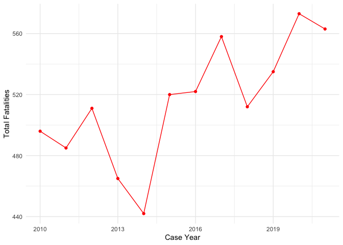
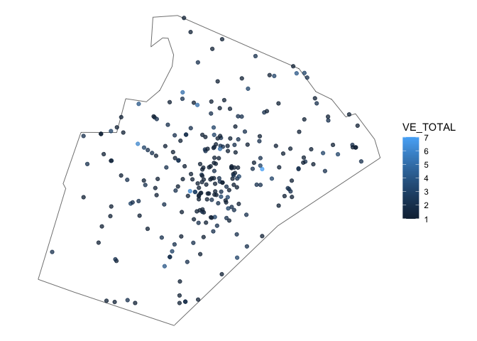

<!-- README.md is generated from README.Rmd. Please edit that file -->

# crashapi

<!-- badges: start -->

[](https://CRAN.R-project.org/package=crashapi)
[](https://lifecycle.r-lib.org/articles/stages.html#experimental)
[](https://opensource.org/licenses/MIT)
[](https://app.codecov.io/gh/elipousson/crashapi?branch=main)
[](https://www.repostatus.org/#active)
<!-- badges: end -->

The goal of the crashapi R package is to provide functions for
downloading data from the National Highway Traffic Safety Administration
(NHTSA) [Fatality Analysis Reporting System (FARS)
API](https://crashviewer.nhtsa.dot.gov/crashviewer/CrashAPI/).

What is FARS? NHTSA explains: “The Fatality Analysis Reporting System
(FARS) contains data on all vehicle crashes in the United States that
occur on a public roadway and involve a fatality.”

## Installation

You can install the development version of crashapi using the pak
package:

``` r
pak::pkg_install("elipousson/crashapi")
```

## Background

### Fatality Analysis Reporting System (FARS) API support

Supported APIs for this package include:

- [x] Get Crash List Information
- [x] Get Crash Details
- [x] Get Crashes By Location
- [x] Get Crashes By Vehicle
- [x] Get Summary Counts
- [x] Get Variables and Get Variable Attributes
- [x] Get FARS Data By Year
- [x] Get Crashes By Occupant (partial support)

Most of these APIs support XML, JSV, CSV, and JSON output formats. This
package only uses JSON with the exception of `get_fars_year()` (which
supports downloading CSV files).

For reference, this package also includes a list of terms and NHTSA
technical definitions in `fars_terms` and a list of variable labels in
`fars_vars_labels`.

The FARS API currently provides access to data from 2010 to 2024. The
[NHTSA website](https://www-fars.nhtsa.dot.gov/Help/helplinks.aspx) also
provides additional information on the release data and version status
for the FARS data files available through the API:

| Data Year | File Version | Release Date      |
|-----------|--------------|-------------------|
| 2010      | Final        | December 11, 2012 |
| 2011      | Final        | November 13, 2013 |
| 2012      | Final        | December 12, 2013 |
| 2013      | Final        | December 14, 2014 |
| 2014      | Final        | December 18, 2015 |
| 2015      | Final        | December 16, 2016 |
| 2016      | Final        | December 14, 2017 |
| 2017      | Final        | December 18, 2018 |
| 2018      | Final        | June 24, 2021     |
| 2019      | Final        | March 2, 2022     |
| 2020      | Final        | April 3, 2023     |
| 2021      | Final        | April 1, 2024     |
| 2022      | Final        | April 8, 2025     |
| 2023      | Final        | April 1, 2026     |
| 2024      | Annual       | April 1, 2026     |

### Changes to the sex variable

According to the [Data Index terminations
tracker](https://dataindex.us/terminations-tracker), in February 2025
NHTSA renamed the person-level gender variable to “Sex” and recoded its
third response value to “Not Reported”, removing the non-binary category
from published FARS data files. The [FARS 2022 release
notes](https://static.nhtsa.gov/nhtsa/downloads/FARS/2022/FARS2022%20Release%20Notes.txt)
confirm that on February 11, 2025, NHTSA replaced attribute 3 with
attribute 8 (Not Reported), updating 22 records in the PERSON table and
1 record in the PBTYPE table. See [OMB ICR
202503-2127-008](https://www.reginfo.gov/public/do/PRAViewICR?ref_nbr=202503-2127-008)
and the Williams Institute report [Removal of SOGI from Federal Data
Collections (Feb
2026)](https://williamsinstitute.law.ucla.edu/wp-content/uploads/Federal-SOGI-Data-Collection-Feb-2026.pdf)
for more information.

Data now returned by the CrashAPI codes `SEX` as 1 (Male), 2 (Female), 8
(Not Reported), or 9 (Reported as Unknown) for all years, so people
previously recorded as non-binary now appear as “Not Reported”.

### Additional data access functionality

The `get_fars_zip()` function can be used to access FARS data files from
1975 to 2024 that are not available via the API but are available for
download on through [the NHTSA File Downloads
site](https://www.nhtsa.gov/file-downloads?p=nhtsa/downloads/FARS/) as
zipped CSV or SAS files (not available through the NHTSA FARS API). This
site also provides extensive technical documentation on coding and use
of the FARS data files.

Earlier data along with data from the the [General Estimates
System](https://www.nhtsa.gov/national-automotive-sampling-system-nass/nass-general-estimates-system)
(GES) / [Crash Report Sampling
System](https://www.nhtsa.gov/crash-data-systems/crash-report-sampling-system-crss)
(CRSS) is also available through the [Fatality and Injury Reporting
System Tool](https://cdan.dot.gov/query) (FIRST).

## Examples

``` r
library(crashapi)
library(ggplot2)
```

Most features for the package can be accessed using the `get_fars()`
function that selects the appropriate API-specific function based on the
provided parameters. You can also set the API to use with the `api`
parameter or use an API-specific function (e.g. `get_fars_summary()`).

For example, you can use the `get_fars()` access state-level summary
data on crash and fatality counts.

``` r
# Get summary crash count and fatality count data for Maryland from 2010 to 2019
md_summary <-
  get_fars(
    year = c(2010, 2021),
    state = "MD",
    api = "summary count"
  )

ggplot(md_summary, aes(x = CaseYear, y = TotalFatalCounts)) +
  geom_point(color = "red") +
  geom_line(color = "red", group = 1) +
  theme_minimal()
```



You can download crash data and set geometry to TRUE optionally convert
the data frame into an `sf` object for mapping.

``` r
crashes_sf <-
  get_fars(
    year = c(2018, 2021),
    state = "NC",
    county = "Wake County",
    geometry = TRUE
  )

nc <- sf::st_read(system.file("shape/nc.shp", package = "sf"))
#> Reading layer `nc' from data source 
#>   `/Users/elipousson/Library/R/arm64/4.6/library/sf/shape/nc.shp' 
#>   using driver `ESRI Shapefile'
#> Simple feature collection with 100 features and 14 fields
#> Geometry type: MULTIPOLYGON
#> Dimension:     XY
#> Bounding box:  xmin: -84.32385 ymin: 33.88199 xmax: -75.45698 ymax: 36.58965
#> Geodetic CRS:  NAD27
wake_co <- sf::st_transform(nc[nc$NAME == "Wake", ], 4326)

# Map crashes
ggplot() +
  geom_sf(
    data = wake_co,
    fill = NA,
    color = "black"
  ) +
  geom_sf(
    data = sf::st_crop(crashes_sf, wake_co),
    aes(color = TOTALVEHICLES),
    alpha = 0.75
  ) +
  theme_void()
#> Warning in st_is_longlat(x): bounding box has potentially an invalid value
#> range for longlat data
#> Warning in st_is_longlat(x): bounding box has potentially an invalid value
#> range for longlat data
#> Warning: attribute variables are assumed to be spatially constant throughout
#> all geometries
```



You can list crashes and filter by the number of vehicles involved.

``` r
# Get fatal crashes in New York state from 2019 with 5 to 10 vehicles
get_fars(
  year = 2019,
  state = "NY",
  vehicles = c(5, 10)
)
#>      CountyName                  CrashDate Fatals Peds Persons St_Case State
#> 1     BRONX (5) /Date(1549865820000-0500)/      2    1       7  360042    36
#> 2     ERIE (29) /Date(1551915000000-0500)/      1    0       4  360159    36
#> 3   QUEENS (81) /Date(1561656240000-0400)/      1    0       6  360319    36
#> 4     BRONX (5) /Date(1561866000000-0400)/      1    0      11  360339    36
#> 5    KINGS (47) /Date(1564564080000-0400)/      1    0       5  360440    36
#> 6 SUFFOLK (103) /Date(1563792360000-0400)/      1    0       2  360551    36
#> 7   ORANGE (71) /Date(1558274040000-0400)/      1    0       1  360277    36
#>   StateName TotalVehicles
#> 1  New York             5
#> 2  New York             5
#> 3  New York             5
#> 4  New York             5
#> 5  New York             5
#> 6  New York             6
#> 7  New York             6
```

If you call `get_fars()` or `get_fars_crashes()` with details set to
TRUE, additional information from `get_fars_cases()` (including the
crash date and time) is appended to the crash data frame.

``` r
# Get fatal crashes for Anne Arundel County, MD for 2019 and append details
crashes_detailed <-
  get_fars(
    year = 2019,
    state = "MD",
    county = "Anne Arundel County",
    details = TRUE
  )
#> ■■■■■■                            18% | ETA: 14s
#> ■■■■■■■■■■■■■■■■■■                57% | ETA:  7s
#> ■■■■■■■■■■■■■■■■■■■■■■■■          78% | ETA:  4s
#> ■■■■■■■■■■■■■■■■■■■■■■■■■■■■■     95% | ETA:  1s

# Show 10 fatal crashes at random
dplyr::slice_sample(crashes_detailed, n = 10)
#>    CaseYear TOTALVEHICLES STATE STATENAME ST_CASE       date  time
#> 1      2019             2    24  Maryland  240116 2019-04-22 08:00
#> 2      2019             2    24  Maryland  240333 2019-08-26 11:57
#> 3      2019             2    24  Maryland  240027 2019-02-04 13:19
#> 4      2019             2    24  Maryland  240046 2019-02-16 11:43
#> 5      2019             1    24  Maryland  240463 2019-01-05 23:42
#> 6      2019             2    24  Maryland  240123 2019-05-10 07:53
#> 7      2019             1    24  Maryland  240121 2019-05-04 13:59
#> 8      2019             1    24  Maryland  240007 2019-01-09 05:38
#> 9      2019             1    24  Maryland  240242 2019-06-29 23:14
#> 10     2019             3    24  Maryland  240291 2019-09-12 08:00
#>               datetime PEDS PERNOTMVIT VE_TOTAL VE_FORMS PVH_INVL
#> 1  2019-04-22 08:00:00    0          0        2        2        0
#> 2  2019-08-26 11:57:00    0          0        2        2        0
#> 3  2019-02-04 13:19:00    0          0        2        2        0
#> 4  2019-02-16 11:43:00    0          0        2        2        0
#> 5  2019-01-05 23:42:00    0          0        1        1        0
#> 6  2019-05-10 07:53:00    0          0        2        2        0
#> 7  2019-05-04 13:59:00    0          0        1        1        0
#> 8  2019-01-09 05:38:00    0          0        1        1        0
#> 9  2019-06-29 23:14:00    1          1        1        1        0
#> 10 2019-09-12 08:00:00    0          0        3        3        0
#>                                                                                                                                                                                                                                                                                                                                                                                                                                                                                                                                                                                                                                                                                                                                                                                                                                                                                                                                                                                                                                                                                                                                                                                                                                                    NPersons
#> 1                                                                                                                                                                                                                                                                                                                                                                                                                                                                                                                                                                                                                                                                                                                                                                                                                                                                                                                                                                                                                                                                                                                                                                                                                                                      NULL
#> 2                                                                                                                                                                                                                                                                                                                                                                                                                                                                                                                                                                                                                                                                                                                                                                                                                                                                                                                                                                                                                                                                                                                                                                                                                                                      NULL
#> 3                                                                                                                                                                                                                                                                                                                                                                                                                                                                                                                                                                                                                                                                                                                                                                                                                                                                                                                                                                                                                                                                                                                                                                                                                                                      NULL
#> 4                                                                                                                                                                                                                                                                                                                                                                                                                                                                                                                                                                                                                                                                                                                                                                                                                                                                                                                                                                                                                                                                                                                                                                                                                                                      NULL
#> 5                                                                                                                                                                                                                                                                                                                                                                                                                                                                                                                                                                                                                                                                                                                                                                                                                                                                                                                                                                                                                                                                                                                                                                                                                                                      NULL
#> 6                                                                                                                                                                                                                                                                                                                                                                                                                                                                                                                                                                                                                                                                                                                                                                                                                                                                                                                                                                                                                                                                                                                                                                                                                                                      NULL
#> 7                                                                                                                                                                                                                                                                                                                                                                                                                                                                                                                                                                                                                                                                                                                                                                                                                                                                                                                                                                                                                                                                                                                                                                                                                                                      NULL
#> 8                                                                                                                                                                                                                                                                                                                                                                                                                                                                                                                                                                                                                                                                                                                                                                                                                                                                                                                                                                                                                                                                                                                                                                                                                                                      NULL
#> 9  32, 32 Years, 97, Not a Motor Vehicle Occupant, 9, Not Reported, 0, 0.000 % BAC, 2, Test Given, 1, Blood, NA, NA, NA, 3, ANNE ARUNDEL (3), 2019, 29, 29, 29, 29, 23, 23:00-23:59, 32, 32, 6, June, 2332, 2332, 2019, 2019, NA, NA, NA, NA, 7, Died at Scene, 8, Not Reported, NA, NA, NA, NA, NA, NA, 0, No (drugs not involved), NA, NA, NA, NA, NA, NA, 1, Evidential Test (Blood, Urine), 2, Test Given, 8, Not Applicable, 0, Ejection Path Not Applicable, NA, NA, 0, Not Extricated or Not Applicable, NA, NA, 1, Interstate, NA, NA, NA, NA, 8, Pedestrian, 8, Not a Motor Vehicle Occupant, 96, Not a Motor Vehicle Occupant, 7, Non-Hispanic, 0, Not Transported, 23, 11:00pm-11:59pm, NA, NA, NA, NA, NA, NA, 4, Fatal Injury (K), 0, 0, 18, 18, 11, Not at Intersection - On Roadway, Not in Marked Crosswalk, NA, NA, NA, NA, 0, The First Harmful Event was Not a Collision with a Motor Vehicle in Transport, 14, 14, NA, NA, 6, June, NA, NA, 1, 5, Pedestrian, 0, None, 0, None, 0, None, NA, NA, NA, 8, Not a Motor Vehicle Occupant, 96, Not a Motor Vehicle Occupant, NA, NA, NA, NA, 2, Urban, NA, 0, No, 0, Not a Motor Vehicle Occupant, 1, Male, NA, NA, 24, Maryland, 1, NA, 240242, NA, NA, 0, 1, NA, NA, NA, NA, NA, NA, 0, No
#> 10                                                                                                                                                                                                                                                                                                                                                                                                                                                                                                                                                                                                                                                                                                                                                                                                                                                                                                                                                                                                                                                                                                                                                                                                                                                     NULL
#>    PERSONS PERMVIT COUNTY       COUNTYNAME CITY       CITYNAME MONTH MonthName
#> 1        2       2      3 ANNE ARUNDEL (3)    0 NOT APPLICABLE     4     April
#> 2        2       2      3 ANNE ARUNDEL (3)    0 NOT APPLICABLE     8    August
#> 3        2       2      3 ANNE ARUNDEL (3)    0 NOT APPLICABLE     2  February
#> 4        3       3      3 ANNE ARUNDEL (3)    0 NOT APPLICABLE     2  February
#> 5        1       1      3 ANNE ARUNDEL (3)    0 NOT APPLICABLE     1   January
#> 6        3       3      3 ANNE ARUNDEL (3)    0 NOT APPLICABLE     5       May
#> 7        1       1      3 ANNE ARUNDEL (3)    0 NOT APPLICABLE     5       May
#> 8        1       1      3 ANNE ARUNDEL (3)    0 NOT APPLICABLE     1   January
#> 9        1       1      3 ANNE ARUNDEL (3)    0 NOT APPLICABLE     6      June
#> 10       3       3      3 ANNE ARUNDEL (3)    0 NOT APPLICABLE     9 September
#>    DAY DAY_WEEK DAY_WEEKNAME YEAR HOUR        HOURNAME MINUTE MINUTENAME
#> 1   22        2       Monday 2019    8   8:00am-8:59am      0          0
#> 2   26        2       Monday 2019   11 11:00am-11:59am     57         57
#> 3    4        2       Monday 2019   13   1:00pm-1:59pm     19         19
#> 4   16        7     Saturday 2019   11 11:00am-11:59am     43         43
#> 5    5        7     Saturday 2019   23 11:00pm-11:59pm     42         42
#> 6   10        6       Friday 2019    7   7:00am-7:59am     53         53
#> 7    4        7     Saturday 2019   13   1:00pm-1:59pm     59         59
#> 8    9        4    Wednesday 2019    5   5:00am-5:59am     38         38
#> 9   29        7     Saturday 2019   23 11:00pm-11:59pm     14         14
#> 10  12        5     Thursday 2019    8   8:00am-8:59am      0          0
#>    TWAY_ID TWAY_ID2 ROUTE     ROUTENAME RUR_URB RUR_URBNAME FUNC_SYS
#> 1   SR-450     <NA>     3 State Highway       2       Urban        3
#> 2   SR-710  CR-3700     3 State Highway       2       Urban        4
#> 3     SR-3   SR-175     3 State Highway       2       Urban        3
#> 4   SR-100     <NA>     3 State Highway       2       Urban        7
#> 5   SR-295     <NA>     3 State Highway       2       Urban        3
#> 6   SR-468     <NA>     3 State Highway       2       Urban        5
#> 7  CR-1371     <NA>     4   County Road       2       Urban        5
#> 8     I-97     <NA>     1    Interstate       2       Urban        1
#> 9   I-895B     <NA>     1    Interstate       2       Urban        1
#> 10 CR-5461     <NA>     4   County Road       2       Urban        4
#>                  FUNC_SYSNAME RD_OWNER          RD_OWNERNAME NHS
#> 1  Principal Arterial - Other        1  State Highway Agency   0
#> 2              Minor Arterial        1  State Highway Agency   0
#> 3  Principal Arterial - Other        1  State Highway Agency   0
#> 4                       Local        1  State Highway Agency   0
#> 5  Principal Arterial - Other        1  State Highway Agency   1
#> 6             Major Collector        1  State Highway Agency   0
#> 7             Major Collector        2 County Highway Agency   0
#> 8                  Interstate        1  State Highway Agency   1
#> 9                  Interstate        1  State Highway Agency   1
#> 10             Minor Arterial        2 County Highway Agency   0
#>                           NHSNAME SP_JUR              SP_JURNAME MILEPT
#> 1  This section IS NOT on the NHS      0 No Special Jurisdiction    102
#> 2  This section IS NOT on the NHS      0 No Special Jurisdiction      9
#> 3  This section IS NOT on the NHS      0 No Special Jurisdiction     57
#> 4  This section IS NOT on the NHS      0 No Special Jurisdiction     70
#> 5      This section IS ON the NHS      1   National Park Service      0
#> 6  This section IS NOT on the NHS      0 No Special Jurisdiction     36
#> 7  This section IS NOT on the NHS      0 No Special Jurisdiction     13
#> 8      This section IS ON the NHS      0 No Special Jurisdiction     26
#> 9      This section IS ON the NHS      0 No Special Jurisdiction      0
#> 10 This section IS NOT on the NHS      0 No Special Jurisdiction      4
#>    MILEPTNAME LATITUDE LATITUDENAME  LONGITUD  LONGITUDNAME HARM_EV
#> 1         102 38.98216  38.98215833 -76.53157 -76.531572220      12
#> 2           9 39.19551  39.19551111 -76.59787 -76.597869440      12
#> 3          57 39.05743  39.05742778 -76.65684 -76.656836110      12
#> 4          70 39.15161  39.15160833 -76.63751 -76.637511110      24
#> 5        None 39.11145  39.11144722 -76.78118 -76.781183330      42
#> 6          36 38.81520  38.81519722 -76.55408 -76.554083330      12
#> 7          13 39.13579  39.13578611 -76.61039 -76.610394440       1
#> 8          26 39.00808  39.00807778 -76.60894 -76.608936110       1
#> 9        None 39.22533  39.22533056 -76.62447 -76.624466670       8
#> 10          4 39.07551  39.07551111 -76.62905 -76.629047220      12
#>                   HARM_EVNAME MAN_COLL
#> 1  Motor Vehicle In-Transport        6
#> 2  Motor Vehicle In-Transport        2
#> 3  Motor Vehicle In-Transport        6
#> 4              Guardrail Face        0
#> 5        Tree (Standing Only)        0
#> 6  Motor Vehicle In-Transport        2
#> 7           Rollover/Overturn        0
#> 8           Rollover/Overturn        0
#> 9                  Pedestrian        0
#> 10 Motor Vehicle In-Transport        7
#>                                                                     MAN_COLLNAME
#> 1                                                                          Angle
#> 2                                                                 Front-to-Front
#> 3                                                                          Angle
#> 4  The First Harmful Event was Not a Collision with a Motor Vehicle in Transport
#> 5  The First Harmful Event was Not a Collision with a Motor Vehicle in Transport
#> 6                                                                 Front-to-Front
#> 7  The First Harmful Event was Not a Collision with a Motor Vehicle in Transport
#> 8  The First Harmful Event was Not a Collision with a Motor Vehicle in Transport
#> 9  The First Harmful Event was Not a Collision with a Motor Vehicle in Transport
#> 10                                                    Sideswipe - Same Direction
#>    RELJCT1 RELJCT1NAME RELJCT2                RELJCT2NAME TYP_INT
#> 1        0          No       8    Driveway Access Related       1
#> 2        0          No       2               Intersection       2
#> 3        0          No       2               Intersection       2
#> 4        0          No       1               Non-Junction       1
#> 5        0          No       5 Entrance/Exit Ramp Related       1
#> 6        0          No       1               Non-Junction       1
#> 7        0          No       1               Non-Junction       1
#> 8        0          No       1               Non-Junction       1
#> 9        0          No       1               Non-Junction       1
#> 10       0          No       1               Non-Junction       1
#>              TYP_INTNAME REL_ROAD REL_ROADNAME WRK_ZONE WRK_ZONENAME LGT_COND
#> 1    Not an Intersection        1   On Roadway        0         None        1
#> 2  Four-Way Intersection        1   On Roadway        0         None        1
#> 3  Four-Way Intersection        1   On Roadway        0         None        1
#> 4    Not an Intersection        4  On Roadside        0         None        1
#> 5    Not an Intersection        3    On Median        0         None        3
#> 6    Not an Intersection        1   On Roadway        0         None        1
#> 7    Not an Intersection        1   On Roadway        0         None        1
#> 8    Not an Intersection        3    On Median        0         None        2
#> 9    Not an Intersection        1   On Roadway        0         None        2
#> 10   Not an Intersection        1   On Roadway        0         None        1
#>          LGT_CONDNAME WEATHER WEATHERNAME WEATHER1 WEATHER1NAME WEATHER2
#> 1            Daylight      10      Cloudy       10       Cloudy        0
#> 2            Daylight       1       Clear        1        Clear        0
#> 3            Daylight       1       Clear        1        Clear        0
#> 4            Daylight       1       Clear        1        Clear        0
#> 5      Dark - Lighted       1       Clear        1        Clear        0
#> 6            Daylight       1       Clear        1        Clear        0
#> 7            Daylight       1       Clear        1        Clear        0
#> 8  Dark - Not Lighted       1       Clear        1        Clear        0
#> 9  Dark - Not Lighted       2        Rain        2         Rain        0
#> 10           Daylight       1       Clear        1        Clear        0
#>                            WEATHER2NAME SCH_BUS SCH_BUSNAME    RAIL
#> 1  No Additional Atmospheric Conditions       0          No 0000000
#> 2  No Additional Atmospheric Conditions       0          No 0000000
#> 3  No Additional Atmospheric Conditions       0          No 0000000
#> 4  No Additional Atmospheric Conditions       0          No 0000000
#> 5  No Additional Atmospheric Conditions       0          No 0000000
#> 6  No Additional Atmospheric Conditions       0          No 0000000
#> 7  No Additional Atmospheric Conditions       0          No 0000000
#> 8  No Additional Atmospheric Conditions       0          No 0000000
#> 9  No Additional Atmospheric Conditions       0          No 0000000
#> 10 No Additional Atmospheric Conditions       0          No 0000000
#>          RAILNAME NOT_HOUR NOT_HOURNAME NOT_MIN NOT_MINNAME ARR_HOUR
#> 1  Not Applicable       99      Unknown      99     Unknown       99
#> 2  Not Applicable       99      Unknown      99     Unknown       99
#> 3  Not Applicable       99      Unknown      99     Unknown       99
#> 4  Not Applicable       99      Unknown      99     Unknown       99
#> 5  Not Applicable       99      Unknown      99     Unknown       99
#> 6  Not Applicable       99      Unknown      99     Unknown       99
#> 7  Not Applicable       99      Unknown      99     Unknown       99
#> 8  Not Applicable       99      Unknown      99     Unknown       99
#> 9  Not Applicable       99      Unknown      99     Unknown       99
#> 10 Not Applicable       99      Unknown      99     Unknown       99
#>                      ARR_HOURNAME ARR_MIN                       ARR_MINNAME
#> 1  Unknown EMS Scene Arrival Hour      99 Unknown EMS Scene Arrival Minutes
#> 2  Unknown EMS Scene Arrival Hour      99 Unknown EMS Scene Arrival Minutes
#> 3  Unknown EMS Scene Arrival Hour      99 Unknown EMS Scene Arrival Minutes
#> 4  Unknown EMS Scene Arrival Hour      99 Unknown EMS Scene Arrival Minutes
#> 5  Unknown EMS Scene Arrival Hour      99 Unknown EMS Scene Arrival Minutes
#> 6  Unknown EMS Scene Arrival Hour      99 Unknown EMS Scene Arrival Minutes
#> 7  Unknown EMS Scene Arrival Hour      99 Unknown EMS Scene Arrival Minutes
#> 8  Unknown EMS Scene Arrival Hour      99 Unknown EMS Scene Arrival Minutes
#> 9  Unknown EMS Scene Arrival Hour      98                Unknown if Arrived
#> 10 Unknown EMS Scene Arrival Hour      99 Unknown EMS Scene Arrival Minutes
#>    HOSP_HR                      HOSP_HRNAME HOSP_MN
#> 1       99                          Unknown      99
#> 2       99                          Unknown      99
#> 3       99                          Unknown      99
#> 4       99                          Unknown      99
#> 5       88 Not Applicable (Not Transported)      88
#> 6       99                          Unknown      99
#> 7       99                          Unknown      99
#> 8       88 Not Applicable (Not Transported)      88
#> 9       88 Not Applicable (Not Transported)      88
#> 10      99                          Unknown      99
#>                          HOSP_MNNAME CF1 CF1NAME CF2 CF2NAME CF3 CF3NAME FATALS
#> 1  Unknown EMS Hospital Arrival Time   0    None   0    None   0    None      1
#> 2  Unknown EMS Hospital Arrival Time   0    None   0    None   0    None      1
#> 3  Unknown EMS Hospital Arrival Time   0    None   0    None   0    None      1
#> 4  Unknown EMS Hospital Arrival Time   0    None   0    None   0    None      1
#> 5   Not Applicable (Not Transported)   0    None   0    None   0    None      1
#> 6  Unknown EMS Hospital Arrival Time   0    None   0    None   0    None      1
#> 7  Unknown EMS Hospital Arrival Time   0    None   0    None   0    None      1
#> 8   Not Applicable (Not Transported)   0    None   0    None   0    None      1
#> 9   Not Applicable (Not Transported)   0    None   0    None   0    None      1
#> 10 Unknown EMS Hospital Arrival Time   0    None   0    None   0    None      1
#>    DRUNK_DR ROAD_FNC ROAD_FNCNAME
#> 1         0       NA           NA
#> 2         0       NA           NA
#> 3         0       NA           NA
#> 4         0       NA           NA
#> 5         1       NA           NA
#> 6         0       NA           NA
#> 7         0       NA           NA
#> 8         0       NA           NA
#> 9         0       NA           NA
#> 10        0       NA           NA
#>                                                                                                                                                                                                                                                                                                                                                                                                                                                                                                                                                                                                                                                                                                                                                                                                                                                                                                                                                                                                                                                                                                                                                                                                                                                                                                                                                                                                                                                                                                                                                                                                                                                                                                                                                                                                                                                                                                                                                                                                                                                                                                                                                                                                                                                                                                                                                                                                                                                                                                                                                                                                                                                                                                                                                                                                                                                                                                                                                                                                                                                                                                                                                                                                                                                                                                                                                                                                                                                                                                                                                                                                                                                                                                                                                                                                                                                                                                                                                                                                                                                                                                                                                                                                                                                                                                                                                                                                                                                                                                                                                                                                                                                                                                                                                                                                                                                                                                                                                                                                                                                                                                                                                                                                                                                                                                                                                                                                                                                                                                                                                                                                                                                                                                                                                                                                                                                                                                                                                                                                                                                                                                                                                                                                                                                                                                                                                                                                                                                                                                                                                                                                                                                                                                                                                                                                                                                                                                                                                                                                                                                                                                                                                                                                                                                                                                                                                                                                                                                                                                                                                                                                                                                                                                                                                                                                                                                                                                                                                                                                                                                                                                                                                                                                                                                                                                                                                                                                                                                                                                                                                                                                                                                                                                                                                                                                                                                                                                                                                                                                                                                                                                                                                                                                                                                                                                                                                                                                                                                                                                                                                                                                                                                                                                                                                                                                                                                                                                                                                                                                                                                                                                                                                                                                                                                                                                                                                                                                                                                                                                                                                                                                                                                                                                                                                                                                                                                                                                                                                                                                                                                                                                                                                                                                                                                                                                                                                                                                                                                                                                                                                                                                                                                                                                                                                                                                                                                                                                                                                                                                                                                                                                                                                                                                                                                                                                                                                                                                                                                                                                                                                                                                                                                                                                                                                                                                                                                                                                                                                                                                                                                                                                                                                                                                                                                                                                                                                                                                                                                                                                                                                                                                                                                                                                                                                                                                                                                                                                                                                                                                                                                                                                                                                                                                                                                                                                                                                                                                                                                                                                                                                                                                                                                                                                                                                                                                                                                                                                                                                                                                                                                                                                                                                                                                                                                                                                                                                                                                                                                                                                                                                                                                                                                                                                                                                                                                                                                                                                                                                                                                                                                                                                                                                                                                                                                                                                                                                                                                                                                                                                                                                                                                                                                                                                                                                                                                                                                                                                                                                                                                                                                                                                                                                                                                                                                                                                                                                                                                                                                                                                                                                                                                                                                                                                                                                                                                                                                                                                                                                                                                                                                                                                                                                                                                                                                                                                                                                                                                                                                                                                                                                                                                                                                                                                                                                                                                                                                                                                                                                                                                                                                                                                                                                                                                                                                                                                                                                                                                                                                                                                                                                                                                                                                                                                                                                                                                                              Vehicles
#> 1                                                                                                                                                                                                                                                                                                                                                                                                                                                                                                                                                                                                                                                                                                                                                                                                                                                                                                                                                                                                                                                                                                                                                                                                                                                                                                                                                                                                                                                                                                                                                                                                                                                                                                                                                                                                                                                                                                                                                                                                                                                                                                                                                                                                                                                                                                                                                                                                                                                                                                                                                                                                                                                                                                                                                                                                                                                                                                                                                                                                                                                                                                                                                                                                                                                                                                                                                                                                                                                                                                                                                                                                                                                                                                                                                                                                                                                                                                                                                                                                                                                                                                                                                                                                                                                                                                                                                                                                                                                                                                                                                                                                                                                                                                                                                                                                                                                                                                                                                                                                                                                                                                                                                                                                                                                                                                                                                                                                                                                                                                                                                                                                                                                                                                                                                                                                                                                                                                                                                                                                                                                                                                                                                                                                                                                                                                                                                                                                                                                                                                                                                                                                                                                                                                                                                                                                                                                                                                                                                                                                       NA, NA, NA, NA, 83, 82, K83-Trafficway Vehicle Turning-Turn Into Path-Turn Into Opposite Directions (Going Straight), K82-Trafficway Vehicle Turning-Turn Into Path-Turn Into Opposite Directions (Turning Left), NA, NA, NA, NA, NA, NA, NA, NA, NA, NA, NA, NA, 34, 2, Light Pickup, 2-door sedan,hardtop,coupe, 0, 0, Not a Bus, Not a Bus, 0, 0, Not Applicable (N/A), Not Applicable (N/A), 0, 0, No (CDL), No (CDL), 2019, 2019, NA, NA, 22, 22, 22, 22, 0, 1, 6, 6, Disabling Damage, Disabling Damage, 0, 0, No, No, 67, 69, 1, 1, Yes, Yes, 0, 38, None, Failure to Yield Right-of-Way, 0, 0, None, None, 0, 0, None, None, 0, 0, None, None, 150, 150, 150 lbs., 150 lbs., 21061, 21231, 21061, 21231, 2019, 2019, 2019, 1, 11, 12, 1 Clock Value, 11 Clock Value, 12 Clock Value, 1, 11, 12, 1 Clock Value, 11 Clock Value, 12 Clock Value, 24, 24, 24, Maryland, Maryland, Maryland, 240116, 240116, 240116, 1, 1, 1, 2019, 2019, 2019, 8, 9, 10, 8 Clock Value, 9 Clock Value, 10 Clock Value, 8, 9, 10, 8 Clock Value, 9 Clock Value, 10 Clock Value, 24, 24, 24, Maryland, Maryland, Maryland, 240116, 240116, 240116, 2, 2, 2, 2019, 0, Not Distracted, 0, Not Distracted, 24, Maryland, 240116, 1, 2019, 0, Not Distracted, 0, Not Distracted, 24, Maryland, 240116, 2, 2019, 0, None/Apparently Normal, 24, Maryland, 240116, 1, 2019, 98, Not Reported, 24, Maryland, 240116, 2, 0, 0, Not Applicable, Not Applicable, 0, 0, No or Not Reported, No or Not Reported, 12, 0, December, No Record, 2018, 0, 2018, No Record, 2019, 0, None, 24, Maryland, 240116, 0, None, 1, 2019, 0, None, 24, Maryland, 240116, 0, None, 2, 0, 0, Not Applicable, Not Applicable, NA, NA, NA, NA, NA, NA, NA, NA, 12, 12, Motor Vehicle In-Transport, Motor Vehicle In-Transport, 0, 0, Not Applicable, Not Applicable, 0, 0, Not Applicable, Not Applicable, 1, 1, No, No, 0, 0, Not Applicable, Not Applicable, 0, 0, Not Applicable, Not Applicable, 0, 0, No, No, 8, 8, 8:00am-8:59am, 8:00am-8:59am, NA, NA, NA, NA, 12, 9, 12 Clock Point, 9 Clock Point, NA, NA, NA, NA, 0, 0, Not an Articulated Vehicle, Not an Articulated Vehicle, 12, 0, December, No Record, 2018, 0, 2018, No Record, 3, 3, Valid license for this class vehicle, Valid license for this class vehicle, 0, 0, No Endorsements required for this vehicle, No Endorsements required for this vehicle, 0, 0, No Restrictions or Not Applicable, No Restrictions or Not Applicable, 24, 24, Maryland, Maryland, 6, 6, Valid, Valid, 1, 1, Full Driver License, Full Driver License, 12, 20, Ford, Chevrolet, 12481, 20016, Ford F-Series pickup, Chevrolet Cavalier, 6, 6, Angle, Angle, 0, 0, Not Applicable, Not Applicable, 0, 0, Not Applicable, Not Applicable, 0, 0, Not Applicable, Not Applicable, 0, 0, 0, 0, 481, 16, F-Series pickup, Cavalier, 2018, 2004, 2018, 2004, 4, 4, 12, 12, Motor Vehicle In-Transport, Motor Vehicle In-Transport, 2019, 98, Not Reported, 98, Not Reported, 24, Maryland, 240116, 1, 2019, 98, Not Reported, 98, Not Reported, 24, Maryland, 240116, 2, April, April, NA, NA, NA, NA, NA, NA, NA, NA, NA, NA, NA, NA, 1, 1, 1, 1, 1, 1, Driver (in this crash) was  Registered Owner, Driver (in this crash) was  Registered Owner, Tracking, Tracking, 1, 1, Stayed in original travel lane, Stayed in original travel lane, 0, 0, None, None, 0, 0, None, None, 0, 0, None, None, 1, 0, 1, None, NA, NA, 0, 0, None, None, 0, 0, None, None, 0, 0, None, None, NA, NA, 1, 11, Going Straight, Turning Left, 72, 15, From driveway, turning into opposite direction, Turning Left, 99, 99, Unknown/Not Reported, Unknown/Not Reported, NA, NA, 23, 23 Years, 2, Deployed- Side (door, seatback), 9, Not Reported, 996, Test Not Given, 0, Test Not Given, 0, Test Not Given, 34, Light Pickup, NA, 3, ANNE ARUNDEL (3), 2019, 22, 22, 88, Not Applicable (Non-Fatal), 88, Not Applicable (Non-fatal), 88, Not Applicable (Non-fatal), 88, Not Applicable (Non-Fatal), 8888, Not Applicable (Non-fatal), 8888, Not Applicable (Non-fatal), NA, NA, NA, NA, 0, Not Applicable, 0, No (Alcohol Not Involved), NA, NA, NA, NA, NA, NA, 0, No (drugs not involved), NA, NA, NA, NA, NA, NA, 8, Not Reported, 0, Test Not Given, 0, Not Ejected, 0, Ejection Path Not Applicable, 0, Not Applicable, 0, Not Extricated or Not Applicable, 0, No or Not Reported, 3, Principal Arterial - Other, NA, NA, NA, NA, 12, Motor Vehicle In-Transport, 7, None Used/Not Applicable, 20, Not Applicable, 0, Not A Fatality (not Applicable), 5, EMS Ground, 8, 8:00am-8:59am, NA, NA, 12, 12 Clock Point, NA, NA, 2, Suspected Minor Injury (B), 999, Unknown, 99, Unknown, 0, Occupant of a Motor Vehicle, 12, Ford, NA, Ford F-Series pickup, 6, Angle, 0, 0, 2018, 2018, 4, April, NA, 2019, -1.000, NA, -1, NA, -1, NA, 0, Test Not Given, 0, Test Not Given, -1, NA, 1, 24, MD, Maryland, 240116, 1, 1, 1, Driver of a Motor Vehicle In-Transport, 0, None, 0, None, 0, None, NA, NA, 0, No Indication of Mis-Use, 3, Shoulder and Lap Belt Used, NA, NA, 0, No Rollover, 2, Urban, 2019, 0, No, 1, 1, 0, Not a Fatality (not Applicable), 24, MD, Maryland, 240116, 1, 0, No, 11, Front Seat, Left Side, 1, Male, 0, No Special Use, 24, Maryland, 0, NA, 240116, 0, No Trailing Units, 1, 2, NA, NA, NA, NA, NA, NA, 8, Not Applicable (not a fatality), 59, 59 Years, 20, Not Deployed, 9, Not Reported, 0, 0.000 % BAC, 2, Test Given, 1, Blood, 2, 2-door sedan,hardtop,coupe, NA, 3, ANNE ARUNDEL (3), 2019, 22, 22, 22, 22, 8, 8:00-8:59, 56, 56, 4, April, 856, 856, 2019, 2019, NA, NA, NA, NA, 0, Not Applicable, 0, No (Alcohol Not Involved), NA, NA, NA, NA, NA, NA, 0, No (drugs not involved), NA, NA, NA, NA, NA, NA, 8, Not Reported, 2, Test Given, 0, Not Ejected, 0, Ejection Path Not Applicable, 0, Not Applicable, 9, Unknown, 0, No or Not Reported, 3, Principal Arterial - Other, NA, NA, NA, NA, 12, Motor Vehicle In-Transport, 7, None Used/Not Applicable, 20, Not Applicable, 7, Non-Hispanic, 5, EMS Ground, 8, 8:00am-8:59am, NA, NA, 9, 9 Clock Point, NA, NA, 4, Fatal Injury (K), 0, 0, 56, 56, 0, Occupant of a Motor Vehicle, 20, Chevrolet, NA, Chevrolet Cavalier, 6, Angle, 0, 0, 2004, 2004, 4, April, NA, 2019, -1.000, NA, -1, NA, -1, NA, 996, Other Drug, 1, Whole Blood, -1, NA, 1, 24, MD, Maryland, 240116, 2, 1, 1, Driver of a Motor Vehicle In-Transport, 0, None, 0, None, 0, None, NA, NA, 0, No Indication of Mis-Use, 3, Shoulder and Lap Belt Used, NA, NA, 0, No Rollover, 2, Urban, 2019, 0, No, 1, 1, 1, White, 24, MD, Maryland, 240116, 2, 0, No, 11, Front Seat, Left Side, 2, Female, 0, No Special Use, 24, Maryland, 0, NA, 240116, 0, No Trailing Units, 2, 2, NA, NA, NA, NA, NA, NA, 0, No, 24, 24, Maryland, Maryland, 0, 0, No Rollover, No Rollover, 0, 0, No Rollover, No Rollover, 0, 0, No Special Use, No Special Use, 0, 0, No, No, 24, 24, Maryland, Maryland, 240116, 240116, 2, 2, Towed Due to Disabling Damage, Towed Due to Disabling Damage, 0, 0, No Trailing Units, No Trailing Units, 998, 998, Not Reported, Not Reported, NA, NA, NA, NA, No Trailing Units, No Trailing Units, NA, NA, NA, NA, No Trailing Units, No Trailing Units, NA, NA, NA, NA, No Trailing Units, No Trailing Units, 0, 0, No Underride or Override Noted, No Underride or Override Noted, NA, NA, NA, NA, 1, 1, Motor Vehicle In-Transport (Inside or Outside the Trafficway), Motor Vehicle In-Transport (Inside or Outside the Trafficway), 1, 0, Straight, Non-Trafficway or Driveway Access, 1, 2, 0, 0, None, None, 0, 0, None, None, 2, 2, 12, 12 Clock Point, 9, 9 Clock Point, 2019, 1, 12, Motor Vehicle In-Transport, 24, Maryland, 240116, 1, 1, 1, 2, 12, 12 Clock Point, 9, 9 Clock Point, 2019, 1, 12, Motor Vehicle In-Transport, 24, Maryland, 240116, 2, 1, 1, 2, 1FTEW1EP8JFE, 1G1JC12F1471, 1FTEW1EP8JFE, 1G1JC12F1471, 1, 1, J, 4, F, 7, E, 1, F, G, T, 1, E, J, W, C, 1, 1, E, 2, P, F, 8, 1, 4, 0, Four lanes, Non-Trafficway or Driveway Access, 2, 0, Blacktop, Bituminous, or Asphalt, Non-Trafficway or Driveway Access, NA, NA, NA, NA, NA, NA, NA, NA, NA, NA, NA, NA, 1, 0, Level, Non-Trafficway or Driveway Access, 30, 0, 30 MPH, No Statutory Limit/Non-Trafficway or Driveway Access, 1, 0, Dry, Non-Trafficway or Driveway Access, 3, 3, Device Functioning Properly, Device Functioning Properly, 40, 40, Warning Sign, Warning Sign, 1, 0, Two-Way, Not Divided, Non-Trafficway or Driveway Access, 0, 0, Not Applicable, Not Applicable, 2, All Wheel Std, NA, NA, NA, NA, V-type, PK, Pickup, NA, F, Fuel Injection, 2019, NA, 6, 2.7, 0, 165, 4, 4RD, Rear Wheel Drive w/4x4, 4, N, Not Available, DOHC, Double Overhead Camshaft, 70, FORD, 2.7L, Y, G, D, Direct, Gas, 2, 6,001 - 10,000#, N, NA, NA, C134, Ford, 37755, FORD, D, Domestic, F, DEARBORN, USA, United States, MI, MICHIGAN, NA, NA, 47, 17R245, 7, Du Frnt/Sd/Hd Air Bgs/Rr Hd Ar Bgs/Act Belts, NA, NA, B, Immobilizer / keyless entry / and alarm, 4, Non Luxury Full Size Half Ton Pickup, 4729, 24, Maryland, NA, 240116, N, No, NA, NA, 47, 17R245, U, Unknown, S, Single, R, Regular, HYD, HYDRAULIC, CRW, Crew Cab, ME, Medium Duty, B, Y, Yes, T, Truck, 1, FORD, F150, NA, NA, NA, NA, SUPERCREW, 2018, 4, 24, 4, 157, 145, 5, All Wheel Opt, NA, NA, NA, NA, In-Line, CP, Coupe, NA, F, Fuel Injection, 2019, NA, 4, 2.2, 0, 134, 2, FWD, Front Wheel Drive, 0, N, Not Available, DOHC, Double Overhead Camshaft, NA, NA, NA, NA, G, U, Unknown, Gas, NA, NA, N, NA, NA, C137, General Motors, 14235, CHEV, D, Domestic, 7, LORDSTOWN, USA, United States, OH, OHIO, NA, NA, NA, NA, E, Dual Front Air Bag/Active Belts, NA, NA, P, Pass Key, F, Non Luxury Traditional Compact, 2617, 24, Maryland, NA, 240116, NA, NA, NA, NA, 17, 14R195, NA, NA, NA, NA, NA, NA, NA, NA, NA, NA, NA, NA, NA, NA, NA, P, Passenger Car, 2, CHEVROLET, CAVALIER, NA, NA, NA, NA, NA, 2004, 0, 0, 0, 104.1, 104.1, NA, NA, NA, NA, NA, NA, NA, 1st Row (Driver and Passenger), 3, NA, NA, NA, NA, 1st and 2nd Rows, 4, NA, NA, NA, NA, NA, NA, NA, NA, NA, NA, NA, NA, NA, NA, NA, NA, NA, NA, NA, NA, NA, NA, NA, NA, NA, NA, NA, NA, NA, Pickup, 60, NA, Hydraulic, 2, Not Applicable, 0, NA, Not Applicable, 0, 2019, NA, NA, NA, NA, NA, NA, Not Applicable, 0, NA, NA, NA, NA, 2700.000, 164.76, 2.700000, NA, 4WD/4-Wheel Drive/4x4, 2, NA, NA, NA, NA, NA, NA, 325.0000, NA, V-Shaped, 2, NA, NA, 6, NA, NA, Ford, 2.7L-4V, 242.350, NA, NA, NA, NA, NA, NA, NA, NA, NA, NA, NA, NA, NA, Gasoline, 4, NA, NA, NA, NA, NA, NA, Class 2E: 6,001 - 7,000 lb (2,722 - 3,175 kg), 14, NA, NA, NA, NA, NA, NA, NA, NA, NA, NA, NA, NA, FORD, 460, FORD MOTOR COMPANY, USA, 976, F-150, 1801, 2018, Not Applicable, 0, Not Applicable, 0, NA, NA, NA, NA, NA, NA, NA, NA, NA, NA, NA, NA, DEARBORN, Dearborn, UNITED STATES (USA), 6, MICHIGAN, NA, NA, NA, NA, NA, NA, NA, NA, 24, 240116, Manual, 1, NA, NA, NA, NA, NA, , NA, NA, Direct, 1, NA, NA, NA, NA, NA, NA, NA, , , NA, NA, NA, Crew/ Super Crew/ Crew Max, 4, 1, 0, 8/20/2021 1:33:59 PM, 1FTEW1EP*JF******, TRUCK, 3, NA, NA, NA, NA, NA, NA, NA, NA, NA, NA, NA, NA, NA, NA, NA, 1st Row (Driver and Passenger), 3, NA, NA, NA, NA, NA, NA, NA, NA, NA, NA, NA, NA, NA, NA, NA, NA, NA, NA, NA, NA, NA, NA, NA, NA, NA, NA, NA, NA, NA, NA, NA, NA, NA, NA, NA, Coupe, 3, NA, NA, NA, Not Applicable, 0, NA, Not Applicable, 0, 2019, NA, NA, NA, NA, NA, NA, Not Applicable, 0, NA, NA, NA, NA, 2200.000, 134.25, 2.200000, 2, NA, NA, NA, NA, NA, NA, NA, NA, 170.0000, NA, In-Line, 1, NA, NA, 4, NA, NA, GM, L61, 126.770, NA, NA, NA, Dual Overhead Cam (DOHC), 2, NA, NA, NA, NA, NA, NA, Multipoint Fuel Injection (MPFI), 3, Gasoline, 4, NA, NA, NA, NA, NA, NA, NA, NA, NA, NA, NA, NA, NA, NA, NA, NA, NA, NA, NA, NA, CHEVROLET, 467, GENERAL MOTORS LLC, 984, Cavalier, 8834, 2004, Not Applicable, 0, Not Applicable, 0, NA, NA, NA, NA, NA, Name Plate: Chevrolet, Pontiac, Saturn, Oldsmobile, NA, NA, NA, NA, NA, NA, LORDSTOWN, NA-GM Corp, UNITED STATES (USA), 6, OHIO, NA, NA, NA, NA, NA, NA, NA, NA, 24, 240116, Manual, 1, NA, NA, NA, NA, NA, , NA, NA, NA, NA, NA, NA, NA, NA, NA, NA, NA, , , NA, Not Applicable, 0, Not Applicable, 0, 2, 0, 8/20/2021 2:49:25 PM, 1G1JC12F*47******, PASSENGER CAR, 2, NA, NA, NA, NA, NA, NA, NA, NA, 2019, 0, None, 24, Maryland, 240116, 1, -1, NA, 2019, 0, None, 24, Maryland, 240116, 2, -1, NA, 2019, 0, No Obstruction Noted, 24, Maryland, 240116, 1, -1, NA, 2019, 0, No Obstruction Noted, 24, Maryland, 240116, 2, -1, NA, 12, 12 Clock Point, 2019, 12, Motor Vehicle In-Transport, 24, Maryland, 240116, 1, 1, 9, 9 Clock Point, 2019, 12, Motor Vehicle In-Transport, 24, Maryland, 240116, 2, 1
#> 2                                                                                                                                                                                                                                                                                                                                                                                                                                                                                                                                                                                                                                                                                                                                                                                                                                                                                                                                                                                                                                                                                                                                                                                                                                                                                                                                                                                                                                                                                                                                                                                                                                                                                                                                                                                                                                                                                                                                                                                                                                                                                                                                                                                                                                                                                                                                                                                                                                                                                                                                                                                                                                                                                                                                                                                                                                                                                                                                                                                                                                                                                                                                                                                                                                                                                                                                                                                                                                                                                                                                                                                                                                                                                                                                                                                                                                                                                                                                                                                                                                                                                                                                                                                                                                                                                                                                                                                                                                                                                                                                                                                                                                                                                                                                                                                                                                                                                                                                                                                                                                                                                                                                                                                                                                                                                                                                                                                                                                                                                                                                                                                                                                                                                                                                                                                                                                                                                                                                                                                                                                                                                                                     NA, NA, NA, NA, 68, 69, J68-Trafficway Vehicle Turning-Turn Across Path-Initial Opposite Directions (Left/Right), J69-Trafficway Vehicle Turning-Turn Across Path-Initial Opposite Directions (Going Straight), NA, NA, NA, NA, NA, NA, NA, NA, NA, NA, NA, NA, 4, 15, 4-door sedan, hardtop, Large utility (ANSI D16.1 Utility Vehicle Categories and "Full Size" and "Large"), 0, 0, Not a Bus, Not a Bus, 0, 0, Not Applicable (N/A), Not Applicable (N/A), 0, 0, No (CDL), No (CDL), 2019, 2019, NA, NA, 26, 26, 26, 26, 1, 0, 2, 2, Minor Damage, Minor Damage, 0, 0, No, No, 62, 67, 1, 1, Yes, Yes, 0, 10, None, Looked But Did Not See, 0, 0, None, None, 0, 0, None, None, 0, 0, None, None, 130, 220, 130 lbs., 220 lbs., 21060, 21226, 21060, 21226, 2019, 12, 12 Clock Value, 12, 12 Clock Value, 24, Maryland, 240333, 1, 2019, 2019, 2019, 2019, 1, 2, 11, 12, 1 Clock Value, 2 Clock Value, 11 Clock Value, 12 Clock Value, 1, 2, 11, 12, 1 Clock Value, 2 Clock Value, 11 Clock Value, 12 Clock Value, 24, 24, 24, 24, Maryland, Maryland, Maryland, Maryland, 240333, 240333, 240333, 240333, 2, 2, 2, 2, 2019, 0, Not Distracted, 0, Not Distracted, 24, Maryland, 240333, 1, 2019, 99, Reported as Unknown if Distracted, 99, Reported as Unknown if Distracted, 24, Maryland, 240333, 2, 2019, 0, None/Apparently Normal, 24, Maryland, 240333, 1, 2019, 0, None/Apparently Normal, 24, Maryland, 240333, 2, 0, 0, Not Applicable, Not Applicable, 0, 0, No or Not Reported, No or Not Reported, 0, 3, No Record, March, 0, 2018, No Record, 2018, 2019, 0, None, 24, Maryland, 240333, 0, None, 1, 2019, 0, None, 24, Maryland, 240333, 0, None, 2, 0, 0, Not Applicable, Not Applicable, NA, NA, NA, NA, NA, NA, NA, NA, 12, 12, Motor Vehicle In-Transport, Motor Vehicle In-Transport, 0, 0, Not Applicable, Not Applicable, 0, 0, Not Applicable, Not Applicable, 1, 1, No, No, 0, 0, Not Applicable, Not Applicable, 0, 0, Not Applicable, Not Applicable, 0, 0, No, No, 11, 11, 11:00am-11:59am, 11:00am-11:59am, NA, NA, NA, NA, 12, 12, 12 Clock Point, 12 Clock Point, NA, NA, NA, NA, 0, 0, Not an Articulated Vehicle, Not an Articulated Vehicle, 0, 3, No Record, March, 0, 2018, No Record, 2018, 3, 3, Valid license for this class vehicle, Valid license for this class vehicle, 0, 0, No Endorsements required for this vehicle, No Endorsements required for this vehicle, 0, 0, No Restrictions or Not Applicable, No Restrictions or Not Applicable, 24, 24, Maryland, Maryland, 6, 6, Valid, Valid, 1, 1, Full Driver License, Full Driver License, 18, 20, Buick / Opel, Chevrolet, 18002, 20421, Buick / Opel LeSabre/Centurion/ Estate Wagon, Invicta, Custom, Limited, T-Type, Ltd, C.M.I, LE, Chevrolet Fullsize Blazer/Tahoe, 2, 2, Front-to-Front, Front-to-Front, 0, 0, Not Applicable, Not Applicable, 0, 0, Not Applicable, Not Applicable, 0, 0, Not Applicable, Not Applicable, 57, 57, 57, 57, 2, 421, LeSabre/Centurion/ Estate Wagon, Invicta, Custom, Limited, T-Type, Ltd, C.M.I, LE, Fullsize Blazer/Tahoe, 2003, 2016, 2003, 2016, 8, 8, 12, 12, Motor Vehicle In-Transport, Motor Vehicle In-Transport, 2019, 98, Not Reported, 98, Not Reported, 24, Maryland, 240333, 1, 2019, 98, Not Reported, 98, Not Reported, 24, Maryland, 240333, 2, August, August, NA, NA, NA, NA, NA, NA, NA, NA, NA, NA, NA, NA, 1, 1, 1, 1, 1, 1, Driver (in this crash) was  Registered Owner, Driver (in this crash) was  Registered Owner, Tracking, Precrash stability unknown, 1, 1, Stayed in original travel lane, Stayed in original travel lane, 0, 0, None, None, 0, 0, None, None, 0, 0, None, None, 0, 0, None, None, NA, NA, 0, 0, None, None, 0, 0, None, None, 0, 1, None, 1, NA, NA, 11, 1, Turning Left, Going Straight, 15, 62, Turning Left, From opposite direction  over left lane line, 99, 99, Unknown/Not Reported, Unknown/Not Reported, NA, NA, 87, 87 Years, 8, Deployed- Combination, 9, Not Reported, 0, 0.000 % BAC, 2, Test Given, 1, Blood, 4, 4-door sedan, hardtop, NA, 3, ANNE ARUNDEL (3), 2019, 26, 26, 11, 11, 11, 11:00-11:59, 37, 37, 9, September, 1137, 1137, 2019, 2019, NA, NA, NA, NA, 0, Not Applicable, 0, No (Alcohol Not Involved), NA, NA, NA, NA, NA, NA, 0, No (drugs not involved), NA, NA, NA, NA, NA, NA, 8, Not Reported, 2, Test Given, 0, Not Ejected, 0, Ejection Path Not Applicable, 0, Not Applicable, 9, Unknown, 0, No or Not Reported, 4, Minor Arterial, NA, NA, NA, NA, 12, Motor Vehicle In-Transport, 7, None Used/Not Applicable, 20, Not Applicable, 7, Non-Hispanic, 5, EMS Ground, 11, 11:00am-11:59am, NA, NA, 12, 12 Clock Point, NA, NA, 4, Fatal Injury (K), 383, 383, 40, 40, 0, Occupant of a Motor Vehicle, 18, Buick / Opel, NA, Buick / Opel LeSabre/Centurion/ Estate Wagon, Invicta, Custom, Limited, T-Type, Ltd, C.M.I, LE, 2, Front-to-Front, 57, 57, 2003, 2003, 8, August, NA, 2019, -1.000, NA, -1, NA, -1, NA, 177, MORPHINE, 1, Whole Blood, -1, NA, 1, 24, MD, Maryland, 240333, 1, 1, 1, Driver of a Motor Vehicle In-Transport, 0, None, 0, None, 0, None, NA, NA, 0, No Indication of Mis-Use, 3, Shoulder and Lap Belt Used, NA, NA, 1, Rollover, Tripped by Object/Vehicle, 2, Urban, 2019, 0, No, 1, 1, 1, White, 24, MD, Maryland, 240333, 1, 0, No, 11, Front Seat, Left Side, 2, Female, 0, No Special Use, 24, Maryland, 0, NA, 240333, 0, No Trailing Units, 1, 2, NA, NA, NA, NA, NA, NA, 0, No, 33, 33 Years, 8, Deployed- Combination, 9, Not Reported, 996, Test Not Given, 0, Test Not Given, 0, Test Not Given, 15, Large utility (ANSI D16.1 Utility Vehicle Categories and "Full Size" and "Large"), NA, 3, ANNE ARUNDEL (3), 2019, 26, 26, 88, Not Applicable (Non-Fatal), 88, Not Applicable (Non-fatal), 88, Not Applicable (Non-fatal), 88, Not Applicable (Non-Fatal), 8888, Not Applicable (Non-fatal), 8888, Not Applicable (Non-fatal), NA, NA, NA, NA, 0, Not Applicable, 0, No (Alcohol Not Involved), NA, NA, NA, NA, NA, NA, 0, No (drugs not involved), NA, NA, NA, NA, NA, NA, 8, Not Reported, 0, Test Not Given, 0, Not Ejected, 0, Ejection Path Not Applicable, 0, Not Applicable, 0, Not Extricated or Not Applicable, 0, No or Not Reported, 4, Minor Arterial, NA, NA, NA, NA, 12, Motor Vehicle In-Transport, 7, None Used/Not Applicable, 20, Not Applicable, 0, Not A Fatality (not Applicable), 5, EMS Ground, 11, 11:00am-11:59am, NA, NA, 12, 12 Clock Point, NA, NA, 3, Suspected Serious Injury (A), 999, Unknown, 99, Unknown, 0, Occupant of a Motor Vehicle, 20, Chevrolet, NA, Chevrolet Fullsize Blazer/Tahoe, 2, Front-to-Front, 57, 57, 2016, 2016, 8, August, NA, 2019, -1.000, NA, -1, NA, -1, NA, 0, Test Not Given, 0, Test Not Given, -1, NA, 1, 24, MD, Maryland, 240333, 2, 1, 1, Driver of a Motor Vehicle In-Transport, 0, None, 0, None, 0, None, NA, NA, 0, No Indication of Mis-Use, 3, Shoulder and Lap Belt Used, NA, NA, 0, No Rollover, 2, Urban, 2019, 0, No, 1, 1, 0, Not a Fatality (not Applicable), 24, MD, Maryland, 240333, 2, 0, No, 11, Front Seat, Left Side, 2, Female, 0, No Special Use, 24, Maryland, 0, NA, 240333, 0, No Trailing Units, 2, 2, NA, NA, NA, NA, NA, NA, 8, Not Applicable (not a fatality), 24, 24, Maryland, Maryland, 1, 0, On Roadway, No Rollover, 1, 0, Rollover, Tripped by Object/Vehicle, No Rollover, 0, 0, No Special Use, No Special Use, 0, 4, No, Yes, Too Fast for Conditions, 24, 24, Maryland, Maryland, 240333, 240333, 3, 3, Towed Not Due to Disabling Damage, Towed Not Due to Disabling Damage, 0, 0, No Trailing Units, No Trailing Units, 998, 998, Not Reported, Not Reported, NA, NA, NA, NA, No Trailing Units, No Trailing Units, NA, NA, NA, NA, No Trailing Units, No Trailing Units, NA, NA, NA, NA, No Trailing Units, No Trailing Units, 0, 0, No Underride or Override Noted, No Underride or Override Noted, NA, NA, NA, NA, 1, 1, Motor Vehicle In-Transport (Inside or Outside the Trafficway), Motor Vehicle In-Transport (Inside or Outside the Trafficway), 1, 1, Straight, Straight, 1, 2, 0, 0, None, None, 0, 0, None, None, 2, 2, 12, 0, 12 Clock Point, Non-Collision, 12, 77, 12 Clock Point, Not a Motor Vehicle, 2019, 2019, 1, 2, 12, 1, Motor Vehicle In-Transport, Rollover/Overturn, 24, 24, Maryland, Maryland, 240333, 240333, 1, 1, 1, 2, 1, 1, 2, 9999, 12, 12 Clock Point, 12, 12 Clock Point, 2019, 1, 12, Motor Vehicle In-Transport, 24, Maryland, 240333, 2, 1, 1, 2, 1G4HP52K9341, 1GNSKBKC2GR4, 1G4HP52K9341, 1GNSKBKC2GR4, 1, 1, 3, G, 4, R, 1, 4, G, G, 4, N, H, S, P, K, 5, B, 2, K, K, C, 9, 2, 2, 2, Two lanes, Two lanes, 2, 2, Blacktop, Bituminous, or Asphalt, Blacktop, Bituminous, or Asphalt, NA, NA, NA, NA, NA, NA, NA, NA, NA, NA, NA, NA, 1, 1, Level, Level, 45, 45, 45 MPH, 45 MPH, 1, 1, Dry, Dry, 1, 1, Device Not Functioning, Device Not Functioning, 3, 3, Traffic control signal(on colors) not known whether or not Pedestrian Signal, Traffic control signal(on colors) not known whether or not Pedestrian Signal, 3, 3, Two-Way,  Divided, Positive  Median Barrier, Two-Way,  Divided, Positive  Median Barrier, 0, 0, Not Applicable, Not Applicable, 2, All Wheel Std, NA, NA, NA, NA, V-type, SD, Sedan, NA, F, Fuel Injection, 2019, NA, 6, 3.8, 0, 231, 4, FWD, Front Wheel Drive, 0, N, Not Available, NA, NA, NA, NA, NA, NA, G, U, Unknown, Gas, NA, NA, N, NA, NA, C137, General Motors, 25645, BUIC, D, Domestic, 4, ORION, USA, United States, MI, MICHIGAN, NA, NA, NA, NA, E, Dual Front Air Bag/Active Belts, NA, NA, P, Pass Key, K, Non Luxury Traditional Full Size, 3567, 24, Maryland, NA, 240333, NA, NA, NA, NA, 31, 15R215, NA, NA, NA, NA, NA, NA, NA, NA, NA, NA, NA, NA, NA, NA, NA, P, Passenger Car, 1, BUICK, LESABRE, NA, NA, NA, NA, CUSTOM, 2003, 2, 12, 0, 112.2, 112.2, 2, All Wheel Std, NA, N/A, Not Applicable, NA, V-type, UT, Sport Utility Vehicle, NA, F, Fuel Injection, 2019, NA, 8, 5.3, 0, 323, 4, 4RD, Rear Wheel Drive w/4x4, 4, N, Not Available, OHV, Overhead Valve, 80, GENERAL MOTORS, 5.3L, Y, G, D, Direct, Gas, 2, 6,001 - 10,000#, N, NA, NA, C137, General Motors, 55030, CHEV, D, Domestic, R, ARLINGTON, USA, United States, TX, TEXAS, NA, NA, 73, 18R265, S, Du Ar Bgs Frnt Hd and Sd/Act Blts/ w/Ato Pss Snsr, NA, NA, G, Sentry key and keyless entry, Z, Non Luxury Full Size SUV, 5602, 24, Maryland, NA, 240333, N, No, NA, NA, 73, 18R265, N, Standard Axle, S, Single, U, Unknown, HYD, HYDRAULIC, SUV, Sport Utility, ME, Medium Duty, B, N, No, T, Truck, 2, CHEVROLET, TAHOE, NA, NA, NA, NA, K1500 LT, 2016, 2, 16, 4, 116, 116, NA, NA, NA, NA, NA, NA, NA, 1st Row (Driver and Passenger), 3, NA, NA, NA, NA, NA, NA, NA, NA, NA, NA, NA, NA, NA, NA, NA, NA, NA, NA, NA, NA, NA, NA, NA, NA, NA, NA, NA, NA, NA, NA, NA, NA, NA, NA, NA, Sedan/Saloon, 13, NA, NA, NA, Not Applicable, 0, NA, Not Applicable, 0, 2019, NA, NA, NA, NA, NA, NA, Not Applicable, 0, NA, NA, NA, NA, 3800.000, 231.89, 3.800000, 4, NA, NA, NA, NA, NA, NA, NA, NA, NA, NA, V-Shaped, 2, NA, NA, 6, NA, NA, GMPTG Flint, L36, NA, NA, NA, NA, Overhead Valve (OHV), 3, NA, NA, NA, NA, NA, NA, Sequential Fuel Injection (SFI), 4, NA, NA, NA, NA, NA, NA, NA, NA, NA, NA, NA, NA, NA, NA, NA, NA, NA, NA, NA, NA, NA, NA, BUICK, 468, GENERAL MOTORS LLC, 984, LeSabre, 8842, 2003, Not Applicable, 0, Not Applicable, 0, NA, NA, NA, NA, NA, Name Plate: Chevrolet, Pontiac, Buick, NA, NA, NA, NA, NA, NA, ORION, NA-GM Corp, UNITED STATES (USA), 6, MICHIGAN, NA, NA, NA, NA, NA, NA, NA, NA, 24, 240333, Manual, 1, NA, NA, NA, NA, Custom, , NA, NA, NA, NA, NA, NA, NA, NA, NA, NA, NA, , , NA, Not Applicable, 0, Not Applicable, 0, 1, 0, 8/20/2021 2:56:00 PM, 1G4HP52K*34******, PASSENGER CAR, 2, NA, NA, NA, NA, NA, NA, NA, 4, NA, NA, NA, NA, NA, All Rows, 6, 1st Row (Driver and Passenger), 3, NA, NA, NA, NA, 1st Row (Driver and Passenger), 3, NA, NA, NA, NA, NA, NA, NA, NA, NA, NA, NA, NA, NA, NA, NA, NA, NA, NA, NA, NA, NA, NA, NA, NA, NA, NA, NA, NA, NA, Sport Utility Vehicle (SUV)/Multi-Purpose Vehicle (MPV), 7, NA, Hydraulic, 2, Not Applicable, 0, NA, Not Applicable, 0, 2019, NA, NA, NA, NA, NA, NA, Not Applicable, 0, NA, NA, NA, NA, 5300.000, 323.43, 5.300000, 4, 4WD/4-Wheel Drive/4x4, 2, NA, NA, NA, NA, NA, NA, NA, NA, NA, NA, NA, NA, 8, NA, NA, GM, L83 - SIDI, VVT, AFM, E85 MAX, Aluminum., NA, NA, NA, NA, NA, NA, NA, NA, NA, NA, NA, NA, Stoichiometric Gasoline Direct Injection (SGDI), 1, Gasoline, 4, NA, NA, NA, NA, NA, NA, Class 2F: 7,001 - 8,000 lb (3,175 - 3,629 kg), 15, NA, NA, NA, NA, NA, NA, NA, NA, NA, NA, NA, NA, CHEVROLET, 467, GENERAL MOTORS LLC, 984, Tahoe, 1852, 2016, Not Applicable, 0, Not Applicable, 0, NA, NA, NA, NA, NA, NA, NA, Front Inboard Seat Side air bag in front row., NA, NA, NA, NA, ARLINGTON, GMNA, UNITED STATES (USA), 6, TEXAS, NA, NA, NA, NA, NA, NA, NA, NA, 24, 240333, Manual, 1, NA, NA, NA, NA, LT, , NA, NA, Direct, 1, NA, NA, NA, NA, NA, NA, NA, , , NA, NA, NA, NA, NA, 2, 0, 8/20/2021 1:45:17 PM, 1GNSKBKC*GR******, MULTIPURPOSE PASSENGER VEHICLE (MPV), 7, NA, NA, NA, NA, NA, NA, NA, NA, 2019, 0, None, 24, Maryland, 240333, 1, -1, NA, 2019, 0, None, 24, Maryland, 240333, 2, -1, NA, 2019, 0, No Obstruction Noted, 24, Maryland, 240333, 1, -1, NA, 2019, 0, No Obstruction Noted, 24, Maryland, 240333, 2, -1, NA, 12, 0, 12 Clock Point, Non-Collision, 2019, 2019, 12, 1, Motor Vehicle In-Transport, Rollover/Overturn, 24, 24, Maryland, Maryland, 240333, 240333, 1, 1, 1, 2, 12, 12 Clock Point, 2019, 12, Motor Vehicle In-Transport, 24, Maryland, 240333, 2, 1
#> 3                                                                                                                                                                                                                                                                                                                                                                                                                                                                                                                                                                                                                                                                                                                                                                                                                                                                                                                                                                                                                                                                                                                                                                                                                                                                                                                                                                                                                                                                                                                                                                                                                                                                                                                                                                                                                                                                                                                                                                                                                                                                                                                                                                                                                                                                                                                                                                                                                                                                                                                                                                                                                                                                                                                                                                                                                                                                                                                                                                                                                                                                                                                                                                                                                                                                                                                                                                                                                                                                                                                                                                                                                                                                                                                                                                                                                                                                                                                                                                                                                                                                                                                                                                                                                                                                                                                                                                                                                                                                                                                                                                                                                                                                                                                                                                                                                                                                                                                                                                                                                                                                                                                                                                                                                                                                                                                                                                                                                                                                                                                                                                                                                                                                                                                                                                                                                                                                                                                                                                                                                                                                                                                                                                                                                                                                                                                                                                                                                                                                                                                                                                                                                                                                                                                                                                                                                                                                                                                                                                                                                                                                                                                                                                                                                                                                                                                                                                                                                                                                                                                                                                                                                                                                                       NA, NA, NA, NA, 89, 88, L89-Intersecting Paths-Straight Paths-Struck on the left, L88-Intersecting Paths-Straight Paths-Striking from the Left, NA, NA, NA, NA, NA, NA, NA, NA, NA, NA, NA, NA, 14, 66, Compact Utility (Utility Vehicle Categories "Small" and "Midsize"), Truck-tractor (Cab only, or with any number of trailing unit; any weight), 0, 0, Not a Bus, Not a Bus, 0, 3, Not Applicable (N/A), Flatbed, 0, 6, No (CDL), Valid, 2019, 2019, NA, NA, 4, 4, 4, 4, 1, 0, 6, 6, Disabling Damage, Disabling Damage, 0, 0, No, No, 68, 68, 1, 1, Yes, Yes, 0, 0, None, None, 0, 0, None, None, 0, 0, None, None, 0, 0, None, None, 130, 999, 130 lbs., Unknown, 21054, 27924, 21054, 27924, 2019, 2019, 2019, 8, 9, 10, 8 Clock Value, 9 Clock Value, 10 Clock Value, 8, 9, 10, 8 Clock Value, 9 Clock Value, 10 Clock Value, 24, 24, 24, Maryland, Maryland, Maryland, 240027, 240027, 240027, 1, 1, 1, 2019, 2019, 2019, 1, 11, 12, 1 Clock Value, 11 Clock Value, 12 Clock Value, 1, 11, 12, 1 Clock Value, 11 Clock Value, 12 Clock Value, 24, 24, 24, Maryland, Maryland, Maryland, 240027, 240027, 240027, 2, 2, 2, 2019, 99, Reported as Unknown if Distracted, 99, Reported as Unknown if Distracted, 24, Maryland, 240027, 1, 2019, 0, Not Distracted, 0, Not Distracted, 24, Maryland, 240027, 2, 2019, 0, None/Apparently Normal, 24, Maryland, 240027, 1, 2019, 0, None/Apparently Normal, 24, Maryland, 240027, 2, 0, 0, Not Applicable, Not Applicable, 0, 0, No or Not Reported, No or Not Reported, 0, 9, No Record, September, 0, 2017, No Record, 2017, 2019, 0, None, 24, Maryland, 240027, 0, None, 1, 2019, 0, None, 24, Maryland, 240027, 0, None, 2, 0, 3, Not Applicable, 26,001 lbs. or more, NA, NA, NA, NA, NA, NA, NA, NA, 12, 12, Motor Vehicle In-Transport, Motor Vehicle In-Transport, 0, 0, Not Applicable, Not Applicable, 0, 0, Not Applicable, Not Applicable, 1, 1, No, No, 0, 0, Not Applicable, Not Applicable, 0, 0, Not Applicable, Not Applicable, 0, 0, No, No, 13, 13, 1:00pm-1:59pm, 1:00pm-1:59pm, NA, NA, NA, NA, 9, 12, 9 Clock Point, 12 Clock Point, NA, NA, NA, NA, 0, 1, Not an Articulated Vehicle, No, 0, 3, No Record, March, 0, 2018, No Record, 2018, 3, 3, Valid license for this class vehicle, Valid license for this class vehicle, 0, 0, No Endorsements required for this vehicle, No Endorsements required for this vehicle, 0, 0, No Restrictions or Not Applicable, No Restrictions or Not Applicable, 24, 37, Maryland, North Carolina, 6, 6, Valid, Valid, 1, 1, Full Driver License, Full Driver License, 37, 82, Honda, Freightliner, 37403, 82884, Honda Element, Freightliner Medium/Heavy - Unknown engine location, 6, 6, Angle, Angle, 0, 57, Not Applicable, US DOT, 0, 1243338, Not Applicable, 1243338, 0, 571243338, Not Applicable, 571243338, 19, 19, 19, 19, 403, 884, Element, Medium/Heavy – Unknown engine location, 2005, 2013, 2005, 2013, 2, 2, 12, 12, Motor Vehicle In-Transport, Motor Vehicle In-Transport, 2019, 98, Not Reported, 98, Not Reported, 24, Maryland, 240027, 1, 2019, 98, Not Reported, 98, Not Reported, 24, Maryland, 240027, 2, February, February, NA, NA, NA, NA, NA, NA, NA, NA, NA, NA, NA, NA, 1, 1, 1, 1, 1, 3, Driver (in this crash) was  Registered Owner, Vehicle Registered as Business/Company/Government Vehicle, Tracking, Tracking, 1, 1, Stayed in original travel lane, Stayed in original travel lane, 0, 0, None, None, 0, 0, None, None, 0, 0, None, None, 0, 2, None, 2, NA, NA, 0, 0, None, None, 0, 0, None, None, 0, 0, None, None, NA, NA, 3, 1, Accelerating in Road, Going Straight, 17, 66, Crossing over (passing through) Junction, From crossing street, across path, 99, 99, Unknown/Not Reported, Unknown/Not Reported, NA, NA, 80, 80 Years, 1, Deployed- Front, 9, Not Reported, 0, 0.000 % BAC, 2, Test Given, 1, Blood, 14, Compact Utility (Utility Vehicle Categories "Small" and "Midsize"), NA, 3, ANNE ARUNDEL (3), 2019, 4, 4, 4, 4, 13, 13:00-13:59, 30, 30, 2, February, 1330, 1330, 2019, 2019, NA, NA, NA, NA, 0, Not Applicable, 0, No (Alcohol Not Involved), NA, NA, NA, NA, NA, NA, 0, No (drugs not involved), NA, NA, NA, NA, NA, NA, 8, Not Reported, 2, Test Given, 0, Not Ejected, 0, Ejection Path Not Applicable, 0, Not Applicable, 9, Unknown, 0, No or Not Reported, 3, Principal Arterial - Other, NA, NA, NA, NA, 12, Motor Vehicle In-Transport, 7, None Used/Not Applicable, 20, Not Applicable, 7, Non-Hispanic, 5, EMS Ground, 13, 1:00pm-1:59pm, NA, NA, 9, 9 Clock Point, NA, NA, 4, Fatal Injury (K), 0, 0, 11, 11, 0, Occupant of a Motor Vehicle, 37, Honda, NA, Honda Element, 6, Angle, 19, 19, 2005, 2005, 2, February, NA, 2019, -1.000, NA, -1, NA, -1, NA, 1, Tested, No Drugs Found/Negative, 1, Whole Blood, -1, NA, 1, 24, MD, Maryland, 240027, 1, 1, 1, Driver of a Motor Vehicle In-Transport, 0, None, 0, None, 0, None, NA, NA, 0, No Indication of Mis-Use, 3, Shoulder and Lap Belt Used, NA, NA, 0, No Rollover, 2, Urban, 2019, 0, No, 1, 1, 1, White, 24, MD, Maryland, 240027, 1, 0, No, 11, Front Seat, Left Side, 2, Female, 0, No Special Use, 24, Maryland, 0, NA, 240027, 0, No Trailing Units, 1, 2, NA, NA, NA, NA, NA, NA, 0, No, 28, 28 Years, 20, Not Deployed, 9, Not Reported, 996, Test Not Given, 0, Test Not Given, 0, Test Not Given, 66, Truck-tractor (Cab only, or with any number of trailing unit; any weight), NA, 3, ANNE ARUNDEL (3), 2019, 4, 4, 88, Not Applicable (Non-Fatal), 88, Not Applicable (Non-fatal), 88, Not Applicable (Non-fatal), 88, Not Applicable (Non-Fatal), 8888, Not Applicable (Non-fatal), 8888, Not Applicable (Non-fatal), NA, NA, NA, NA, 0, Not Applicable, 0, No (Alcohol Not Involved), NA, NA, NA, NA, NA, NA, 0, No (drugs not involved), NA, NA, NA, NA, NA, NA, 8, Not Reported, 0, Test Not Given, 0, Not Ejected, 0, Ejection Path Not Applicable, 0, Not Applicable, 0, Not Extricated or Not Applicable, 0, No or Not Reported, 3, Principal Arterial - Other, NA, NA, NA, NA, 12, Motor Vehicle In-Transport, 7, None Used/Not Applicable, 20, Not Applicable, 0, Not A Fatality (not Applicable), 5, EMS Ground, 13, 1:00pm-1:59pm, NA, NA, 12, 12 Clock Point, NA, NA, 2, Suspected Minor Injury (B), 999, Unknown, 99, Unknown, 0, Occupant of a Motor Vehicle, 82, Freightliner, NA, Freightliner Medium/Heavy - Unknown engine location, 6, Angle, 19, 19, 2013, 2013, 2, February, NA, 2019, -1.000, NA, -1, NA, -1, NA, 0, Test Not Given, 0, Test Not Given, -1, NA, 1, 24, MD, Maryland, 240027, 2, 1, 1, Driver of a Motor Vehicle In-Transport, 0, None, 0, None, 0, None, NA, NA, 0, No Indication of Mis-Use, 3, Shoulder and Lap Belt Used, NA, NA, 0, No Rollover, 2, Urban, 2019, 0, No, 1, 1, 0, Not a Fatality (not Applicable), 24, MD, Maryland, 240027, 2, 0, No, 11, Front Seat, Left Side, 1, Male, 0, No Special Use, 24, Maryland, 0, NA, 240027, 1, One Trailing Unit, 2, 2, NA, NA, NA, NA, NA, NA, 8, Not Applicable (not a fatality), 24, 47, Maryland, Tennessee, 0, 0, No Rollover, No Rollover, 0, 0, No Rollover, No Rollover, 0, 0, No Special Use, No Special Use, 0, 0, No, No, 24, 24, Maryland, Maryland, 240027, 240027, 2, 2, Towed Due to Disabling Damage, Towed Due to Disabling Damage, 0, 1, No Trailing Units, One Trailing Unit, 998, 998, Not Reported, Not Reported, NA, NA, NA, NA, No Trailing Units, 1GRDM9624FH7, NA, NA, NA, NA, No Trailing Units, No Trailing Units, NA, NA, NA, NA, No Trailing Units, No Trailing Units, NA, NA, 2, Trailer, 61, 2019, NA, NA, NA, NA, GREAT DANE TRAILERS, 520, GREAT DANE TRAILERS, 1073, Great Dane Trailers, 13436, 2015, NA, HUNTSVILLE, NA, UNITED STATES (USA), 6, TENNESSEE, 24, 240027, NA, NA, 2, 0, 9/8/2021 2:53:45 PM, 1GRDM962*FH******, TRAILER, 6, 0, 0, No Underride or Override Noted, No Underride or Override Noted, NA, NA, NA, NA, 1, 1, Motor Vehicle In-Transport (Inside or Outside the Trafficway), Motor Vehicle In-Transport (Inside or Outside the Trafficway), 1, 1, Straight, Straight, 1, 2, 0, 0, None, None, 0, 0, None, None, 2, 2, 9, 9 Clock Point, 12, 12 Clock Point, 2019, 1, 12, Motor Vehicle In-Transport, 24, Maryland, 240027, 1, 1, 1, 2, 9, 9 Clock Point, 12, 12 Clock Point, 2019, 1, 12, Motor Vehicle In-Transport, 24, Maryland, 240027, 2, 1, 1, 2, 5J6YH18645L0, 1FUJSLDR1DSB, 5J6YH18645L0, 1FUJSLDR1DSB, 5, 1, 5, D, L, S, 0, B, J, F, 6, U, Y, J, H, S, 1, L, 8, D, 6, R, 4, 1, 3, 3, Three lanes, Three lanes, 2, 2, Blacktop, Bituminous, or Asphalt, Blacktop, Bituminous, or Asphalt, NA, NA, NA, NA, NA, NA, NA, NA, NA, NA, NA, NA, 1, 1, Level, Level, 50, 50, 50 MPH, 50 MPH, 1, 1, Dry, Dry, 3, 3, Device Functioning Properly, Device Functioning Properly, 3, 3, Traffic control signal(on colors) not known whether or not Pedestrian Signal, Traffic control signal(on colors) not known whether or not Pedestrian Signal, 3, 3, Two-Way,  Divided, Positive  Median Barrier, Two-Way,  Divided, Positive  Median Barrier, 0, 6, Not Applicable, Truck Tractor/Semi-Trailer, 2, All Wheel Std, NA, NA, NA, NA, In-Line, UT, Sport Utility Vehicle, NA, F, Fuel Injection, 2019, NA, 4, 2.4, 0, 146, 4, FWD, Front Wheel Drive, 2, N, Not Available, DOHC, Double Overhead Camshaft, NA, NA, NA, Y, G, U, Unknown, Gas, 1, 0 - 6,000#, N, NA, NA, C141, Honda, 20325, HOND, B, Import Built in North America, L, EAST LIBERY, USA, United States, OH, OHIO, NA, NA, NA, NA, E, Dual Front Air Bag/Active Belts, NA, NA, T, Other, P, Non Luxury Compact CUV, 3450, 24, Maryland, NA, 240027, NA, NA, NA, NA, 38, 16R215, U, Unknown, U, Unknown, NA, NA, U, Unknown, SUV, Sport Utility, U, Unknown, NA, NA, NA, T, Truck, 1, HONDA, ELEMENT, NA, NA, NA, NA, EX, 2005, 4, 16, 4, 101.4, 101.4, NA, NA, NA, NA, NA, NA, NA, TR, TRACTOR TRUCK, NA, NA, NA, 2019, NA, 6, 14.8, 0, 903, 0, RWD, Rear Wheel Drive, 4, NA, NA, NA, NA, 30, DETROIT DIESEL, DD15, NA, D, NA, NA, Diesel, 8, 33,000# +, N, NA, NA, C182, Daimler, 0, FRHT, D, Domestic, S, SALTILLO, MEX, Mexico, NA, NA, NA, NA, NA, NA, NA, NA, NA, NA, NA, NA, 9, Commercial Truck, 0, 24, Maryland, NA, 240027, NA, NA, NA, NA, NA, NA, U, Unknown, T, Tandem, NA, NA, AIR, AIR, CLN, Long Conventional, HV, Heavy Duty, NA, NA, NA, T, Truck, 2, FREIGHTLINER, CASCADIA 125, NA, NA, NA, NA, NA, 2013, 0, 0, 6, NA, NA, NA, NA, NA, NA, NA, NA, NA, NA, NA, NA, NA, NA, NA, 1st Row (Driver and Passenger), 3, Standard, 1, NA, NA, NA, NA, NA, NA, NA, NA, NA, NA, NA, NA, NA, NA, NA, NA, NA, NA, NA, NA, NA, NA, NA, NA, NA, NA, NA, Sport Utility Vehicle (SUV)/Multi-Purpose Vehicle (MPV), 7, NA, Hydraulic, 2, Not Applicable, 0, NA, Not Applicable, 0, 2019, NA, NA, NA, NA, NA, NA, Not Applicable, 0, NA, NA, NA, NA, 2359.737, 144.00, 2.359737, 5, FWD/Front-Wheel Drive, 1, NA, NA, NA, NA, NA, NA, 160.0000, NA, In-Line, 1, NA, NA, 4, NA, NA, NA, K24A4, 119.310, NA, NA, NA, Dual Overhead Cam (DOHC), 2, NA, NA, NA, NA, NA, NA, NA, NA, Gasoline, 4, NA, NA, NA, NA, NA, NA, Class 1C: 4,001 - 5,000 lb (1,814 - 2,268 kg), 12, NA, NA, NA, NA, NA, NA, NA, NA, NA, NA, NA, NA, HONDA, 474, HONDA DEVELOPMENT & MANUFACTURING OF AMERICA, LLC, 988, Element, 1868, 2005, Not Applicable, 0, Not Applicable, 0, NA, NA, NA, NA, NA, NA, NA, NA, NA, NA, NA, NA, EAST LIBERTY, NA, UNITED STATES (USA), 6, OHIO, NA, NA, NA, NA, NA, NA, NA, NA, 24, 240027, Manual, 1, NA, NA, NA, NA, NA, , NA, NA, NA, NA, NA, NA, NA, NA, 4, Automatic, 2, EX, , NA, NA, NA, NA, NA, 1, 0, 8/20/2021 2:45:59 PM, 5J6YH186*5L******, MULTIPURPOSE PASSENGER VEHICLE (MPV), 7, NA, NA, NA, NA, NA, NA, NA, NA, 2019, 0, None, 24, Maryland, 240027, 1, -1, NA, 2019, 0, None, 24, Maryland, 240027, 2, -1, NA, 2019, 0, No Obstruction Noted, 24, Maryland, 240027, 1, -1, NA, 2019, 0, No Obstruction Noted, 24, Maryland, 240027, 2, -1, NA, 9, 9 Clock Point, 2019, 12, Motor Vehicle In-Transport, 24, Maryland, 240027, 1, 1, 12, 12 Clock Point, 2019, 12, Motor Vehicle In-Transport, 24, Maryland, 240027, 2, 1
#> 4                                                                                                                                                                                                                                                                                                                                                                                                                                                                                                                                                                                                                                                                                                                                                                                                                                                                                                                                                                                                                                                                                                                                                                                                                                                                                                                                                                                                                                                                                                                                                                                                                                                                                                                                                                                                                                                                                                                                                                                                                                                                                                                                                                                                                                                                                                                                                                                                                                                                                                                                                                                                                                                                                                                                                                                                                                                                                                                                                                                                                                                                                                                                                                                                                                                                                                                                                                                                                                                                                                                                                                                                                                                                                                                                                                                                                                                                                                                                                                               NA, NA, NA, NA, 2, 98, A2-Single Driver-Right Roadside Departure-Control/Traction Loss, M98-Other Crash Type, NA, NA, NA, NA, NA, NA, NA, NA, NA, NA, NA, NA, 3, 4, 3-door/2-door hatchback, 4-door sedan, hardtop, 0, 0, Not a Bus, Not a Bus, 0, 0, Not Applicable (N/A), Not Applicable (N/A), 0, 0, No (CDL), No (CDL), 2019, 2019, NA, NA, 16, 16, 16, 16, 1, 0, 6, 6, Disabling Damage, Disabling Damage, 0, 0, No, No, 67, 60, 1, 1, Yes, Yes, 36, 0, Operating the Vehicle in an Erratic, Reckless or Negligent Manner., None, 0, 0, None, None, 0, 0, None, None, 0, 0, None, None, 150, 170, 150 lbs., 170 lbs., 21061, 20716, 21061, 20716, 2019, 2019, 2019, 6, 12, 13, 6 Clock Value, 12 Clock Value, Top, 6, 12, 13, 6 Clock Value, 12 Clock Value, Top, 24, 24, 24, Maryland, Maryland, Maryland, 240046, 240046, 240046, 1, 1, 1, 2019, 2019, 2019, 1, 2, 12, 1 Clock Value, 2 Clock Value, 12 Clock Value, 1, 2, 12, 1 Clock Value, 2 Clock Value, 12 Clock Value, 24, 24, 24, Maryland, Maryland, Maryland, 240046, 240046, 240046, 2, 2, 2, 2019, 99, Reported as Unknown if Distracted, 99, Reported as Unknown if Distracted, 24, Maryland, 240046, 1, 2019, 0, Not Distracted, 0, Not Distracted, 24, Maryland, 240046, 2, 2019, 99, Reported as Unknown if Impaired, 24, Maryland, 240046, 1, 2019, 0, None/Apparently Normal, 24, Maryland, 240046, 2, 0, 0, Not Applicable, Not Applicable, 0, 0, No or Not Reported, No or Not Reported, 0, 3, No Record, March, 0, 2018, No Record, 2018, 2019, 0, None, 24, Maryland, 240046, 0, None, 1, 2019, 0, None, 24, Maryland, 240046, 0, None, 2, 0, 0, Not Applicable, Not Applicable, NA, NA, NA, NA, NA, NA, NA, NA, 24, 24, Guardrail Face, Guardrail Face, 0, 0, Not Applicable, Not Applicable, 0, 0, Not Applicable, Not Applicable, 1, 1, No, No, 0, 0, Not Applicable, Not Applicable, 0, 0, Not Applicable, Not Applicable, 0, 0, No, No, 11, 11, 11:00am-11:59am, 11:00am-11:59am, NA, NA, NA, NA, 12, 12, 12 Clock Point, 12 Clock Point, NA, NA, NA, NA, 0, 0, Not an Articulated Vehicle, Not an Articulated Vehicle, 0, 3, No Record, March, 0, 2018, No Record, 2018, 3, 3, Valid license for this class vehicle, Valid license for this class vehicle, 0, 0, No Endorsements required for this vehicle, No Endorsements required for this vehicle, 0, 0, No Restrictions or Not Applicable, No Restrictions or Not Applicable, 24, 24, Maryland, Maryland, 6, 6, Valid, Valid, 1, 1, Full Driver License, Full Driver License, 49, 37, Toyota, Honda, 49050, 37031, Toyota Scion tC (2005-2011 only.  See Scion for 2012 on.), Honda Civic/CRX, del Sol, 0, 0, The First Harmful Event was Not a Collision with a Motor Vehicle in Transport, The First Harmful Event was Not a Collision with a Motor Vehicle in Transport, 0, 0, Not Applicable, Not Applicable, 0, 0, Not Applicable, Not Applicable, 0, 0, Not Applicable, Not Applicable, 43, 43, 43, 43, 50, 31, Scion tC (2005-2011 only.  See Scion for 2012 on.), Civic/CRX, del Sol, 2006, 2017, 2006, 2017, 2, 2, 12, 12, Motor Vehicle In-Transport, Motor Vehicle In-Transport, 2019, 98, Not Reported, 98, Not Reported, 24, Maryland, 240046, 1, 2019, 98, Not Reported, 98, Not Reported, 24, Maryland, 240046, 2, February, February, NA, NA, NA, NA, NA, NA, NA, NA, NA, NA, NA, NA, 1, 2, 1, 2, 1, 2, Driver (in this crash) was  Registered Owner, Driver (in this crash) Not Registered Owner (Other Private Owner Listed), Precrash stability unknown, Tracking, 4, 1, Departed roadway, Stayed in original travel lane, 0, 0, None, None, 0, 0, None, None, 0, 1, None, 1, 0, 0, None, None, NA, NA, 0, 0, None, None, 0, 0, None, None, 0, 0, None, None, NA, NA, 1, 1, Going Straight, Going Straight, 6, 64, Traveling Too Fast for Conditions or Road Configuration, From parking Lane/Shoulder, Median/Crossover, Roadside, 99, 99, Unknown/Not Reported, Unknown/Not Reported, NA, NA, 36, 36 Years, 8, Deployed- Combination, 9, Not Reported, 0, 0.000 % BAC, 2, Test Given, 1, Blood, 3, 3-door/2-door hatchback, NA, 3, ANNE ARUNDEL (3), 2019, 16, 16, 16, 16, 12, 12:00-12:59, 29, 29, 2, February, 1229, 1229, 2019, 2019, NA, NA, NA, NA, 7, Died at Scene, 9, Reported as Unknown, NA, NA, NA, NA, NA, NA, 9, Reported as Unknown, NA, NA, NA, NA, NA, NA, 8, Not Reported, 2, Test Given, 0, Not Ejected, 0, Ejection Path Not Applicable, 0, Not Applicable, 1, Extricated, 0, No or Not Reported, 7, Local, NA, NA, NA, NA, 24, Guardrail Face, 7, None Used/Not Applicable, 20, Not Applicable, 7, Non-Hispanic, 0, Not Transported, 11, 11:00am-11:59am, NA, NA, 12, 12 Clock Point, NA, NA, 4, Fatal Injury (K), 0, 0, 46, 46, 0, Occupant of a Motor Vehicle, 49, Toyota, NA, Toyota Scion tC (2005-2011 only.  See Scion for 2012 on.), 0, The First Harmful Event was Not a Collision with a Motor Vehicle in Transport, 43, 43, 2006, 2006, 2, February, NA, 2019, -1.000, NA, -1, NA, -1, NA, 1, Tested, No Drugs Found/Negative, 1, Whole Blood, -1, NA, 1, 24, MD, Maryland, 240046, 1, 1, 1, Driver of a Motor Vehicle In-Transport, 0, None, 0, None, 0, None, NA, NA, 0, No Indication of Mis-Use, 3, Shoulder and Lap Belt Used, NA, NA, 1, Rollover, Tripped by Object/Vehicle, 2, Urban, 2019, 0, No, 1, 1, 1, White, 24, MD, Maryland, 240046, 1, 0, No, 11, Front Seat, Left Side, 2, Female, 0, No Special Use, 24, Maryland, 0, NA, 240046, 0, No Trailing Units, 1, 2, NA, NA, NA, NA, NA, NA, 0, No, 22, 1, 22 Years, 1 Year, 8, 8, Deployed- Combination, Deployed- Combination, 9, 9, Not Reported, Not Reported, 996, 996, Test Not Given, Test Not Given, 0, 0, Test Not Given, Test Not Given, 0, 0, Test Not Given, Test Not Given, 4, 4, 4-door sedan, hardtop, 4-door sedan, hardtop, NA, NA, 3, 3, ANNE ARUNDEL (3), ANNE ARUNDEL (3), 2019, 2019, 16, 16, 16, 16, 88, 88, Not Applicable (Non-Fatal), Not Applicable (Non-Fatal), 88, 88, Not Applicable (Non-fatal), Not Applicable (Non-fatal), 88, 88, Not Applicable (Non-fatal), Not Applicable (Non-fatal), 88, 88, Not Applicable (Non-Fatal), Not Applicable (Non-Fatal), 8888, 8888, Not Applicable (Non-fatal), Not Applicable (Non-fatal), 8888, 8888, Not Applicable (Non-fatal), Not Applicable (Non-fatal), NA, NA, NA, NA, NA, NA, NA, NA, 0, 0, Not Applicable, Not Applicable, 0, 8, No (Alcohol Not Involved), Not Reported, NA, NA, NA, NA, NA, NA, NA, NA, NA, NA, NA, NA, 0, 8, No (drugs not involved), Not Reported, NA, NA, NA, NA, NA, NA, NA, NA, NA, NA, NA, NA, 8, 8, Not Reported, Not Reported, 0, 0, Test Not Given, Test Not Given, 0, 0, Not Ejected, Not Ejected, 0, 0, Ejection Path Not Applicable, Ejection Path Not Applicable, 0, 0, Not Applicable, Not Applicable, 0, 0, Not Extricated or Not Applicable, Not Extricated or Not Applicable, 0, 0, No or Not Reported, No or Not Reported, 7, 7, Local, Local, NA, NA, NA, NA, NA, NA, NA, NA, 24, 24, Guardrail Face, Guardrail Face, 7, 7, None Used/Not Applicable, None Used/Not Applicable, 20, 20, Not Applicable, Not Applicable, 0, 0, Not A Fatality (not Applicable), Not A Fatality (not Applicable), 5, 0, EMS Ground, Not Transported, 11, 11, 11:00am-11:59am, 11:00am-11:59am, NA, NA, NA, NA, 12, 12, 12 Clock Point, 12 Clock Point, NA, NA, NA, NA, 2, 0, Suspected Minor Injury (B), No Apparent Injury (O), 999, 999, Unknown, Unknown, 99, 99, Unknown, Unknown, 0, 0, Occupant of a Motor Vehicle, Occupant of a Motor Vehicle, 37, 37, Honda, Honda, NA, NA, Honda Civic/CRX, del Sol, Honda Civic/CRX, del Sol, 0, 0, The First Harmful Event was Not a Collision with a Motor Vehicle in Transport, The First Harmful Event was Not a Collision with a Motor Vehicle in Transport, 43, 43, 43, 43, 2017, 2017, 2017, 2017, 2, 2, February, February, NA, NA, 2019, -1.000, NA, -1, NA, -1, NA, 0, Test Not Given, 0, Test Not Given, -1, NA, 1, 24, MD, Maryland, 240046, 2, 2019, -1.000, NA, -1, NA, -1, NA, 0, Test Not Given, 0, Test Not Given, -1, NA, 2, 24, MD, Maryland, 240046, 2, 1, 2, 1, 2, Driver of a Motor Vehicle In-Transport, Passenger of a Motor Vehicle In-Transport, 0, 0, None, None, 0, 0, None, None, 0, 0, None, None, NA, NA, NA, NA, 0, 0, No Indication of Mis-Use, No Indication of Mis-Use, 3, 10, Shoulder and Lap Belt Used, Child Restraint System - Forward Facing, NA, NA, NA, NA, 0, 0, No Rollover, No Rollover, 2, 2, Urban, Urban, 2019, 0, No, 1, 1, 0, Not a Fatality (not Applicable), 24, MD, Maryland, 240046, 2, 2019, 0, No, 1, 2, 0, Not a Fatality (not Applicable), 24, MD, Maryland, 240046, 2, 0, 0, No, No, 11, 23, Front Seat, Left Side, Second Seat, Right Side, 2, 2, Female, Female, 0, 0, No Special Use, No Special Use, 24, 24, Maryland, Maryland, 0, 0, NA, NA, 240046, 240046, 0, 0, No Trailing Units, No Trailing Units, 2, 2, 2, 2, NA, NA, NA, NA, NA, NA, NA, NA, NA, NA, NA, NA, 8, 8, Not Applicable (not a fatality), Not Applicable (not a fatality), 24, 24, Maryland, Maryland, 5, 0, On Roadside, No Rollover, 1, 0, Rollover, Tripped by Object/Vehicle, No Rollover, 0, 0, No Special Use, No Special Use, 3, 0, Yes, Exceeded Speed Limit, No, 24, 24, Maryland, Maryland, 240046, 240046, 2, 2, Towed Due to Disabling Damage, Towed Due to Disabling Damage, 0, 0, No Trailing Units, No Trailing Units, 998, 998, Not Reported, Not Reported, NA, NA, NA, NA, No Trailing Units, No Trailing Units, NA, NA, NA, NA, No Trailing Units, No Trailing Units, NA, NA, NA, NA, No Trailing Units, No Trailing Units, 0, 0, No Underride or Override Noted, No Underride or Override Noted, NA, NA, NA, NA, 1, 1, Motor Vehicle In-Transport (Inside or Outside the Trafficway), Motor Vehicle In-Transport (Inside or Outside the Trafficway), 2, 2, Curve - Right, Curve - Right, 1, 2, 0, 0, None, None, 0, 0, None, None, 2, 2, 55, 12, 0, 55, 98, Non-Harmful Event, 12 Clock Point, Non-Collision, Non-Harmful Event, Not Reported, 55, 77, 77, 55, 12, Non-Harmful Event, Not a Motor Vehicle, Not a Motor Vehicle, Non-Harmful Event, 12 Clock Point, 2019, 2019, 2019, 2019, 2019, 1, 2, 3, 4, 5, 63, 24, 1, 69, 12, Ran Off Roadway - Right, Guardrail Face, Rollover/Overturn, Re-entering Roadway, Motor Vehicle In-Transport, 24, 24, 24, 24, 24, Maryland, Maryland, Maryland, Maryland, Maryland, 240046, 240046, 240046, 240046, 240046, 1, 1, 1, 1, 1, 1, 2, 3, 4, 5, 1, 1, 1, 1, 1, 5555, 9999, 9999, 5555, 2, 98, Not Reported, 12, 12 Clock Point, 2019, 5, 12, Motor Vehicle In-Transport, 24, Maryland, 240046, 2, 1, 1, 2, JTKDE1779601, 2HGFC1E53HH7, JTKDE1779601, 2HGFC1E53HH7, J, 2, 6, H, 0, H, 1, 7, T, H, K, G, D, F, E, C, 1, 1, 7, E, 7, 5, 9, 3, 2, 2, Two lanes, Two lanes, 2, 2, Blacktop, Bituminous, or Asphalt, Blacktop, Bituminous, or Asphalt, NA, NA, NA, NA, NA, NA, NA, NA, NA, NA, NA, NA, 1, 1, Level, Level, 55, 55, 55 MPH, 55 MPH, 1, 1, Dry, Dry, 0, 0, No Controls, No Controls, 0, 0, No Controls, No Controls, 3, 3, Two-Way,  Divided, Positive  Median Barrier, Two-Way,  Divided, Positive  Median Barrier, 0, 0, Not Applicable, Not Applicable, 2, All Wheel Std, NA, NA, NA, NA, In-Line, HB, Hatchback, NA, F, Fuel Injection, 2019, NA, 4, 2.4, 0, 144, 2, FWD, Front Wheel Drive, 0, N, Not Available, DOHC, Double Overhead Camshaft, NA, NA, NA, Y, G, U, Unknown, Gas, NA, NA, N, NA, NA, C175, Toyota, 16300, TOYT, I, Import, 0, TOYOTA CITY, JPN, Japan, U, UNKNOWN, NA, NA, NA, NA, E, Dual Front Air Bag/Active Belts, NA, NA, K, Active keyless entry, A, Non Luxury Sport, 2905, 24, Maryland, NA, 240046, N, No, NA, NA, 44, 17R215, NA, NA, NA, NA, NA, NA, NA, NA, NA, NA, NA, NA, NA, N, No, P, Passenger Car, 1, TOYOTA, SCION TC, NA, NA, NA, NA, NA, 2006, 0, 16, 0, 106.3, 106.3, 2, All Wheel Std, NA, NA, NA, NA, In-Line, SD, Sedan, NA, F, Fuel Injection, 2019, NA, 4, 1.5, 0, 91, 4, FWD, Front Wheel Drive, 2, S, Standard, DOHC, Double Overhead Camshaft, NA, NA, NA, Y, G, D, Direct, Gas, NA, NA, N, NA, NA, C141, Honda, 23900, HOND, B, Import Built in North America, H, ALLISTON, CAN, Canada, ON, ONTARIO, NA, NA, 55, 18R235, 7, Du Frnt/Sd/Hd Air Bgs/Rr Hd Ar Bgs/Act Belts, NA, NA, B, Immobilizer / keyless entry / and alarm, F, Non Luxury Traditional Compact, 2906, 24, Maryland, NA, 240046, N, No, NA, NA, 55, 18R235, NA, NA, NA, NA, NA, NA, NA, NA, NA, NA, NA, NA, NA, Y, Yes, P, Passenger Car, 2, HONDA, CIVIC, NA, NA, NA, NA, SI, 2017, 4, 16, 4, 106.3, 106.3, NA, NA, NA, NA, NA, NA, NA, 1st Row (Driver and Passenger), 3, Driver Seat Only, 1, NA, NA, NA, NA, NA, NA, NA, NA, NA, NA, NA, NA, NA, NA, NA, NA, NA, NA, NA, NA, NA, NA, NA, NA, NA, NA, NA, NA, NA, NA, NA, NA, NA, Hatchback/Liftback/Notchback, 5, NA, NA, NA, Not Applicable, 0, NA, Not Applicable, 0, 2019, NA, NA, NA, NA, NA, NA, Not Applicable, 0, NA, NA, NA, NA, 2362.000, 146.46, 2.400000, 3, 4x2, 7, NA, NA, NA, NA, NA, NA, 161.0000, 170.0000, In-Line, 1, Water, 2, 4, NA, NA, Toyota, 2AZ-FE, 120.060, NA, NA, NA, Dual Overhead Cam (DOHC), 2, NA, NA, NA, NA, NA, NA, NA, NA, Gasoline, 4, NA, NA, NA, NA, NA, NA, NA, NA, NA, NA, NA, NA, NA, NA, NA, NA, NA, NA, NA, NA, TOYOTA, 448, TOYOTA MOTOR NORTH AMERICA, INC, 962, SCION tC, 2207, 2006, Not Applicable, 0, Not Applicable, 0, NA, NA, NA, NA, NA, Horsepower: 149 hp, 160 hp, 162 hp, 170 hp, NA, NA, NA, NA, NA, NA, TSUTSUMI, Toyota Motor Corp, JAPAN, 3, NA, NA, NA, NA, NA, NA, NA, NA, NA, 24, 240046, Manual, 1, NA, NA, NA, NA, ANT10L, , NA, NA, NA, NA, NA, NA, NA, NA, NA, NA, NA, , , NA, Not Applicable, 0, Not Applicable, 0, 1, 0, 8/20/2021 1:24:06 PM, JTKDE177*60******, PASSENGER CAR, 2, NA, NA, NA, NA, NA, NA, NA, NA, NA, NA, NA, NA, NA, All Rows, 6, 1st Row (Driver and Passenger), 3, NA, NA, NA, NA, 1st Row (Driver and Passenger), 3, Standard, 1, NA, NA, Standard, 1, NA, NA, NA, NA, 2, Standard, 1, 23900.00, NA, NA, NA, NA, NA, NA, NA, NA, NA, NA, NA, NA, NA, Standard, 1, Sedan/Saloon, 13, NA, NA, NA, Not Applicable, 0, NA, Not Applicable, 0, 2019, NA, NA, NA, NA, NA, NA, Not Applicable, 0, Standard, 1, NA, NA, 1500.000, 91.54, 1.500000, 4, 4x2, 7, Standard, 1, NA, NA, Standard, 1, 205.0000, NA, In-Line, 1, Water, 2, 4, NA, NA, Honda, L15B7, 152.870, 4, Yes, 1, Dual Overhead Cam (DOHC), 2, NA, NA, NA, NA, NA, NA, NA, NA, Gasoline, 4, NA, NA, NA, NA, NA, NA, Class 1B: 3,001 - 4,000 lb (1,360 - 1,814 kg), 11, NA, NA, NA, NA, Standard, 1, NA, NA, NA, NA, NA, NA, HONDA, 474, HONDA OF CANADA MFG., INC., 990, Civic, 1863, 2017, Not Applicable, 0, Not Applicable, 0, NA, NA, NA, NA, NA, Direct Fuel Injection, NA, NA, NA, NA, NA, NA, ALLISTON, NA, CANADA, 1, ONTARIO, NA, NA, NA, NA, NA, NA, NA, NA, 24, 240046, Manual, 1, 2, 5, Standard, 1, Si/Si HPT, , Left-Hand Drive (LHD), 1, Indirect, 2, 130, NA, Standard, 1, 6, Manual/Standard, 3, , , NA, Not Applicable, 0, Not Applicable, 0, 2, 0, 8/20/2021 1:26:23 PM, 2HGFC1E5*HH******, PASSENGER CAR, 2, 106.3000, NA, NA, NA, 18, 18, 4, NA, 2019, 0, None, 24, Maryland, 240046, 1, -1, NA, 2019, 0, None, 24, Maryland, 240046, 2, -1, NA, 2019, 0, No Obstruction Noted, 24, Maryland, 240046, 1, -1, NA, 2019, 0, No Obstruction Noted, 24, Maryland, 240046, 2, -1, NA, 55, 12, 0, 55, 98, Non-Harmful Event, 12 Clock Point, Non-Collision, Non-Harmful Event, Not Reported, 2019, 2019, 2019, 2019, 2019, 63, 24, 1, 69, 12, Ran Off Roadway - Right, Guardrail Face, Rollover/Overturn, Re-entering Roadway, Motor Vehicle In-Transport, 24, 24, 24, 24, 24, Maryland, Maryland, Maryland, Maryland, Maryland, 240046, 240046, 240046, 240046, 240046, 1, 1, 1, 1, 1, 1, 2, 3, 4, 5, 12, 12 Clock Point, 2019, 12, Motor Vehicle In-Transport, 24, Maryland, 240046, 2, 1
#> 5                                                                                                                                                                                                                                                                                                                                                                                                                                                                                                                                                                                                                                                                                                                                                                                                                                                                                                                                                                                                                                                                                                                                                                                                                                                                                                                                                                                                                                                                                                                                                                                                                                                                                                                                                                                                                                                                                                                                                                                                                                                                                                                                                                                                                                                                                                                                                                                                                                                                                                                                                                                                                                                                                                                                                                                                                                                                                                                                                                                                                                                                                                                                                                                                                                                                                                                                                                                                                                                                                                                                                                                                                                                                                                                                                                                                                                                                                                                                                                                                                                                                                                                                                                                                                                                                                                                                                                                                                                                                                                                                                                                                                                                                                                                                                                                                                                                                                                                                                                                                                                                                                                                                                                                                                                                                                                                                                                                                                                                                                                                                                                                                                                                                                                                                                                                                                                                                                                                                                                                                                                                                                                                                                                                                                                                                                                                                                                                                                                                                                                                                                                                                                                                                                                                                                                                                                                                                                                                                                                                                                                                                                                                                                                                                                                                                                                                                                                                                                                                                                                                                                                                                                                                                                                                                                                                                                                                                                                                                                                                                                                                                                                                                                                                                                                                                                                                                                                                                                                                                                                                                                                                                                                                                                                                                                                                                                                                                                                                                                                                                                                                                                                                                                                                                                                                                                                                                                                                                                                                                                                                                                                                                                                                                                                                                                                                                                                                                                                                                                                                                                                                                                                                                                                                                                                                                                                                                                                                                                                                                                                                                                                                                                                                                                                                                                                                                                                                                                                                                                                                                                                                                                                                                                                                                                                                                                                                                                                                                                                                                                                                                                                                                                                                                                                                                                                                                                                                                                                                                                                                                                                                                                                                                                                                                                                                                                                                                                                                                                                                                                                                                                                                                                                                                                                                                                                                                                                                                                                                                                                                                                                                                                                                                                                                                                                                                                                                                                                                                           NA, NA, 7, B7-Single Driver-Left Roadside Departure-Control/Traction Loss, NA, NA, NA, NA, NA, NA, 4, 4-door sedan, hardtop, 0, Not a Bus, 0, Not Applicable (N/A), 0, No (CDL), 2019, NA, 5, 5, 1, 6, Disabling Damage, 1, Yes, 65, 1, Yes, 0, None, 0, None, 0, None, 0, None, 158, 158 lbs., 20708, 20708, 2019, 12, 12 Clock Value, 12, 12 Clock Value, 24, Maryland, 240463, 1, 2019, 99, Reported as Unknown if Distracted, 99, Reported as Unknown if Distracted, 24, Maryland, 240463, 1, 2019, 9, Under the Influence of Alcohol, Drugs or Medication, 24, Maryland, 240463, 1, 0, Not Applicable, 0, No or Not Reported, 8, August, 2018, 2018, 2019, 0, None, 24, Maryland, 240463, 0, None, 1, 0, Not Applicable, NA, NA, NA, NA, 42, Tree (Standing Only), 0, Not Applicable, 0, Not Applicable, 1, No, 0, Not Applicable, 0, Not Applicable, 0, No, 23, 11:00pm-11:59pm, NA, NA, 12, 12 Clock Point, NA, NA, 0, Not an Articulated Vehicle, 8, August, 2018, 2018, 3, Valid license for this class vehicle, 0, No Endorsements required for this vehicle, 0, No Restrictions or Not Applicable, 24, Maryland, 6, Valid, 1, Full Driver License, 13, Lincoln, 13013, Lincoln Zephyr/MKZ, 0, The First Harmful Event was Not a Collision with a Motor Vehicle in Transport, 0, Not Applicable, 0, Not Applicable, 0, Not Applicable, 42, 42, 13, Zephyr/MKZ, 2007, 2007, 1, 42, Tree (Standing Only), 2019, 98, Not Reported, 98, Not Reported, 24, Maryland, 240463, 1, January, NA, NA, NA, NA, NA, NA, 1, 1, 1, Driver (in this crash) was  Registered Owner, Precrash stability unknown, 4, Departed roadway, 0, None, 0, None, 0, None, 1, 1, NA, 0, None, 0, None, 0, None, NA, 1, Going Straight, 6, Traveling Too Fast for Conditions or Road Configuration, 99, Unknown/Not Reported, NA, 62, 62 Years, 98, Not Reported, 1, Evidential Test (breath, blood, urine), 220, 0.220 % BAC, 2, Test Given, 1, Blood, 4, 4-door sedan, hardtop, NA, 3, ANNE ARUNDEL (3), 2019, 5, 5, 6, 6, 0, 0:00-0:59, 10, 10, 1, January, 10, 10, 2019, 2019, NA, NA, NA, NA, 7, Died at Scene, 1, Yes (Alcohol Involved), NA, NA, NA, NA, NA, NA, 1, Yes (drugs involved), NA, NA, NA, NA, NA, NA, 1, Evidential Test (Blood, Urine), 2, Test Given, 0, Not Ejected, 0, Ejection Path Not Applicable, 0, Not Applicable, 1, Extricated, 0, No or Not Reported, 3, Principal Arterial - Other, NA, NA, NA, NA, 42, Tree (Standing Only), 7, None Used/Not Applicable, 20, Not Applicable, 7, Non-Hispanic, 0, Not Transported, 23, 11:00pm-11:59pm, NA, NA, 12, 12 Clock Point, NA, NA, 4, Fatal Injury (K), 0, 0, 28, 28, 0, Occupant of a Motor Vehicle, 13, Lincoln, NA, Lincoln Zephyr/MKZ, 0, The First Harmful Event was Not a Collision with a Motor Vehicle in Transport, 42, 42, 2007, 2007, 1, January, NA, 2019, -1.000, NA, -1, NA, -1, NA, 996, Other Drug, 1, Whole Blood, -1, NA, 1, 24, MD, Maryland, 240463, 1, 1, 1, Driver of a Motor Vehicle In-Transport, 0, None, 0, None, 0, None, NA, NA, 7, None Used/Not Applicable, 99, Reported as Unknown, NA, NA, 0, No Rollover, 2, Urban, 2019, 0, No, 1, 1, 2, Black or African American, 24, MD, Maryland, 240463, 1, 0, No, 11, Front Seat, Left Side, 1, Male, 0, No Special Use, 24, Maryland, 0, NA, 240463, 0, No Trailing Units, 1, 1, NA, NA, NA, NA, NA, NA, 0, No, 24, Maryland, 0, No Rollover, 0, No Rollover, 0, No Special Use, 3, Yes, Exceeded Speed Limit, 24, Maryland, 240463, 2, Towed Due to Disabling Damage, 0, No Trailing Units, 998, Not Reported, NA, NA, No Trailing Units, NA, NA, No Trailing Units, NA, NA, No Trailing Units, 0, No Underride or Override Noted, NA, NA, 1, Motor Vehicle In-Transport (Inside or Outside the Trafficway), 1, Straight, 1, 0, None, 0, None, 1, 55, 12, Non-Harmful Event, 12 Clock Point, 55, 77, Non-Harmful Event, Not a Motor Vehicle, 2019, 2019, 1, 2, 64, 42, Ran Off Roadway - Left, Tree (Standing Only), 24, 24, Maryland, Maryland, 240463, 240463, 1, 1, 1, 2, 1, 1, 5555, 9999, 3LNHM28T67R6, 3LNHM28T67R6, 3, 7, R, 6, L, N, H, M, 2, 8, T, 6, 2, Two lanes, 2, Blacktop, Bituminous, or Asphalt, NA, NA, NA, NA, NA, NA, 1, Level, 55, 55 MPH, 1, Dry, 0, No Controls, 0, No Controls, 6, Entrance/Exit Ramp, 0, Not Applicable, 2, All Wheel Std, NA, NA, NA, NA, V-type, SD, Sedan, NA, F, Fuel Injection, 2019, NA, 6, 3.5, 0, 214, 4, AWD, All Wheel Drive, 0, N, Not Available, DOHC, Double Overhead Camshaft, NA, NA, NA, NA, G, U, Unknown, Gas, NA, NA, N, NA, NA, C134, Ford, 31175, LINC, D, Domestic, R, HERMOSILLO, MEX, Mexico, NA, NA, NA, NA, NA, NA, W, Du Ar Bgs FrntHdSd/ActBlts/AtoPassSnsr/RrDuSdArBgs, NA, NA, B, Immobilizer / keyless entry / and alarm, G, Luxury Traditional Compact, 3672, 24, Maryland, NA, 240463, NA, NA, NA, NA, 45, 17R225, NA, NA, NA, NA, NA, NA, NA, NA, NA, NA, NA, NA, NA, NA, NA, P, Passenger Car, 1, LINCOLN, MKZ, NA, NA, NA, NA, NA, 2007, 4, 24, 0, 107.4, 107.4, NA, NA, NA, NA, NA, All Rows, 6, 1st Row (Driver and Passenger), 3, NA, NA, NA, NA, 1st Row (Driver and Passenger), 3, NA, NA, NA, NA, NA, NA, NA, NA, NA, NA, NA, NA, NA, NA, NA, NA, NA, NA, NA, NA, NA, NA, NA, NA, NA, NA, NA, NA, NA, Sedan/Saloon, 13, NA, NA, NA, Not Applicable, 0, NA, Not Applicable, 0, 2019, NA, NA, NA, NA, NA, NA, Not Applicable, 0, NA, NA, NA, NA, 3500.000, 213.58, 3.500000, 4, AWD/All-Wheel Drive, 3, NA, NA, NA, NA, NA, NA, 210.0000, NA, V-Shaped, 2, NA, NA, 6, NA, NA, Ford, NA, 156.600, NA, NA, NA, NA, NA, NA, NA, NA, NA, NA, NA, NA, NA, Gasoline, 4, NA, NA, NA, NA, NA, NA, NA, NA, NA, NA, NA, NA, NA, NA, NA, NA, NA, NA, NA, NA, LINCOLN, 464, FORD MOTOR COMPANY, MEXICO, 979, MKZ, 1790, 2007, Not Applicable, 0, Not Applicable, 0, NA, NA, NA, NA, NA, NA, NA, NA, NA, NA, NA, NA, HERMOSILLO, NA, MEXICO, 12, NA, NA, NA, NA, NA, NA, NA, NA, NA, 24, 240463, Manual, 1, NA, NA, NA, NA, Zephyr, , NA, NA, NA, NA, NA, NA, NA, NA, NA, NA, NA, , , NA, Not Applicable, 0, Not Applicable, 0, 1, 0, 8/20/2021 2:10:29 PM, 3LNHM28T*7R******, PASSENGER CAR, 2, NA, NA, NA, NA, NA, NA, NA, NA, 2019, 0, None, 24, Maryland, 240463, 1, -1, NA, 2019, 0, No Obstruction Noted, 24, Maryland, 240463, 1, -1, NA, 55, 12, Non-Harmful Event, 12 Clock Point, 2019, 2019, 64, 42, Ran Off Roadway - Left, Tree (Standing Only), 24, 24, Maryland, Maryland, 240463, 240463, 1, 1, 1, 2
#> 6                                                                                                                                                                                                                                                                                                                                                                                                                                                                                                                                                                                                                                                                                                                                                                                                                                                                                                                                                                                                                                                                                                                                                                                                                                                                                                                                                                                                                                                                                                                                                                                                                                                                                                                                                                                                                                                                                                                                                                                                                                                                                                                                                                                                                                                                                                                                                                                                                                                                                                                                                                                                                                                                                                                                                                                                                                                                                                                                                                                                                                                                                                                                                                                                                                                                                                                                                                                                                                                                                                                                                                                                                                                                                                                                                                                                                                   NA, NA, NA, NA, 50, 51, G50-Same Trafficway, Opposite Direction-Head-On-Lateral Move (Left/Right), G51-Same Trafficway, Opposite Direction-Head-On-Lateral Move (Going Straight), NA, NA, NA, NA, NA, NA, NA, NA, NA, NA, NA, NA, 5, 14, 5-door/4-door hatchback, Compact Utility (Utility Vehicle Categories "Small" and "Midsize"), 0, 0, Not a Bus, Not a Bus, 0, 0, Not Applicable (N/A), Not Applicable (N/A), 0, 0, No (CDL), No (CDL), 2019, 2019, NA, NA, 10, 10, 10, 10, 1, 0, 6, 6, Disabling Damage, Disabling Damage, 0, 0, No, No, 63, 65, 1, 1, Yes, Yes, 6, 0, Careless Driving, None, 36, 0, Operating the Vehicle in an Erratic, Reckless or Negligent Manner., None, 0, 0, None, None, 0, 0, None, None, 200, 130, 200 lbs., 130 lbs., 20733, 20778, 20733, 20778, 2019, 2019, 2019, 1, 11, 12, 1 Clock Value, 11 Clock Value, 12 Clock Value, 1, 11, 12, 1 Clock Value, 11 Clock Value, 12 Clock Value, 24, 24, 24, Maryland, Maryland, Maryland, 240123, 240123, 240123, 1, 1, 1, 2019, 2019, 2019, 1, 11, 12, 1 Clock Value, 11 Clock Value, 12 Clock Value, 1, 11, 12, 1 Clock Value, 11 Clock Value, 12 Clock Value, 24, 24, 24, Maryland, Maryland, Maryland, 240123, 240123, 240123, 2, 2, 2, 2019, 99, Reported as Unknown if Distracted, 99, Reported as Unknown if Distracted, 24, Maryland, 240123, 1, 2019, 0, Not Distracted, 0, Not Distracted, 24, Maryland, 240123, 2, 2019, 99, Reported as Unknown if Impaired, 24, Maryland, 240123, 1, 2019, 0, None/Apparently Normal, 24, Maryland, 240123, 2, 0, 0, Not Applicable, Not Applicable, 0, 0, No or Not Reported, No or Not Reported, 11, 0, November, No Record, 2018, 0, 2018, No Record, 2019, 0, None, 24, Maryland, 240123, 0, None, 1, 2019, 0, None, 24, Maryland, 240123, 0, None, 2, 0, 0, Not Applicable, Not Applicable, NA, NA, NA, NA, NA, NA, NA, NA, 12, 12, Motor Vehicle In-Transport, Motor Vehicle In-Transport, 0, 0, Not Applicable, Not Applicable, 0, 0, Not Applicable, Not Applicable, 1, 1, No, No, 0, 0, Not Applicable, Not Applicable, 0, 0, Not Applicable, Not Applicable, 0, 0, No, No, 7, 7, 7:00am-7:59am, 7:00am-7:59am, NA, NA, NA, NA, 12, 12, 12 Clock Point, 12 Clock Point, NA, NA, NA, NA, 0, 0, Not an Articulated Vehicle, Not an Articulated Vehicle, 11, 0, November, No Record, 2018, 0, 2018, No Record, 3, 3, Valid license for this class vehicle, Valid license for this class vehicle, 0, 0, No Endorsements required for this vehicle, No Endorsements required for this vehicle, 0, 0, No Restrictions or Not Applicable, No Restrictions or Not Applicable, 24, 24, Maryland, Maryland, 6, 6, Valid, Valid, 1, 1, Full Driver License, Full Driver License, 37, 49, Honda, Toyota, 37039, 49403, Honda Fit, Toyota Highlander, 2, 2, Front-to-Front, Front-to-Front, 0, 0, Not Applicable, Not Applicable, 0, 0, Not Applicable, Not Applicable, 0, 0, Not Applicable, Not Applicable, 53, 53, 53, 53, 39, 403, Fit, Highlander, 2019, 2017, 2019, 2017, 5, 5, 12, 12, Motor Vehicle In-Transport, Motor Vehicle In-Transport, 2019, 98, Not Reported, 98, Not Reported, 24, Maryland, 240123, 1, 2019, 98, Not Reported, 98, Not Reported, 24, Maryland, 240123, 2, May, May, NA, NA, NA, NA, NA, NA, NA, NA, NA, NA, NA, NA, 1, 2, 1, 2, 2, 2, Driver (in this crash) Not Registered Owner (Other Private Owner Listed), Driver (in this crash) Not Registered Owner (Other Private Owner Listed), Precrash stability unknown, Tracking, 2, 1, Stayed on roadway, but left original travel lane, Stayed in original travel lane, 0, 0, None, None, 0, 0, None, None, 0, 0, None, None, 0, 0, None, None, NA, NA, 0, 0, None, None, 0, 0, None, None, 1, 0, 1, None, NA, NA, 14, 1, Negotiating a Curve, Going Straight, 10, 60, Over the lane line on left side of travel lane, From adjacent lane (same direction) over left lane line, 99, 99, Unknown/Not Reported, Unknown/Not Reported, NA, NA, 22, 22 Years, 8, Deployed- Combination, 9, Not Reported, 995, Not Reported, 8, Not Reported, 95, Not Reported, 5, 5-door/4-door hatchback, NA, 3, ANNE ARUNDEL (3), 2019, 10, 10, 10, 10, 9, 9:00-9:59, 10, 10, 5, May, 910, 910, 2019, 2019, NA, NA, NA, NA, 0, Not Applicable, 0, No (Alcohol Not Involved), NA, NA, NA, NA, NA, NA, 0, No (drugs not involved), NA, NA, NA, NA, NA, NA, 8, Not Reported, 8, Not Reported, 0, Not Ejected, 0, Ejection Path Not Applicable, 0, Not Applicable, 9, Unknown, 0, No or Not Reported, 5, Major Collector, NA, NA, NA, NA, 12, Motor Vehicle In-Transport, 7, None Used/Not Applicable, 20, Not Applicable, 7, Non-Hispanic, 1, EMS Air, 7, 7:00am-7:59am, NA, NA, 12, 12 Clock Point, NA, NA, 4, Fatal Injury (K), 1, 1, 17, 17, 0, Occupant of a Motor Vehicle, 37, Honda, NA, Honda Fit, 2, Front-to-Front, 53, 53, 2019, 2019, 5, May, NA, 2019, -1.000, NA, -1, NA, -1, NA, 95, Not Reported, 96, Not Reported, -1, NA, 1, 24, MD, Maryland, 240123, 1, 1, 1, Driver of a Motor Vehicle In-Transport, 0, None, 0, None, 0, None, NA, NA, 0, No Indication of Mis-Use, 3, Shoulder and Lap Belt Used, NA, NA, 0, No Rollover, 2, Urban, 2019, 0, No, 1, 1, 1, White, 24, MD, Maryland, 240123, 1, 0, No, 11, Front Seat, Left Side, 2, Female, 0, No Special Use, 24, Maryland, 0, NA, 240123, 0, No Trailing Units, 1, 2, NA, NA, NA, NA, NA, NA, 0, No, 43, 8, 43 Years, 8 Years, 8, 8, Deployed- Combination, Deployed- Combination, 9, 9, Not Reported, Not Reported, 996, 996, Test Not Given, Test Not Given, 0, 0, Test Not Given, Test Not Given, 0, 0, Test Not Given, Test Not Given, 14, 14, Compact Utility (Utility Vehicle Categories "Small" and "Midsize"), Compact Utility (Utility Vehicle Categories "Small" and "Midsize"), NA, NA, 3, 3, ANNE ARUNDEL (3), ANNE ARUNDEL (3), 2019, 2019, 10, 10, 10, 10, 88, 88, Not Applicable (Non-Fatal), Not Applicable (Non-Fatal), 88, 88, Not Applicable (Non-fatal), Not Applicable (Non-fatal), 88, 88, Not Applicable (Non-fatal), Not Applicable (Non-fatal), 88, 88, Not Applicable (Non-Fatal), Not Applicable (Non-Fatal), 8888, 8888, Not Applicable (Non-fatal), Not Applicable (Non-fatal), 8888, 8888, Not Applicable (Non-fatal), Not Applicable (Non-fatal), NA, NA, NA, NA, NA, NA, NA, NA, 0, 0, Not Applicable, Not Applicable, 0, 8, No (Alcohol Not Involved), Not Reported, NA, NA, NA, NA, NA, NA, NA, NA, NA, NA, NA, NA, 0, 8, No (drugs not involved), Not Reported, NA, NA, NA, NA, NA, NA, NA, NA, NA, NA, NA, NA, 8, 8, Not Reported, Not Reported, 0, 0, Test Not Given, Test Not Given, 0, 0, Not Ejected, Not Ejected, 0, 0, Ejection Path Not Applicable, Ejection Path Not Applicable, 0, 0, Not Applicable, Not Applicable, 0, 0, Not Extricated or Not Applicable, Not Extricated or Not Applicable, 0, 0, No or Not Reported, No or Not Reported, 5, 5, Major Collector, Major Collector, NA, NA, NA, NA, NA, NA, NA, NA, 12, 12, Motor Vehicle In-Transport, Motor Vehicle In-Transport, 7, 7, None Used/Not Applicable, None Used/Not Applicable, 20, 20, Not Applicable, Not Applicable, 0, 0, Not A Fatality (not Applicable), Not A Fatality (not Applicable), 5, 5, EMS Ground, EMS Ground, 7, 7, 7:00am-7:59am, 7:00am-7:59am, NA, NA, NA, NA, 12, 12, 12 Clock Point, 12 Clock Point, NA, NA, NA, NA, 2, 2, Suspected Minor Injury (B), Suspected Minor Injury (B), 999, 999, Unknown, Unknown, 99, 99, Unknown, Unknown, 0, 0, Occupant of a Motor Vehicle, Occupant of a Motor Vehicle, 49, 49, Toyota, Toyota, NA, NA, Toyota Highlander, Toyota Highlander, 2, 2, Front-to-Front, Front-to-Front, 53, 53, 53, 53, 2017, 2017, 2017, 2017, 5, 5, May, May, NA, NA, 2019, -1.000, NA, -1, NA, -1, NA, 0, Test Not Given, 0, Test Not Given, -1, NA, 1, 24, MD, Maryland, 240123, 2, 2019, -1.000, NA, -1, NA, -1, NA, 0, Test Not Given, 0, Test Not Given, -1, NA, 2, 24, MD, Maryland, 240123, 2, 1, 2, 1, 2, Driver of a Motor Vehicle In-Transport, Passenger of a Motor Vehicle In-Transport, 0, 0, None, None, 0, 0, None, None, 0, 0, None, None, NA, NA, NA, NA, 0, 0, No Indication of Mis-Use, No Indication of Mis-Use, 3, 10, Shoulder and Lap Belt Used, Child Restraint System - Forward Facing, NA, NA, NA, NA, 0, 0, No Rollover, No Rollover, 2, 2, Urban, Urban, 2019, 0, No, 1, 1, 0, Not a Fatality (not Applicable), 24, MD, Maryland, 240123, 2, 2019, 0, No, 1, 2, 0, Not a Fatality (not Applicable), 24, MD, Maryland, 240123, 2, 0, 0, No, No, 11, 23, Front Seat, Left Side, Second Seat, Right Side, 2, 2, Female, Female, 0, 0, No Special Use, No Special Use, 24, 24, Maryland, Maryland, 0, 0, NA, NA, 240123, 240123, 0, 0, No Trailing Units, No Trailing Units, 2, 2, 2, 2, NA, NA, NA, NA, NA, NA, NA, NA, NA, NA, NA, NA, 8, 8, Not Applicable (not a fatality), Not Applicable (not a fatality), 24, 24, Maryland, Maryland, 0, 0, No Rollover, No Rollover, 0, 0, No Rollover, No Rollover, 0, 0, No Special Use, No Special Use, 0, 0, No, No, 24, 24, Maryland, Maryland, 240123, 240123, 2, 2, Towed Due to Disabling Damage, Towed Due to Disabling Damage, 0, 0, No Trailing Units, No Trailing Units, 998, 998, Not Reported, Not Reported, NA, NA, NA, NA, No Trailing Units, No Trailing Units, NA, NA, NA, NA, No Trailing Units, No Trailing Units, NA, NA, NA, NA, No Trailing Units, No Trailing Units, 0, 0, No Underride or Override Noted, No Underride or Override Noted, NA, NA, NA, NA, 1, 1, Motor Vehicle In-Transport (Inside or Outside the Trafficway), Motor Vehicle In-Transport (Inside or Outside the Trafficway), 3, 3, Curve - Left, Curve - Left, 1, 2, 0, 0, None, None, 0, 0, None, None, 2, 2, 55, 12, Non-Harmful Event, 12 Clock Point, 55, 12, Non-Harmful Event, 12 Clock Point, 2019, 2019, 1, 2, 68, 12, Cross Centerline, Motor Vehicle In-Transport, 24, 24, Maryland, Maryland, 240123, 240123, 1, 1, 1, 2, 1, 1, 5555, 2, 12, 12 Clock Point, 12, 12 Clock Point, 2019, 2, 12, Motor Vehicle In-Transport, 24, Maryland, 240123, 2, 1, 1, 2, 3HGGK5H40KM7, 5TDDGRFH1HS0, 3HGGK5H40KM7, 5TDDGRFH1HS0, 3, 5, K, H, M, S, 7, 0, H, T, G, D, G, D, K, G, 5, R, H, F, 4, H, 0, 1, 2, 2, Two lanes, Two lanes, 2, 2, Blacktop, Bituminous, or Asphalt, Blacktop, Bituminous, or Asphalt, NA, NA, NA, NA, NA, NA, NA, NA, NA, NA, NA, NA, 1, 1, Level, Level, 45, 45, 45 MPH, 45 MPH, 1, 1, Dry, Dry, 0, 0, No Controls, No Controls, 0, 0, No Controls, No Controls, 2, 2, Two-Way, Divided, Unprotected Median, Two-Way, Divided, Unprotected Median, 0, 0, Not Applicable, Not Applicable, 2, All Wheel Std, NA, NA, NA, NA, In-Line, HB, Hatchback, NA, F, Fuel Injection, 2019, NA, 4, 1.5, 0, 91, 4, FWD, Front Wheel Drive, 0, N, Not Available, DOHC, Double Overhead Camshaft, NA, NA, NA, Y, G, D, Direct, Gas, NA, NA, N, NA, NA, C141, Honda, 16990, HOND, B, Import Built in North America, M, CELAYA, MEX, Mexico, NA, NA, NA, NA, 27, 15R185, 7, Du Frnt/Sd/Hd Air Bgs/Rr Hd Ar Bgs/Act Belts, NA, NA, D, Sentry key / keyless entry / and alarm, D, Non Luxury Traditional Sub Compact, 2522, 24, Maryland, NA, 240123, N, No, NA, NA, 27, 15R185, NA, NA, NA, NA, NA, NA, NA, NA, NA, NA, NA, NA, NA, N, No, P, Passenger Car, 1, HONDA, FIT, NA, NA, NA, NA, LX, 2019, 4, 16, 0, 99.6, 99.6, 2, All Wheel Std, 1.87, NiMH, Nickel Metal Hydride, 288, V-type, UT, Sport Utility Vehicle, NA, F, Fuel Injection, 2019, NA, 6, 3.5, 0, 214, 4, AWD, All Wheel Drive, 4, S, Standard, DOHC, Double Overhead Camshaft, 207, TOYOTA, 3.5L, Y, B, D, Direct, Electric and Gas Hybrid, 1, 0 - 6,000#, N, NA, NA, C175, Toyota, 44760, TOYT, B, Import Built in North America, S, PRINCETON, USA, United States, IN, INDIANA, NA, NA, 47, 17R245, 7, Du Frnt/Sd/Hd Air Bgs/Rr Hd Ar Bgs/Act Belts, NA, NA, B, Immobilizer / keyless entry / and alarm, V, Non Luxury Mid Size CUV, 4965, 24, Maryland, NA, 240123, N, No, NA, NA, 47, 17R245, N, Standard Axle, S, Single, R, Regular, HYD, HYDRAULIC, SUV, Sport Utility, ME, Medium Duty, U, N, No, T, Truck, 2, TOYOTA, HIGHLANDER, LTD PLATINUM, NA, NA, NA, HYBRID LIMITED, 2017, 4, 24, 4, 109.8, 109.8, NA, NA, NA, NA, NA, 1st and 2nd Rows, 4, 1st Row (Driver and Passenger), 3, NA, NA, NA, NA, 1st Row (Driver and Passenger), 3, NA, NA, NA, NA, NA, NA, NA, NA, NA, NA, NA, NA, NA, NA, NA, NA, NA, NA, NA, NA, NA, NA, NA, NA, NA, NA, NA, NA, NA, Hatchback/Liftback/Notchback, 5, NA, NA, NA, Not Applicable, 0, NA, Not Applicable, 0, 2019, NA, NA, NA, NA, NA, NA, Not Applicable, 0, NA, NA, NA, NA, 1500.000, 91.54, 1.500000, 5, 4x2, 7, NA, NA, NA, NA, NA, NA, 128.0000, NA, In-Line, 1, Water, 2, 4, NA, NA, HONDA, L15B1, 95.450, 4, NA, NA, Dual Overhead Cam (DOHC), 2, NA, NA, NA, NA, NA, NA, Stoichiometric Gasoline Direct Injection (SGDI), 1, Gasoline, 4, NA, NA, NA, NA, NA, NA, Class 1B: 3,001 - 4,000 lb (1,360 - 1,814 kg), 11, NA, NA, NA, NA, NA, NA, NA, NA, NA, NA, NA, NA, HONDA, 474, HONDA DE MEXICO, 992, Fit, 2127, 2019, Not Applicable, 0, Not Applicable, 0, NA, NA, NA, NA, NA, NA, NA, NA, NA, NA, NA, NA, CELAYA, NA, MEXICO, 12, GUANAJUATO, NA, NA, NA, NA, NA, NA, NA, NA, 24, 240123, Manual, 1, NA, NA, NA, NA, NA, , NA, NA, Indirect, 2, NA, NA, NA, NA, NA, Continuously Variable Transmission (CVT), 7, LX, , NA, Not Applicable, 0, Not Applicable, 0, 1, 0, 8/20/2021 2:49:37 PM, 3HGGK5H4*KM******, PASSENGER CAR, 2, NA, NA, NA, NA, NA, NA, NA, NA, NA, Standard, 1, Standard, 1, All Rows, 6, 1st Row (Driver and Passenger), 3, Driver Seat Only, 1, Passenger Seat Only, 2, 1st Row (Driver and Passenger), 3, Standard, 1, Standard, 1, Standard, 1, NA, NA, NA, NA, 2, Standard, 1, 44760.00, NA, NA, NA, NA, NA, NA, NA, Nickel-Metal-Hydride/NiMH, 2, NA, NA, NA, NA, Standard, 1, Sport Utility Vehicle (SUV)/Multi-Purpose Vehicle (MPV), 7, Calipers / Front Vented Discs | Rear Solid Discs, NA, NA, Not Applicable, 0, NA, Not Applicable, 0, 2019, NA, NA, NA, Standard, 1, 4861, Not Applicable, 0, Standard, 1, NA, NA, 3500.000, 213.58, 3.500000, 5, 4WD/4-Wheel Drive/4x4, 2, Standard, 1, NA, NA, Standard, 1, 256.0000, NA, V-Shaped, 2, NA, NA, 6, Strong HEV (Hybrid Electric Vehicle), 2, Toyota, 2GR-FXS, 4JM+2FM, 190.900, NA, NA, NA, Dual Overhead Cam (DOHC), 2, CD + Stereo, 2, NA, NA, Standard, 1, NA, NA, Gasoline, 4, Electric, 2, NA, NA, NA, NA, Class 2E: 6,001 - 7,000 lb (2,722 - 3,175 kg), 14, NA, NA, NA, NA, Standard, 1, NA, NA, Standard, 1, Standard, 1, TOYOTA, 448, TOYOTA MOTOR MANUFACTURING, INDIANA, INC., 1087, Highlander, 2213, 2017, Not Applicable, 0, Not Applicable, 0, NA, NA, Entertainment System: Entune Multimedia Bundle (8-in. high-resolution touch-screen with split-screen display, AM/FM CD player, MP3/WMA playback capability, JBL GreenEdge speakers, auxiliary audio jack, USB 2.0 port with iPod connectivity and control, adva, NA, NA, PORT+DIRECT, NA, NA, Optional, 3, Standard, 1, NA, Toyota Motor Manufacturing, Indiana, Inc., UNITED STATES (USA), 6, INDIANA, NA, NA, NA, NA, NA, NA, NA, NA, 24, 240123, Manual, 1, 3, 7, Standard, 1, ASU50L/GSU50L/GSU55L/GVU58L, Wagon body style, Left-Hand Drive (LHD), 1, Direct, 1, NA, 64.400, Standard, 1, NA, Electronic Continuously Variable (e-CVT), 4, Ltd/Ltd Platinum Hybrid, G Grade, NA, NA, NA, NA, NA, 2, 0, 8/20/2021 2:49:37 PM, 5TDDGRFH*HS******, MULTIPURPOSE PASSENGER VEHICLE (MPV), 7, 109.8000, NA, Standard, 5, 19, 19, 4, NA, 2019, 0, None, 24, Maryland, 240123, 1, -1, NA, 2019, 0, None, 24, Maryland, 240123, 2, -1, NA, 2019, 0, No Obstruction Noted, 24, Maryland, 240123, 1, -1, NA, 2019, 0, No Obstruction Noted, 24, Maryland, 240123, 2, -1, NA, 55, 12, Non-Harmful Event, 12 Clock Point, 2019, 2019, 68, 12, Cross Centerline, Motor Vehicle In-Transport, 24, 24, Maryland, Maryland, 240123, 240123, 1, 1, 1, 2, 12, 12 Clock Point, 2019, 12, Motor Vehicle In-Transport, 24, Maryland, 240123, 2, 1
#> 7                                                                                                                                                                                                                                                                                                                                                                                                                                                                                                                                                                                                                                                                                                                                                                                                                                                                                                                                                                                                                                                                                                                                                                                                                                                                                                                                                                                                                                                                                                                                                                                                                                                                                                                                                                                                                                                                                                                                                                                                                                                                                                                                                                                                                                                                                                                                                                                                                                                                                                                                                                                                                                                                                                                                                                                                                                                                                                                                                                                                                                                                                                                                                                                                                                                                                                                                                                                                                                                                                                                                                                                                                                                                                                                                                                                                                                                                                                                                                                                                                                                                                                                                                                                                                                                                                                                                                                                                                                                                                                                                                                                                                                                                                                                                                                                                                                                                                                                                                                                                                                                                                                                                                                                                                                                                                                                                                                                                                                                                                                                                                                                                                                                                                                                                                                                                                                                                                                                                                                                                                                                                                                                                                                                                                                                                                                                                                                                                                                                                                                                                                                                                                                                                                                                                                                                                                                                                                                                                                                                                                                                                                                                                                                                                                                                                                                                                                                                                                                                                                                                                                                                                                                                                                                                                                                                                                                                                                                                                                                                                                                                                                                                                                                                                                                                                                                                                                                                                                                                                                                                                                                                                                                                                                                                                                                                                                                                                                                                                                                                                                                                                                                                                                                                                                                                                                                                                                                                                                                                                                                                                                                                                                                                                                                                                                                                                                                                                                                                                                                                                                                                                                                                                                                                                                                                                                                                                                                                                                                                                                                                                                                                                                                                                                                                                                                                                                                                                                                                                                                                                                                                                                                                                                                                                                                                                                                                                                                                                                                                                                                                                                                                                                                                                                                                                                                                                                                                                                                                                                                                                                                                                                                                                                                                                                                                                                                                                                                                                                                                                                                                                                                                                                                                                                                                                                                                                                                                                                                                                                                                                                                                                                                                                                                                                                                                                                                                                                                                                                                        NA, NA, 98, M98-Other Crash Type, NA, NA, NA, NA, NA, NA, 80, Two Wheel Motorcycle (excluding motor scooters), 0, Not a Bus, 0, Not Applicable (N/A), 0, No (CDL), 2019, NA, 4, 4, 1, 2, Minor Damage, 0, No, 71, 1, Yes, 36, Operating the Vehicle in an Erratic, Reckless or Negligent Manner., 0, None, 0, None, 0, None, 245, 245 lbs., 21108, 21108, 2019, 2019, 2019, 2, 3, 4, 2 Clock Value, 3 Clock Value, 4 Clock Value, 2, 3, 4, 2 Clock Value, 3 Clock Value, 4 Clock Value, 24, 24, 24, Maryland, Maryland, Maryland, 240121, 240121, 240121, 1, 1, 1, 2019, 0, Not Distracted, 0, Not Distracted, 24, Maryland, 240121, 1, 2019, 99, Reported as Unknown if Impaired, 24, Maryland, 240121, 1, 0, Not Applicable, 0, No or Not Reported, 0, No Record, 0, No Record, 2019, 0, None, 24, Maryland, 240121, 0, None, 1, 0, Not Applicable, NA, NA, NA, NA, 1, Rollover/Overturn, 0, Not Applicable, 0, Not Applicable, 1, No, 0, Not Applicable, 0, Not Applicable, 0, No, 13, 1:00pm-1:59pm, NA, NA, 0, Non-Collision, NA, NA, 0, Not an Articulated Vehicle, 0, No Record, 0, No Record, 3, Valid license for this class vehicle, 0, No Endorsements required for this vehicle, 0, No Restrictions or Not Applicable, 24, Maryland, 6, Valid, 1, Full Driver License, 98, Other Make, 98709, Other Make Unknown cc, 0, The First Harmful Event was Not a Collision with a Motor Vehicle in Transport, 0, Not Applicable, 0, Not Applicable, 0, Not Applicable, 59, 59, 709, Unknown cc, 2018, 2018, 5, 1, Rollover/Overturn, 2019, 98, Not Reported, 98, Not Reported, 24, Maryland, 240121, 1, May, NA, NA, NA, NA, NA, NA, 1, 1, 2, Driver (in this crash) Not Registered Owner (Other Private Owner Listed), Precrash stability unknown, 1, Stayed in original travel lane, 0, None, 0, None, 0, None, 0, None, NA, 0, None, 0, None, 0, None, NA, 14, Negotiating a Curve, 6, Traveling Too Fast for Conditions or Road Configuration, 99, Unknown/Not Reported, NA, 21, 21 Years, 20, Not Deployed, 9, Not Reported, 0, 0.000 % BAC, 2, Test Given, 1, Blood, 80, Two Wheel Motorcycle (excluding motor scooters), NA, 3, ANNE ARUNDEL (3), 2019, 4, 4, 4, 4, 15, 15:00-15:59, 10, 10, 5, May, 1510, 1510, 2019, 2019, NA, NA, NA, NA, 0, Not Applicable, 0, No (Alcohol Not Involved), NA, NA, NA, NA, NA, NA, 0, No (drugs not involved), NA, NA, NA, NA, NA, NA, 8, Not Reported, 2, Test Given, 8, Not Applicable, 0, Ejection Path Not Applicable, 0, Not Applicable, 0, Not Extricated or Not Applicable, 0, No or Not Reported, 5, Major Collector, NA, NA, NA, NA, 1, Rollover/Overturn, 0, No Indication of Mis-Use, 19, Helmet, Unknown if DOT-Compliant, 7, Non-Hispanic, 5, EMS Ground, 13, 1:00pm-1:59pm, NA, NA, 0, Non-Collision, NA, NA, 4, Fatal Injury (K), 1, 1, 11, 11, 0, Occupant of a Motor Vehicle, 98, Other Make, NA, Other Make Unknown cc, 0, The First Harmful Event was Not a Collision with a Motor Vehicle in Transport, 59, 59, 2018, 2018, 5, May, NA, 2019, -1.000, NA, -1, NA, -1, NA, 522, Ketamine, 1, Whole Blood, -1, NA, 1, 24, MD, Maryland, 240121, 1, 1, 1, Driver of a Motor Vehicle In-Transport, 0, None, 0, None, 0, None, NA, NA, 7, None Used/Not Applicable, 20, None Used/Not Applicable, NA, NA, 0, No Rollover, 2, Urban, 2019, 0, No, 1, 1, 1, White, 24, MD, Maryland, 240121, 1, 0, No, 11, Front Seat, Left Side, 1, Male, 0, No Special Use, 24, Maryland, 0, NA, 240121, 0, No Trailing Units, 1, 1, NA, NA, NA, NA, NA, NA, 0, No, 24, Maryland, 0, No Rollover, 0, No Rollover, 0, No Special Use, 3, Yes, Exceeded Speed Limit, 24, Maryland, 240121, 3, Towed Not Due to Disabling Damage, 0, No Trailing Units, 998, Not Reported, NA, NA, No Trailing Units, NA, NA, No Trailing Units, NA, NA, No Trailing Units, 0, No Underride or Override Noted, NA, NA, 1, Motor Vehicle In-Transport (Inside or Outside the Trafficway), 2, Curve - Right, 1, 0, None, 0, None, 1, 0, Non-Collision, 77, Not a Motor Vehicle, 2019, 1, 1, Rollover/Overturn, 24, Maryland, 240121, 1, 1, 1, 9999, VBKLET40XJM7, VBKLET40XJM7, V, J, M, 7, B, K, L, E, T, 4, 0, X, 3, Three lanes, 2, Blacktop, Bituminous, or Asphalt, NA, NA, NA, NA, NA, NA, 5, Uphill, 35, 35 MPH, 1, Dry, 0, No Controls, 0, No Controls, 2, Two-Way, Divided, Unprotected Median, 0, Not Applicable, NA, NA, NA, NA, NA, NA, NA, EN, ENDURO, NA, NA, NA, 2019, 4, 1, NA, 690, 0, 0, NA, NA, 0, NA, NA, NA, NA, NA, NA, NA, NA, NA, NA, NA, NA, NA, NA, N, DU, Dual, C154, KTM, 10899, KTM, I, Import, M, MATTIGHOFEN, AUT, Austria, NA, NA, NA, NA, NA, NA, NA, NA, NA, NA, NA, NA, NA, NA, 306, 24, Maryland, NA, 240121, NA, NA, NA, NA, NA, NA, NA, NA, NA, NA, NA, NA, NA, NA, NA, NA, NA, NA, NA, NA, NA, M, Motorcycle, 1, KTM, 690, NA, NA, NA, NA, ENDURO R, 2018, 0, 0, 0, NA, NA, NA, Not Applicable, 0, Not Applicable, 0, NA, NA, NA, NA, NA, NA, NA, NA, NA, NA, NA, NA, Not Applicable, 0, Not Applicable, 0, Not Applicable, 0, NA, NA, NA, Not Applicable, 0, NA, NA, NA, NA, NA, NA, NA, NA, NA, NA, NA, NA, NA, NA, Not Applicable, 0, Off-road Vehicle - Enduro (Off-road long distance racing), 86, NA, NA, NA, Not Applicable, 0, NA, Not Applicable, 0, 2019, NA, NA, NA, Not Applicable, 0, NA, NA, NA, Not Applicable, 0, NA, NA, NA, NA, NA, NA, NA, NA, Not Applicable, 0, NA, NA, NA, NA, 66.0000, 68.0000, NA, NA, NA, NA, NA, NA, NA, NA, NA, 49.220, 4, NA, NA, NA, NA, NA, NA, Not Applicable, 0, Not Applicable, 0, NA, NA, NA, NA, NA, NA, NA, NA, NA, NA, Class 1A: 3,000 lb or less (1,360 kg or less), 10, NA, NA, Not Applicable, 0, NA, NA, NA, NA, Not Applicable, 0, Not Applicable, 0, KTM, 596, KTM SPORTMOTORCYCLE AG, 1165, 690 Enduro, 26521, 2018, NA, NA, NA, NA, NA, NA, NA, NA, NA, Displacement: 600 < 800 cc, NA, NA, Not Applicable, 0, Not Applicable, 0, MATTIGHOFEN, NA, AUSTRIA, 7, NA, NA, NA, NA, NA, Not Applicable, 0, NA, NA, 24, 240121, NA, NA, NA, NA, Not Applicable, 0, Other usage, , NA, NA, NA, NA, NA, NA, NA, NA, NA, NA, NA, , , NA, Not Applicable, 0, Not Applicable, 0, 1, 0,10, 8/20/2021 2:49:33 PM, VBKLET40*JM******, MOTORCYCLE, 1, NA, NA, NA, NA, NA, NA, NA, NA, 2019, 0, None, 24, Maryland, 240121, 1, -1, NA, 2019, 0, No Obstruction Noted, 24, Maryland, 240121, 1, -1, NA, 0, Non-Collision, 2019, 1, Rollover/Overturn, 24, Maryland, 240121, 1, 1
#> 8                                                                                                                                                                                                                                                                                                                                                                                                                                                                                                                                                                                                                                                                                                                                                                                                                                                                                                                                                                                                                                                                                                                                                                                                                                                                                                                                                                                                                                                                                                                                                                                                                                                                                                                                                                                                                                                                                                                                                                                                                                                                                                                                                                                                                                                                                                                                                                                                                                                                                                                                                                                                                                                                                                                                                                                                                                                                                                                                                                                                                                                                                                                                                                                                                                                                                                                                                                                                                                                                                                                                                                                                                                                                                                                                                                                                                                                                                                                                                                                                                                                                                                                                                                                                                                                                                                                                                                                                                                                                                                                                                                                                                                                                                                                                                                                                                                                                                                                                                                                                                                                                                                                                                                                                                                                                                                                                                                                                                                                                                                                                                                                                                                                                                                                                                                                                                                                                                                                                                                                                                                                                                                                                                                                                                                                                                                                                                                                                                                                                                                                                                                                                                                                                                                                                                                                                                                                                                                                                                                                                                                                                                                                                                                                                                                                                                                                                                                                                                                                                                                                                                                                                                                                                                                                                                                                                                                                                                                                                                                                                                                                                                                                                                                                                                                                                                                                                                                                                                                                                                                                                                                                                                                                                                                                                                                                                                                                                                                                                                                                                                                                                                                                                                                                                                                                                                                                                                                                                                                                                                                                                                                                                                                                                                                                                                                                                                                                                                                                                                                                                                                                                                                                                                                                                                                                                                                                                                                                                                                                                                                                                                                                                                                                                                                                                                                                                                                                                                                                                                                                                                                                                                                                                                                                                                                                                                                                                                                                                                                                                                                                                                                                                                                                                                                                                                                                                                                                                                                                                                                                                                                                                                                                                                                                                                                                                                                                                                                                                                                                                                                                                                                                                                                                                                                                                                                                                                                                                                                                                                                                                                                                                                                                          NA, NA, 10, B10-Single Driver-Left Roadside Departure-Specifics Unknown, NA, NA, NA, NA, NA, NA, 80, Two Wheel Motorcycle (excluding motor scooters), 0, Not a Bus, 0, Not Applicable (N/A), 6, Valid, 2019, NA, 9, 9, 1, 6, Disabling Damage, 0, No, 68, 1, Yes, 28, Improper Lane Usage, 0, None, 0, None, 0, None, 190, 190 lbs., 21601, 21601, 2019, 2019, 2019, 3, 9, 12, 3 Clock Value, 9 Clock Value, 12 Clock Value, 3, 9, 12, 3 Clock Value, 9 Clock Value, 12 Clock Value, 24, 24, 24, Maryland, Maryland, Maryland, 240007, 240007, 240007, 1, 1, 1, 2019, 97, Lost in Thought / Day dreaming, 97, Lost in Thought / Day dreaming, 24, Maryland, 240007, 1, 2019, 99, Reported as Unknown if Impaired, 24, Maryland, 240007, 1, 0, Not Applicable, 0, No or Not Reported, 0, No Record, 0, No Record, 2019, 0, None, 24, Maryland, 240007, 0, None, 1, 0, Not Applicable, NA, NA, NA, NA, 1, Rollover/Overturn, 0, Not Applicable, 0, Not Applicable, 1, No, 0, Not Applicable, 0, Not Applicable, 0, No, 5, 5:00am-5:59am, NA, NA, 0, Non-Collision, NA, NA, 0, Not an Articulated Vehicle, 0, No Record, 0, No Record, 3, Valid license for this class vehicle, 0, No Endorsements required for this vehicle, 0, No Restrictions or Not Applicable, 24, Maryland, 6, Valid, 1, Full Driver License, 72, Harley-Davidson, 72706, Harley-Davidson 750cc or greater, 0, The First Harmful Event was Not a Collision with a Motor Vehicle in Transport, 0, Not Applicable, 0, Not Applicable, 0, Not Applicable, 38, 38, 706, 750cc or greater, 2016, 2016, 1, 1, Rollover/Overturn, 2019, 98, Not Reported, 98, Not Reported, 24, Maryland, 240007, 1, January, NA, NA, NA, NA, NA, NA, 1, 1, 1, Driver (in this crash) was  Registered Owner, Precrash stability unknown, 4, Departed roadway, 0, None, 0, None, 0, None, 0, None, NA, 0, None, 0, None, 0, None, NA, 14, Negotiating a Curve, 12, Off the edge of the road on the left side, 99, Unknown/Not Reported, NA, 58, 58 Years, 20, Not Deployed, 9, Not Reported, 0, 0.000 % BAC, 2, Test Given, 1, Blood, 80, Two Wheel Motorcycle (excluding motor scooters), NA, 3, ANNE ARUNDEL (3), 2019, 9, 9, 9, 9, 5, 5:00-5:59, 49, 49, 1, January, 549, 549, 2019, 2019, NA, NA, NA, NA, 7, Died at Scene, 0, No (Alcohol Not Involved), NA, NA, NA, NA, NA, NA, 0, No (drugs not involved), NA, NA, NA, NA, NA, NA, 8, Not Reported, 2, Test Given, 8, Not Applicable, 0, Ejection Path Not Applicable, 0, Not Applicable, 0, Not Extricated or Not Applicable, 0, No or Not Reported, 1, Interstate, NA, NA, NA, NA, 1, Rollover/Overturn, 0, No Indication of Mis-Use, 19, Helmet, Unknown if DOT-Compliant, 7, Non-Hispanic, 0, Not Transported, 5, 5:00am-5:59am, NA, NA, 0, Non-Collision, NA, NA, 4, Fatal Injury (K), 0, 0, 11, 11, 0, Occupant of a Motor Vehicle, 72, Harley-Davidson, NA, Harley-Davidson 750cc or greater, 0, The First Harmful Event was Not a Collision with a Motor Vehicle in Transport, 38, 38, 2016, 2016, 1, January, NA, 2019, -1.000, NA, -1, NA, -1, NA, 1, Tested, No Drugs Found/Negative, 1, Whole Blood, -1, NA, 1, 24, MD, Maryland, 240007, 1, 1, 1, Driver of a Motor Vehicle In-Transport, 0, None, 0, None, 0, None, NA, NA, 7, None Used/Not Applicable, 20, None Used/Not Applicable, NA, NA, 0, No Rollover, 2, Urban, 2019, 0, No, 1, 1, 1, White, 24, MD, Maryland, 240007, 1, 0, No, 11, Front Seat, Left Side, 1, Male, 0, No Special Use, 24, Maryland, 0, NA, 240007, 0, No Trailing Units, 1, 1, NA, NA, NA, NA, NA, NA, 0, No, 24, Maryland, 0, No Rollover, 0, No Rollover, 0, No Special Use, 0, No, 24, Maryland, 240007, 2, Towed Due to Disabling Damage, 0, No Trailing Units, 998, Not Reported, NA, NA, No Trailing Units, NA, NA, No Trailing Units, NA, NA, No Trailing Units, 0, No Underride or Override Noted, NA, NA, 1, Motor Vehicle In-Transport (Inside or Outside the Trafficway), 2, Curve - Right, 1, 0, None, 0, None, 1, 55, 0, Non-Harmful Event, Non-Collision, 55, 77, Non-Harmful Event, Not a Motor Vehicle, 2019, 2019, 1, 2, 64, 1, Ran Off Roadway - Left, Rollover/Overturn, 24, 24, Maryland, Maryland, 240007, 240007, 1, 1, 1, 2, 1, 1, 5555, 9999, 1HD1KEL18GB6, 1HD1KEL18GB6, 1, G, B, 6, H, D, 1, K, E, L, 1, 8, 2, Two lanes, 2, Blacktop, Bituminous, or Asphalt, NA, NA, NA, NA, NA, NA, 1, Level, 65, 65 MPH, 2, Wet, 0, No Controls, 0, No Controls, 3, Two-Way,  Divided, Positive  Median Barrier, 0, Not Applicable, NA, NA, NA, NA, NA, NA, NA, TO, TOURING, NA, NA, NA, 2019, 4, 2, NA, 1690, 0, 0, NA, NA, 0, NA, NA, NA, NA, NA, NA, NA, NA, G, NA, NA, Gas, NA, NA, N, ON, On - Highway, C139, Harley-Davidson, 26399, HD, D, Domestic, B, YORK, USA, United States, PA, PENNSYLVANIA, NA, NA, NA, NA, NA, NA, NA, NA, NA, NA, NA, NA, 861, 24, Maryland, NA, 240007, NA, NA, NA, NA, NA, NA, NA, NA, NA, NA, NA, NA, NA, NA, NA, NA, NA, NA, NA, NA, NA, M, Motorcycle, 1, HARLEY-DAVIDSON, FLHTK, NA, NA, NA, NA, ULTRA LIMITED, 2016, 0, 0, 0, NA, NA, NA, Not Applicable, 0, Not Applicable, 0, NA, NA, NA, NA, NA, NA, NA, NA, NA, NA, NA, NA, Not Applicable, 0, Not Applicable, 0, Not Applicable, 0, NA, NA, NA, Not Applicable, 0, NA, NA, NA, NA, NA, NA, NA, NA, NA, NA, NA, NA, NA, NA, Not Applicable, 0, Motorcycle - Touring / Sport Touring, 81, NA, NA, NA, Not Applicable, 0, NA, Not Applicable, 0, 2019, NA, NA, NA, Not Applicable, 0, NA, NA, NA, Not Applicable, 0, 49 States (Except California), 1, 1690.000, 103.13, 1.690000, NA, NA, NA, Not Applicable, 0, NA, NA, NA, NA, 80.0000, NA, NA, NA, NA, NA, 2, NA, NA, NA, NA, 59.660, 4, NA, NA, NA, NA, NA, NA, Not Applicable, 0, Not Applicable, 0, NA, NA, Gasoline, 4, NA, NA, NA, NA, NA, NA, Class 1A: 3,000 lb or less (1,360 kg or less), 10, NA, NA, Not Applicable, 0, NA, NA, NA, NA, Not Applicable, 0, Not Applicable, 0, HARLEY DAVIDSON, 3888, HARLEY-DAVIDSON MOTOR COMPANY, 4249, FLHTK / ULTRA LIMITED, 12624, 2016, NA, NA, NA, NA, NA, NA, NA, NA, NA, NA, NA, NA, Not Applicable, 0, Not Applicable, 0, YORK, NA, UNITED STATES (USA), 6, PENNSYLVANIA, NA, NA, NA, NA, Not Applicable, 0, NA, NA, 24, 240007, NA, NA, NA, NA, Not Applicable, 0, NA, , NA, NA, NA, NA, NA, NA, NA, NA, NA, NA, NA, , , NA, Not Applicable, 0, Not Applicable, 0, 1, 0, 8/20/2021 1:18:44 PM, 1HD1KEL1*GB******, MOTORCYCLE, 1, NA, NA, NA, NA, NA, NA, NA, NA, 2019, 0, None, 24, Maryland, 240007, 1, -1, NA, 2019, 0, No Obstruction Noted, 24, Maryland, 240007, 1, -1, NA, 55, 0, Non-Harmful Event, Non-Collision, 2019, 2019, 64, 1, Ran Off Roadway - Left, Rollover/Overturn, 24, 24, Maryland, Maryland, 240007, 240007, 1, 1, 1, 2
#> 9                                                                                                                                                                                                                                                                                                                                                                                                                                                                                                                                                                                                                                                                                                                                                                                                                                                                                                                                                                                                                                                                                                                                                                                                                                                                                                                                                                                                                                                                                                                                                                                                                                                                                                                                                                                                                                                                                                                                                                                                                                                                                                                                                                                                                                                                                                                                                                                                                                                                                                                                                                                                                                                                                                                                                                                                                                                                                                                                                                                                                                                                                                                                                                                                                                                                                                                                                                                                                                                                                                                                                                                                                                                                                                                                                                                                                                                                                                                                                                                                                                                                                                                                                                                                                                                                                                                                                                                                                                                                                                                                                                                                                                                                                                                                                                                                                                                                                                                                                                                                                                                                                                                                                                                                                                                                                                                                                                                                                                                                                                                                                                                                                                                                                                                                                                                                                                                                                                                                                                                                                                                                                                                                                                                                                                                                                                                                                                                                                                                                                                                                                                                                                                                                                                                                                                                                                                                                                                                                                                                                                                                                                                                                                                                                                                                                                                                                                                                                                                                                                                                                                                                                                                                                                                                                                                                                                                                                                                                                                                                                                                                                                                                                                                                                                                                                                                                                                                                                                                                                                                                                                                                                                                                                                                                                                                                                                                                                                                                                                                                                                                                                                                                                                                                                                                                                                                                                                                                                                                                                                                                                                                                                                                                                                                                                                                                                                                                                                                                                                                                                                                                                                                                                                                                                                                                                                                                                                                                                                                                                                                                                                                                                                                                                                                                                                                                                                                                                                                                                                                                                                                                                                                                                                                                                                                                                                                                                                                                                                                                                                                                                                                                                                                                                                                                                                                                                                                                                                                                                                                                                                                                                                                                                                                                                                                                                                                                                                                                                                                                                                                                                                                                                                                                                                                                                                                                                                                                                                                                                                                                                                                                                                                                                                                                                                                                                  NA, NA, 13, C13-Single Driver-Forward Impact-Pedestrian/ Animal, NA, NA, NA, NA, NA, NA, 15, Large utility (ANSI D16.1 Utility Vehicle Categories and "Full Size" and "Large"), 0, Not a Bus, 0, Not Applicable (N/A), 0, No (CDL), 2019, NA, 29, 29, 0, 4, Functional Damage, 0, No, 65, 1, Yes, 0, None, 0, None, 0, None, 0, None, 180, 180 lbs., 21921, 21921, 2019, 12, 12 Clock Value, 12, 12 Clock Value, 24, Maryland, 240242, 1, 2019, 0, Not Distracted, 0, Not Distracted, 24, Maryland, 240242, 1, 2019, 0, None/Apparently Normal, 24, Maryland, 240242, 1, 0, Not Applicable, 0, No or Not Reported, 0, No Record, 0, No Record, 2019, 0, None, 24, Maryland, 240242, 0, None, 1, 0, Not Applicable, NA, NA, NA, NA, 8, Pedestrian, 0, Not Applicable, 0, Not Applicable, 1, No, 0, Not Applicable, 0, Not Applicable, 0, No, 23, 11:00pm-11:59pm, NA, NA, 12, 12 Clock Point, NA, NA, 0, Not an Articulated Vehicle, 0, No Record, 0, No Record, 3, Valid license for this class vehicle, 0, No Endorsements required for this vehicle, 0, No Restrictions or Not Applicable, 24, Maryland, 6, Valid, 1, Full Driver License, 20, Chevrolet, 20421, Chevrolet Fullsize Blazer/Tahoe, 0, The First Harmful Event was Not a Collision with a Motor Vehicle in Transport, 0, Not Applicable, 0, Not Applicable, 0, Not Applicable, 14, 14, 421, Fullsize Blazer/Tahoe, 2002, 2002, 6, 8, Pedestrian, 2019, 98, Not Reported, 98, Not Reported, 24, Maryland, 240242, 1, June, NA, NA, NA, NA, NA, NA, 1, 1, 2, Driver (in this crash) Not Registered Owner (Other Private Owner Listed), Tracking, 1, Stayed in original travel lane, 0, None, 0, None, 0, None, 0, None, NA, 0, None, 0, None, 0, None, NA, 2, Decelerating in Road, 80, Pedestrian in road, 99, Unknown/Not Reported, NA, 41, 41 Years, 20, Not Deployed, 9, Not Reported, 996, Test Not Given, 0, Test Not Given, 0, Test Not Given, 15, Large utility (ANSI D16.1 Utility Vehicle Categories and "Full Size" and "Large"), NA, 3, ANNE ARUNDEL (3), 2019, 29, 29, 88, Not Applicable (Non-Fatal), 88, Not Applicable (Non-fatal), 88, Not Applicable (Non-fatal), 88, Not Applicable (Non-Fatal), 8888, Not Applicable (Non-fatal), 8888, Not Applicable (Non-fatal), NA, NA, NA, NA, 0, Not Applicable, 0, No (Alcohol Not Involved), NA, NA, NA, NA, NA, NA, 0, No (drugs not involved), NA, NA, NA, NA, NA, NA, 8, Not Reported, 0, Test Not Given, 0, Not Ejected, 0, Ejection Path Not Applicable, 0, Not Applicable, 0, Not Extricated or Not Applicable, 0, No or Not Reported, 1, Interstate, NA, NA, NA, NA, 8, Pedestrian, 7, None Used/Not Applicable, 20, Not Applicable, 0, Not A Fatality (not Applicable), 0, Not Transported, 23, 11:00pm-11:59pm, NA, NA, 12, 12 Clock Point, NA, NA, 0, No Apparent Injury (O), 999, Unknown, 99, Unknown, 0, Occupant of a Motor Vehicle, 20, Chevrolet, NA, Chevrolet Fullsize Blazer/Tahoe, 0, The First Harmful Event was Not a Collision with a Motor Vehicle in Transport, 14, 14, 2002, 2002, 6, June, NA, 2019, -1.000, NA, -1, NA, -1, NA, 0, Test Not Given, 0, Test Not Given, -1, NA, 1, 24, MD, Maryland, 240242, 1, 1, 1, Driver of a Motor Vehicle In-Transport, 0, None, 0, None, 0, None, NA, NA, 0, No Indication of Mis-Use, 3, Shoulder and Lap Belt Used, NA, NA, 0, No Rollover, 2, Urban, 2019, 0, No, 1, 1, 0, Not a Fatality (not Applicable), 24, MD, Maryland, 240242, 1, 0, No, 11, Front Seat, Left Side, 1, Male, 0, No Special Use, 24, Maryland, 0, NA, 240242, 0, No Trailing Units, 1, 1, NA, NA, NA, NA, NA, NA, 8, Not Applicable (not a fatality), 35, New Mexico, 0, No Rollover, 0, No Rollover, 0, No Special Use, 0, No, 24, Maryland, 240242, 5, Not Towed, 0, No Trailing Units, 998, Not Reported, NA, NA, No Trailing Units, NA, NA, No Trailing Units, NA, NA, No Trailing Units, 0, No Underride or Override Noted, NA, NA, 1, Motor Vehicle In-Transport (Inside or Outside the Trafficway), 1, Straight, 1, 0, None, 0, None, 1, 12, 12 Clock Point, 77, Not a Motor Vehicle, 2019, 1, 8, Pedestrian, 24, Maryland, 240242, 1, 1, 1, 9999, 1GNEC13Z72R2, 1GNEC13Z72R2, 1, 2, R, 2, G, N, E, C, 1, 3, Z, 7, 2, Two lanes, 2, Blacktop, Bituminous, or Asphalt, NA, NA, NA, NA, NA, NA, 1, Level, 55, 55 MPH, 2, Wet, 0, No Controls, 0, No Controls, 3, Two-Way,  Divided, Positive  Median Barrier, 0, Not Applicable, 2, All Wheel Std, NA, NA, NA, NA, V-type, UT, Sport Utility Vehicle, NA, F, Fuel Injection, 2019, NA, 8, 5.3, 0, 325, 4, RWD, Rear Wheel Drive, 2, N, Not Available, NA, NA, 80, GENERAL MOTORS, 5.3L, NA, F, U, Unknown, Flexible, 2, 6,001 - 10,000#, N, NA, NA, C137, General Motors, 33204, CHEV, D, Domestic, R, ARLINGTON, USA, United States, TX, TEXAS, NA, NA, NA, NA, K, Dual Air Bags Front and Sides/Active Belts, NA, NA, T, Other, Z, Non Luxury Full Size SUV, 4828, 24, Maryland, NA, 240242, NA, NA, NA, NA, 71, 16R265, N, Standard Axle, S, Single, NA, NA, HYD, HYDRAULIC, SUV, Sport Utility, ME, Medium Duty, B, NA, NA, T, Truck, 1, CHEVROLET, TAHOE, NA, NA, NA, NA, C1500, 2002, 0, 0, 4, 116, 116, NA, NA, NA, NA, NA, NA, NA, NA, NA, NA, NA, NA, NA, NA, NA, NA, NA, NA, NA, NA, NA, NA, NA, NA, NA, NA, NA, NA, NA, NA, NA, NA, NA, NA, NA, NA, NA, NA, NA, NA, NA, NA, NA, NA, Sport Utility Vehicle (SUV)/Multi-Purpose Vehicle (MPV), 7, NA, Hydraulic, 2, Not Applicable, 0, NA, Not Applicable, 0, 2019, NA, NA, NA, NA, NA, NA, Not Applicable, 0, NA, NA, NA, NA, 5300.000, 323.43, 5.300000, 4, 4x2, 7, NA, NA, NA, NA, NA, NA, NA, NA, V-Shaped, 2, NA, NA, 8, NA, NA, GM, L59, NA, NA, NA, NA, NA, NA, NA, NA, NA, NA, NA, NA, Multipoint Fuel Injection (MPFI), 3, Flexible Fuel Vehicle (FFV), 15, NA, NA, NA, NA, NA, NA, Class 2E: 6,001 - 7,000 lb (2,722 - 3,175 kg), 14, NA, NA, NA, NA, NA, NA, NA, NA, NA, NA, NA, NA, CHEVROLET, 467, GENERAL MOTORS LLC, 984, Tahoe, 1852, 2002, Not Applicable, 0, Not Applicable, 0, NA, NA, NA, NA, NA, Iron, NA, NA, NA, NA, NA, NA, ARLINGTON, GM Truck Group, UNITED STATES (USA), 6, TEXAS, NA, NA, NA, NA, NA, NA, NA, NA, 24, 240242, NA, NA, NA, NA, NA, NA, 1500, , NA, NA, NA, NA, NA, NA, NA, NA, NA, NA, NA, 1/2 Ton, , NA, NA, NA, NA, NA, 1, 0, 8/20/2021 1:47:35 PM, 1GNEC13Z*2R******, MULTIPURPOSE PASSENGER VEHICLE (MPV), 7, NA, NA, NA, NA, NA, NA, NA, NA, 2019, 0, None, 24, Maryland, 240242, 1, -1, NA, 2019, 0, No Obstruction Noted, 24, Maryland, 240242, 1, -1, NA, 12, 12 Clock Point, 2019, 8, Pedestrian, 24, Maryland, 240242, 1, 1
#> 10 NA, NA, NA, NA, NA, NA, 47, 45, 98, F47-Same Trafficway, Same Direction-Angle, Sideswipe-Changing Lanes to the Left, F45-Same Trafficway, Same Direction-Angle, Sideswipe-Straight Ahead on Left/Right, M98-Other Crash Type, NA, NA, NA, NA, NA, NA, NA, NA, NA, NA, NA, NA, NA, NA, NA, NA, NA, NA, 4, 4, 21, 4-door sedan, hardtop, 4-door sedan, hardtop, Large Van-Includes van-based buses (B150-B350, Sportsman, Royal Maxiwagon, Ram, Tradesman,...), 0, 0, 0, Not a Bus, Not a Bus, Not a Bus, 0, 0, 0, Not Applicable (N/A), Not Applicable (N/A), Not Applicable (N/A), 0, 0, 0, No (CDL), No (CDL), No (CDL), 2019, 2019, 2019, NA, NA, NA, 12, 12, 12, 12, 12, 12, 1, 0, 0, 6, 2, 6, Disabling Damage, Minor Damage, Disabling Damage, 0, 0, 0, No, No, No, 70, 74, 72, 1, 1, 1, Yes, Yes, Yes, 35, 0, 0, Passing with Insufficient Distance or Inadequate Visibility or Failing to Yield to Overtaking Vehicle, None, None, 0, 0, 0, None, None, None, 0, 0, 0, None, None, None, 0, 0, 0, None, None, None, 180, 280, 250, 180 lbs., 280 lbs., 250 lbs., 21108, 21617, 21032, 21108, 21617, 21032, 2019, 2019, 2019, 1, 5, 7, 1 Clock Value, 5 Clock Value, 7 Clock Value, 1, 5, 7, 1 Clock Value, 5 Clock Value, 7 Clock Value, 24, 24, 24, Maryland, Maryland, Maryland, 240291, 240291, 240291, 1, 1, 1, 2019, 1, 1 Clock Value, 1, 1 Clock Value, 24, Maryland, 240291, 2, 2019, 2019, 2019, 2, 8, 12, 2 Clock Value, 8 Clock Value, 12 Clock Value, 2, 8, 12, 2 Clock Value, 8 Clock Value, 12 Clock Value, 24, 24, 24, Maryland, Maryland, Maryland, 240291, 240291, 240291, 3, 3, 3, 2019, 0, Not Distracted, 0, Not Distracted, 24, Maryland, 240291, 1, 2019, 0, Not Distracted, 0, Not Distracted, 24, Maryland, 240291, 2, 2019, 0, Not Distracted, 0, Not Distracted, 24, Maryland, 240291, 3, 2019, 0, None/Apparently Normal, 24, Maryland, 240291, 1, 2019, 0, None/Apparently Normal, 24, Maryland, 240291, 2, 2019, 0, None/Apparently Normal, 24, Maryland, 240291, 3, 0, 0, 0, Not Applicable, Not Applicable, Not Applicable, 0, 0, 0, No or Not Reported, No or Not Reported, No or Not Reported, 0, 0, 0, No Record, No Record, No Record, 0, 0, 0, No Record, No Record, No Record, 2019, 0, None, 24, Maryland, 240291, 0, None, 1, 2019, 98, Not Reported, 24, Maryland, 240291, 98, Not Reported, 2, 2019, 0, None, 24, Maryland, 240291, 0, None, 3, 0, 0, 0, Not Applicable, Not Applicable, Not Applicable, NA, NA, NA, NA, NA, NA, NA, NA, NA, NA, NA, NA, 12, 12, 12, Motor Vehicle In-Transport, Motor Vehicle In-Transport, Motor Vehicle In-Transport, 0, 0, 0, Not Applicable, Not Applicable, Not Applicable, 0, 0, 0, Not Applicable, Not Applicable, Not Applicable, 1, 1, 1, No, No, No, 0, 0, 0, Not Applicable, Not Applicable, Not Applicable, 0, 0, 0, Not Applicable, Not Applicable, Not Applicable, 0, 0, 0, No, No, No, 8, 8, 8, 8:00am-8:59am, 8:00am-8:59am, 8:00am-8:59am, NA, NA, NA, NA, NA, NA, 7, 1, 12, 7 Clock Point, 1 Clock Point, 12 Clock Point, NA, NA, NA, NA, NA, NA, 0, 0, 0, Not an Articulated Vehicle, Not an Articulated Vehicle, Not an Articulated Vehicle, 0, 0, 0, No Record, No Record, No Record, 0, 0, 0, No Record, No Record, No Record, 3, 3, 3, Valid license for this class vehicle, Valid license for this class vehicle, Valid license for this class vehicle, 0, 0, 0, No Endorsements required for this vehicle, No Endorsements required for this vehicle, No Endorsements required for this vehicle, 0, 0, 0, No Restrictions or Not Applicable, No Restrictions or Not Applicable, No Restrictions or Not Applicable, 24, 24, 24, Maryland, Maryland, Maryland, 6, 6, 6, Valid, Valid, Valid, 1, 1, 1, Full Driver License, Full Driver License, Full Driver License, 49, 55, 12, Toyota, Hyundai, Ford, 49040, 55033, 12461, Toyota Camry, Hyundai Sonata, Ford E-Series Van/Econoline, 7, 7, 7, Sideswipe - Same Direction, Sideswipe - Same Direction, Sideswipe - Same Direction, 0, 0, 0, Not Applicable, Not Applicable, Not Applicable, 0, 0, 0, Not Applicable, Not Applicable, Not Applicable, 0, 0, 0, Not Applicable, Not Applicable, Not Applicable, 0, 0, 0, 0, 0, 0, 40, 33, 461, Camry, Sonata, E-Series Van/Econoline, 1996, 2012, 2011, 1996, 2012, 2011, 9, 9, 9, 12, 12, 12, Motor Vehicle In-Transport, Motor Vehicle In-Transport, Motor Vehicle In-Transport, 2019, 98, Not Reported, 98, Not Reported, 24, Maryland, 240291, 1, 2019, 98, Not Reported, 98, Not Reported, 24, Maryland, 240291, 2, 2019, 98, Not Reported, 98, Not Reported, 24, Maryland, 240291, 3, September, September, September, NA, NA, NA, NA, NA, NA, NA, NA, NA, NA, NA, NA, NA, NA, NA, NA, NA, NA, 1, 1, 1, 1, 1, 1, 2, 1, 2, Driver (in this crash) Not Registered Owner (Other Private Owner Listed), Driver (in this crash) was  Registered Owner, Driver (in this crash) Not Registered Owner (Other Private Owner Listed), Precrash stability unknown, Tracking, Tracking, 2, 1, 1, Stayed on roadway, but left original travel lane, Stayed in original travel lane, Stayed in original travel lane, 0, 0, 0, None, None, None, 0, 0, 0, None, None, None, 0, 0, 0, None, None, None, 0, 0, 0, None, None, None, NA, NA, NA, 0, 0, 0, None, None, None, 0, 0, 0, None, None, None, 0, 0, 0, None, None, None, NA, NA, NA, 6, 1, 1, Passing or Overtaking Another Vehicle, Going Straight, Going Straight, 11, 61, 61, Over the lane line on right side of travel lane, From adjacent lane (same direction) over right lane line, From adjacent lane (same direction) over right lane line, 99, 99, 99, Unknown/Not Reported, Unknown/Not Reported, Unknown/Not Reported, NA, NA, NA, 32, 32 Years, 1, Deployed- Front, 9, Not Reported, 995, Not Reported, 8, Not Reported, 95, Not Reported, 4, 4-door sedan, hardtop, NA, 3, ANNE ARUNDEL (3), 2019, 12, 12, 12, 12, 99, Unknown, 99, Unknown, 9, September, 9999, Unknown, 2019, 2019, NA, NA, NA, NA, 0, Not Applicable, 9, Reported as Unknown, NA, NA, NA, NA, NA, NA, 9, Reported as Unknown, NA, NA, NA, NA, NA, NA, 8, Not Reported, 8, Not Reported, 7, Not Reported, 0, Ejection Path Not Applicable, 0, Not Applicable, 9, Unknown, 0, No or Not Reported, 4, Minor Arterial, NA, NA, NA, NA, 12, Motor Vehicle In-Transport, 7, None Used/Not Applicable, 20, Not Applicable, 7, Non-Hispanic, 5, EMS Ground, 8, 8:00am-8:59am, NA, NA, 7, 7 Clock Point, NA, NA, 4, Fatal Injury (K), 999, Unknown, 99, Unknown, 0, Occupant of a Motor Vehicle, 49, Toyota, NA, Toyota Camry, 7, Sideswipe - Same Direction, 0, 0, 1996, 1996, 9, September, NA, 2019, -1.000, NA, -1, NA, -1, NA, 95, Not Reported, 96, Not Reported, -1, NA, 1, 24, MD, Maryland, 240291, 1, 1, 1, Driver of a Motor Vehicle In-Transport, 0, None, 0, None, 0, None, NA, NA, 7, None Used/Not Applicable, 20, None Used/Not Applicable, NA, NA, 0, No Rollover, 2, Urban, 2019, 0, No, 1, 1, 1, White, 24, MD, Maryland, 240291, 1, 0, No, 11, Front Seat, Left Side, 1, Male, 0, No Special Use, 24, Maryland, 0, NA, 240291, 0, No Trailing Units, 1, 3, NA, NA, NA, NA, NA, NA, 0, No, 47, 47 Years, 20, Not Deployed, 9, Not Reported, 996, Test Not Given, 0, Test Not Given, 0, Test Not Given, 4, 4-door sedan, hardtop, NA, 3, ANNE ARUNDEL (3), 2019, 12, 12, 88, Not Applicable (Non-Fatal), 88, Not Applicable (Non-fatal), 88, Not Applicable (Non-fatal), 88, Not Applicable (Non-Fatal), 8888, Not Applicable (Non-fatal), 8888, Not Applicable (Non-fatal), NA, NA, NA, NA, 0, Not Applicable, 0, No (Alcohol Not Involved), NA, NA, NA, NA, NA, NA, 0, No (drugs not involved), NA, NA, NA, NA, NA, NA, 8, Not Reported, 0, Test Not Given, 0, Not Ejected, 0, Ejection Path Not Applicable, 0, Not Applicable, 0, Not Extricated or Not Applicable, 0, No or Not Reported, 4, Minor Arterial, NA, NA, NA, NA, 12, Motor Vehicle In-Transport, 7, None Used/Not Applicable, 20, Not Applicable, 0, Not A Fatality (not Applicable), 0, Not Transported, 8, 8:00am-8:59am, NA, NA, 1, 1 Clock Point, NA, NA, 0, No Apparent Injury (O), 999, Unknown, 99, Unknown, 0, Occupant of a Motor Vehicle, 55, Hyundai, NA, Hyundai Sonata, 7, Sideswipe - Same Direction, 0, 0, 2012, 2012, 9, September, NA, 2019, -1.000, NA, -1, NA, -1, NA, 0, Test Not Given, 0, Test Not Given, -1, NA, 1, 24, MD, Maryland, 240291, 2, 1, 1, Driver of a Motor Vehicle In-Transport, 0, None, 0, None, 0, None, NA, NA, 0, No Indication of Mis-Use, 3, Shoulder and Lap Belt Used, NA, NA, 0, No Rollover, 2, Urban, 2019, 0, No, 1, 1, 0, Not a Fatality (not Applicable), 24, MD, Maryland, 240291, 2, 0, No, 11, Front Seat, Left Side, 1, Male, 0, No Special Use, 24, Maryland, 0, NA, 240291, 0, No Trailing Units, 2, 3, NA, NA, NA, NA, NA, NA, 8, Not Applicable (not a fatality), 36, 36 Years, 1, Deployed- Front, 9, Not Reported, 996, Test Not Given, 0, Test Not Given, 0, Test Not Given, 21, Large Van-Includes van-based buses (B150-B350, Sportsman, Royal Maxiwagon, Ram, Tradesman,...), NA, 3, ANNE ARUNDEL (3), 2019, 12, 12, 88, Not Applicable (Non-Fatal), 88, Not Applicable (Non-fatal), 88, Not Applicable (Non-fatal), 88, Not Applicable (Non-Fatal), 8888, Not Applicable (Non-fatal), 8888, Not Applicable (Non-fatal), NA, NA, NA, NA, 0, Not Applicable, 0, No (Alcohol Not Involved), NA, NA, NA, NA, NA, NA, 0, No (drugs not involved), NA, NA, NA, NA, NA, NA, 8, Not Reported, 0, Test Not Given, 0, Not Ejected, 0, Ejection Path Not Applicable, 0, Not Applicable, 0, Not Extricated or Not Applicable, 0, No or Not Reported, 4, Minor Arterial, NA, NA, NA, NA, 12, Motor Vehicle In-Transport, 7, None Used/Not Applicable, 20, Not Applicable, 0, Not A Fatality (not Applicable), 5, EMS Ground, 8, 8:00am-8:59am, NA, NA, 12, 12 Clock Point, NA, NA, 2, Suspected Minor Injury (B), 999, Unknown, 99, Unknown, 0, Occupant of a Motor Vehicle, 12, Ford, NA, Ford E-Series Van/Econoline, 7, Sideswipe - Same Direction, 0, 0, 2011, 2011, 9, September, NA, 2019, -1.000, NA, -1, NA, -1, NA, 0, Test Not Given, 0, Test Not Given, -1, NA, 1, 24, MD, Maryland, 240291, 3, 1, 1, Driver of a Motor Vehicle In-Transport, 0, None, 0, None, 0, None, NA, NA, 0, No Indication of Mis-Use, 3, Shoulder and Lap Belt Used, NA, NA, 0, No Rollover, 2, Urban, 2019, 0, No, 1, 1, 0, Not a Fatality (not Applicable), 24, MD, Maryland, 240291, 3, 0, No, 11, Front Seat, Left Side, 1, Male, 0, No Special Use, 24, Maryland, 0, NA, 240291, 0, No Trailing Units, 3, 3, NA, NA, NA, NA, NA, NA, 8, Not Applicable (not a fatality), 24, 24, 24, Maryland, Maryland, Maryland, 0, 0, 0, No Rollover, No Rollover, No Rollover, 0, 0, 0, No Rollover, No Rollover, No Rollover, 0, 0, 0, No Special Use, No Special Use, No Special Use, 0, 0, 0, No, No, No, 24, 24, 24, Maryland, Maryland, Maryland, 240291, 240291, 240291, 2, 8, 2, Towed Due to Disabling Damage, Not Reported, Towed Due to Disabling Damage, 0, 0, 0, No Trailing Units, No Trailing Units, No Trailing Units, 998, 998, 998, Not Reported, Not Reported, Not Reported, NA, NA, NA, NA, NA, NA, No Trailing Units, No Trailing Units, No Trailing Units, NA, NA, NA, NA, NA, NA, No Trailing Units, No Trailing Units, No Trailing Units, NA, NA, NA, NA, NA, NA, No Trailing Units, No Trailing Units, No Trailing Units, 0, 0, 0, No Underride or Override Noted, No Underride or Override Noted, No Underride or Override Noted, NA, NA, NA, NA, NA, NA, 1, 1, 1, Motor Vehicle In-Transport (Inside or Outside the Trafficway), Motor Vehicle In-Transport (Inside or Outside the Trafficway), Motor Vehicle In-Transport (Inside or Outside the Trafficway), 1, 1, 1, Straight, Straight, Straight, 1, 2, 3, 0, 0, 0, None, None, None, 0, 0, 0, None, None, None, 3, 3, 3, 7, 55, 98, 7 Clock Point, Non-Harmful Event, Not Reported, 1, 55, 12, 1 Clock Point, Non-Harmful Event, 12 Clock Point, 2019, 2019, 2019, 1, 2, 3, 12, 68, 12, Motor Vehicle In-Transport, Cross Centerline, Motor Vehicle In-Transport, 24, 24, 24, Maryland, Maryland, Maryland, 240291, 240291, 240291, 1, 1, 1, 1, 2, 3, 1, 1, 1, 2, 5555, 3, 7, 7 Clock Point, 1, 1 Clock Point, 2019, 1, 12, Motor Vehicle In-Transport, 24, Maryland, 240291, 2, 1, 1, 2, 98, Not Reported, 12, 12 Clock Point, 2019, 3, 12, Motor Vehicle In-Transport, 24, Maryland, 240291, 3, 1, 1, 3, 4T1BG12K0TU7, 5NPEB4AC1CH3, 1FTNE1EW0BDB, 4T1BG12K0TU7, 5NPEB4AC1CH3, 1FTNE1EW0BDB, 4, 5, 1, T, C, B, U, H, D, 7, 3, B, T, N, F, 1, P, T, B, E, N, G, B, E, 1, 4, 1, 2, A, E, K, C, W, 0, 1, 0, 2, 2, 2, Two lanes, Two lanes, Two lanes, 2, 2, 2, Blacktop, Bituminous, or Asphalt, Blacktop, Bituminous, or Asphalt, Blacktop, Bituminous, or Asphalt, NA, NA, NA, NA, NA, NA, NA, NA, NA, NA, NA, NA, NA, NA, NA, NA, NA, NA, 1, 1, 1, Level, Level, Level, 50, 50, 50, 50 MPH, 50 MPH, 50 MPH, 1, 1, 1, Dry, Dry, Dry, 0, 0, 0, No Controls, No Controls, No Controls, 0, 0, 0, No Controls, No Controls, No Controls, 1, 1, 1, Two-Way, Not Divided, Two-Way, Not Divided, Two-Way, Not Divided, 0, 0, 0, Not Applicable, Not Applicable, Not Applicable, 5, All Wheel Opt, NA, NA, NA, NA, In-Line, SD, SEDAN, NA, F, Fuel Injection, 2019, NA, 4, 2.2, 0, 132, 4, FWD, Front Wheel Drive, 0, NA, NA, NA, NA, NA, NA, NA, NA, G, U, Unknown, Gas, NA, NA, N, NA, NA, C175, Toyota, 16758, TOYT, B, Import Built in North America, U, GEORGETOWN, USA, United States, KY, KENTUCKY, NA, NA, NA, NA, E, Dual Front Air Bag/Active Belts, NA, NA, U, Unknown, H, Non Luxury Traditional Mid Size, 2932, 24, Maryland, NA, 240291, NA, NA, NA, NA, 17, 14R195, NA, NA, NA, NA, NA, NA, NA, NA, NA, NA, NA, NA, NA, NA, NA, P, Passenger Car, 1, TOYOTA, CAMRY, LE, XLE, NA, NA, DX, 1996, 4, 16, 0, 103.1, 103.1, 2, All Wheel Std, NA, NA, NA, NA, In-Line, SD, Sedan, NA, F, Fuel Injection, 2019, NA, 4, 2.4, 0, 144, 4, FWD, Front Wheel Drive, 2, N, Not Available, DOHC, Double Overhead Camshaft, NA, NA, NA, NA, G, D, Direct, Gas, NA, NA, N, NA, NA, C142, Hyundai, 19795, HYUN, B, Import Built in North America, H, ALABAMA PLANT, USA, United States, AL, ALABAMA, NA, NA, 37, 16R205, 7, Du Frnt/Sd/Hd Air Bgs/Rr Hd Ar Bgs/Act Belts, NA, NA, B, Immobilizer / keyless entry / and alarm, H, Non Luxury Traditional Mid Size, 3161, 24, Maryland, NA, 240291, N, No, NA, NA, 37, 16R205, NA, NA, NA, NA, NA, NA, NA, NA, NA, NA, NA, NA, NA, N, No, P, Passenger Car, 2, HYUNDAI, SONATA, NA, NA, NA, NA, GLS, 2012, 4, 16, 4, 110, 110, 2, All Wheel Std, NA, NA, NA, NA, V-type, CG, Van Cargo, NA, F, Fuel Injection, 2019, NA, 8, 4.6, 0, 281, 3, RWD, Rear Wheel Drive, 2, N, Not Available, SOHC, Single Overhead Camshaft, 70, FORD, 4.6L, N, G, S, Sequential, Gas, 2, 6,001 - 10,000#, N, NA, NA, C134, Ford, 25840, FORD, D, Domestic, D, AVON LAKE, USA, United States, OH, OHIO, NA, NA, 39, 16R225, E, Dual Front Air Bag/Active Belts, NA, NA, C, Keyless entry and alarm, 5, Non Luxury Full Size Half Ton Van, 4690, 24, Maryland, NA, 240291, N, No, NA, NA, 39, 16R225, N, Standard Axle, S, Single, R, Regular, HYD, HYDRAULIC, VAN, Van, ME, Medium Duty, B, N, No, T, Truck, 3, FORD, ECONOLINE, NA, NA, NA, NA, E150 VAN, 2011, 2, 16, 4, 138, 138, NA, NA, NA, NA, NA, NA, NA, 1st Row (Driver and Passenger), 3, NA, NA, NA, NA, NA, NA, NA, NA, NA, NA, NA, NA, NA, NA, NA, NA, NA, NA, NA, NA, NA, NA, NA, NA, NA, NA, NA, NA, NA, NA, NA, NA, NA, NA, NA, Sedan/Saloon, 13, NA, NA, NA, Not Applicable, 0, NA, Not Applicable, 0, 2019, NA, NA, NA, NA, NA, NA, Not Applicable, 0, NA, NA, NA, NA, 2164.000, 132.10, 2.200000, 4, 4x2, 7, NA, NA, NA, NA, NA, NA, 130.0000, 138.0000, In-Line, 1, NA, NA, 4, NA, NA, Toyota, 5S-FE, 96.940, NA, NA, NA, Dual Overhead Cam (DOHC), 2, NA, NA, NA, NA, NA, NA, NA, NA, Gasoline, 4, NA, NA, NA, NA, NA, NA, NA, NA, NA, NA, NA, NA, NA, NA, NA, NA, NA, NA, NA, NA, TOYOTA, 448, TOYOTA MOTOR MANUFACTURING, KENTUCKY, INC., 1088, Camry, 2469, 1996, Not Applicable, 0, Not Applicable, 0, NA, NA, NA, NA, NA, EFI: Electric Fuel Injection, NA, NA, NA, NA, NA, NA, NA, Toyota Motor Manufacturing, Kentucky, Inc, UNITED STATES (USA), 6, KENTUCKY, NA, NA, NA, NA, NA, NA, NA, NA, 24, 240291, Manual, 1, NA, NA, NA, NA, MCX10L, , NA, NA, NA, NA, NA, NA, NA, NA, NA, NA, NA, , , NA, Not Applicable, 0, Not Applicable, 0, 1, 0, 8/20/2021 2:54:56 PM, 4T1BG12K*TU******, PASSENGER CAR, 2, NA, NA, NA, NA, NA, NA, NA, NA, NA, NA, NA, NA, NA, 1st and 2nd Rows, 4, 1st Row (Driver and Passenger), 3, NA, NA, NA, NA, 1st Row (Driver and Passenger), 3, NA, NA, NA, NA, NA, NA, NA, NA, NA, NA, NA, NA, NA, NA, NA, NA, NA, NA, NA, NA, NA, NA, NA, NA, NA, NA, NA, NA, NA, Sedan/Saloon, 13, NA, NA, NA, Not Applicable, 0, NA, Not Applicable, 0, 2019, NA, NA, NA, NA, NA, NA, Not Applicable, 0, NA, NA, NA, NA, 2400.000, 146.46, 2.400000, 4, NA, NA, NA, NA, NA, NA, NA, NA, NA, NA, NA, NA, NA, NA, 4, NA, NA, NA, DOHC GDI, NA, NA, NA, NA, Dual Overhead Cam (DOHC), 2, NA, NA, NA, NA, NA, NA, Stoichiometric Gasoline Direct Injection (SGDI), 1, Gasoline, 4, NA, NA, NA, NA, NA, NA, NA, NA, NA, NA, NA, NA, NA, NA, NA, NA, NA, NA, NA, NA, HYUNDAI, 498, HYUNDAI-KIA AMERICA TECHNICAL CENTER INC (HATCI), 1034, Sonata, 2459, 2012, Not Applicable, 0, Not Applicable, 0, NA, NA, NA, NA, NA, NA, NA, NA, NA, NA, NA, NA, NA, Hyundai Motor Manufacturing Alabama, UNITED STATES (USA), 6, ALABAMA, NA, NA, NA, NA, NA, NA, NA, NA, 24, 240291, Manual, 1, NA, NA, NA, NA, Middle-low level, YFA, NA, NA, Direct, 1, NA, NA, NA, NA, NA, NA, NA, , , NA, Not Applicable, 0, Not Applicable, 0, 2, 0, 8/20/2021 1:44:01 PM, 5NPEB4AC*CH******, PASSENGER CAR, 2, NA, NA, NA, NA, NA, NA, NA, NA, NA, NA, NA, NA, NA, NA, NA, 1st Row (Driver and Passenger), 3, NA, NA, NA, NA, NA, NA, NA, NA, NA, NA, NA, NA, NA, NA, NA, NA, NA, NA, NA, NA, NA, NA, NA, NA, NA, NA, NA, NA, NA, NA, NA, NA, NA, NA, NA, Cargo Van, 95, NA, Hydraulic, 2, Not Applicable, 0, NA, Not Applicable, 0, 2019, NA, NA, NA, NA, NA, NA, Not Applicable, 0, NA, NA, NA, NA, 4600.000, 280.71, 4.600000, NA, 4x2, 7, NA, NA, NA, NA, NA, NA, 225.0000, NA, V-Shaped, 2, NA, NA, 8, NA, NA, NA, Ford, 167.780, NA, NA, NA, NA, NA, NA, NA, NA, NA, NA, NA, NA, NA, Gasoline, 4, NA, NA, NA, NA, NA, NA, Class 2G: 8,001 - 9,000 lb (3,629 - 4,082 kg), 16, NA, NA, NA, NA, NA, NA, NA, NA, NA, NA, NA, NA, FORD, 460, FORD MOTOR COMPANY, USA, 976, E-150, 1796, 2011, Not Applicable, 0, Not Applicable, 0, NA, NA, NA, NA, NA, Displacement is 4.6L 2V, NA, NA, NA, NA, NA, NA, AVON LAKE, Ohio Assembly Plant, UNITED STATES (USA), 6, OHIO, NA, NA, NA, NA, NA, NA, NA, NA, 24, 240291, Manual, 1, NA, NA, NA, NA, Econoline/E-series, , NA, NA, NA, NA, NA, NA, NA, NA, NA, NA, NA, , , NA, NA, NA, NA, NA, 3, 0, 8/20/2021 1:54:39 PM, 1FTNE1EW*BD******, TRUCK, 3, NA, NA, NA, NA, NA, NA, NA, NA, 2019, 0, None, 24, Maryland, 240291, 1, -1, NA, 2019, 0, None, 24, Maryland, 240291, 2, -1, NA, 2019, 0, None, 24, Maryland, 240291, 3, -1, NA, 2019, 0, No Obstruction Noted, 24, Maryland, 240291, 1, -1, NA, 2019, 0, No Obstruction Noted, 24, Maryland, 240291, 2, -1, NA, 2019, 0, No Obstruction Noted, 24, Maryland, 240291, 3, -1, NA, 7, 55, 98, 7 Clock Point, Non-Harmful Event, Not Reported, 2019, 2019, 2019, 12, 68, 12, Motor Vehicle In-Transport, Cross Centerline, Motor Vehicle In-Transport, 24, 24, 24, Maryland, Maryland, Maryland, 240291, 240291, 240291, 1, 1, 1, 1, 2, 3, 1, 1 Clock Point, 2019, 12, Motor Vehicle In-Transport, 24, Maryland, 240291, 2, 1, 12, 12 Clock Point, 2019, 12, Motor Vehicle In-Transport, 24, Maryland, 240291, 3, 1
#>                                                                                                                                                                                                                                                                                                             NmCrashes
#> 1                                                                                                                                                                                                                                                                                                                NULL
#> 2                                                                                                                                                                                                                                                                                                                NULL
#> 3                                                                                                                                                                                                                                                                                                                NULL
#> 4                                                                                                                                                                                                                                                                                                                NULL
#> 5                                                                                                                                                                                                                                                                                                                NULL
#> 6                                                                                                                                                                                                                                                                                                                NULL
#> 7                                                                                                                                                                                                                                                                                                                NULL
#> 8                                                                                                                                                                                                                                                                                                                NULL
#> 9  2019, 2019, 4, 19, In Roadway Improperly (Standing, Lying, Working, Playing, etc.), Not Visible (Dark clothing, No Lighting, etc.), 4, 19, In Roadway Improperly (Standing, Lying, Working, Playing, etc.), Not Visible (Dark clothing, No Lighting, etc.), 1, 1, 24, 24, Maryland, Maryland, 240242, 240242, 0, 0
#> 10                                                                                                                                                                                                                                                                                                               NULL
#>                                             NmImpairs
#> 1                                                NULL
#> 2                                                NULL
#> 3                                                NULL
#> 4                                                NULL
#> 5                                                NULL
#> 6                                                NULL
#> 7                                                NULL
#> 8                                                NULL
#> 9  2019, 98, Not Reported, 1, 24, Maryland, 240242, 0
#> 10                                               NULL
#>                                                                                                               NmPriors
#> 1                                                                                                                 NULL
#> 2                                                                                                                 NULL
#> 3                                                                                                                 NULL
#> 4                                                                                                                 NULL
#> 5                                                                                                                 NULL
#> 6                                                                                                                 NULL
#> 7                                                                                                                 NULL
#> 8                                                                                                                 NULL
#> 9  2019, 6, Movement Along Roadway Against Traffic (In or Adjacent to Travel Lane), -1, NA, 1, 24, Maryland, 240242, 0
#> 10                                                                                                                NULL
#>                                                                             SafetyEQs
#> 1                                                                                NULL
#> 2                                                                                NULL
#> 3                                                                                NULL
#> 4                                                                                NULL
#> 5                                                                                NULL
#> 6                                                                                NULL
#> 7                                                                                NULL
#> 8                                                                                NULL
#> 9  2019, -1, NA, 1, No, 1, No, 1, No, 1, No, 1, No, 1, No, 1, 24, Maryland, 240242, 0
#> 10                                                                               NULL
#>                                                                                                                                                                                                                                                                                                                                                                                                                                                                                                                                                          CEvents
#> 1                                                                                                                                                                                                                                                                                                                                                                                                                                                      12, 12 Clock Point, 9, 9 Clock Point, 2019, 1, 12, Motor Vehicle In-Transport, 24, Maryland, 240116, 1, 2
#> 2                                                                                                                                                                                                                                                                                                                                           12, 0, 12 Clock Point, Non-Collision, 12, 77, 12 Clock Point, Not a Motor Vehicle, 2019, 2019, 1, 2, 12, 1, Motor Vehicle In-Transport, Rollover/Overturn, 24, 24, Maryland, Maryland, 240333, 240333, 1, 1, 2, 9999
#> 3                                                                                                                                                                                                                                                                                                                                                                                                                                                      9, 9 Clock Point, 12, 12 Clock Point, 2019, 1, 12, Motor Vehicle In-Transport, 24, Maryland, 240027, 1, 2
#> 4  55, 12, 0, 55, 98, Non-Harmful Event, 12 Clock Point, Non-Collision, Non-Harmful Event, Not Reported, 55, 77, 77, 55, 12, Non-Harmful Event, Not a Motor Vehicle, Not a Motor Vehicle, Non-Harmful Event, 12 Clock Point, 2019, 2019, 2019, 2019, 2019, 1, 2, 3, 4, 5, 63, 24, 1, 69, 12, Ran Off Roadway - Right, Guardrail Face, Rollover/Overturn, Re-entering Roadway, Motor Vehicle In-Transport, 24, 24, 24, 24, 24, Maryland, Maryland, Maryland, Maryland, Maryland, 240046, 240046, 240046, 240046, 240046, 1, 1, 1, 1, 1, 5555, 9999, 9999, 5555, 2
#> 5                                                                                                                                                                                                                                                                                                                                55, 12, Non-Harmful Event, 12 Clock Point, 55, 77, Non-Harmful Event, Not a Motor Vehicle, 2019, 2019, 1, 2, 64, 42, Ran Off Roadway - Left, Tree (Standing Only), 24, 24, Maryland, Maryland, 240463, 240463, 1, 1, 5555, 9999
#> 6                                                                                                                                                                                                                                                                                                                                        55, 12, Non-Harmful Event, 12 Clock Point, 55, 12, Non-Harmful Event, 12 Clock Point, 2019, 2019, 1, 2, 68, 12, Cross Centerline, Motor Vehicle In-Transport, 24, 24, Maryland, Maryland, 240123, 240123, 1, 1, 5555, 2
#> 7                                                                                                                                                                                                                                                                                                                                                                                                                                                        0, Non-Collision, 77, Not a Motor Vehicle, 2019, 1, 1, Rollover/Overturn, 24, Maryland, 240121, 1, 9999
#> 8                                                                                                                                                                                                                                                                                                                                      55, 0, Non-Harmful Event, Non-Collision, 55, 77, Non-Harmful Event, Not a Motor Vehicle, 2019, 2019, 1, 2, 64, 1, Ran Off Roadway - Left, Rollover/Overturn, 24, 24, Maryland, Maryland, 240007, 240007, 1, 1, 5555, 9999
#> 9                                                                                                                                                                                                                                                                                                                                                                                                                                                             12, 12 Clock Point, 77, Not a Motor Vehicle, 2019, 1, 8, Pedestrian, 24, Maryland, 240242, 1, 9999
#> 10                                                                                                                                                                                                                                7, 55, 98, 7 Clock Point, Non-Harmful Event, Not Reported, 1, 55, 12, 1 Clock Point, Non-Harmful Event, 12 Clock Point, 2019, 2019, 2019, 1, 2, 3, 12, 68, 12, Motor Vehicle In-Transport, Cross Centerline, Motor Vehicle In-Transport, 24, 24, 24, Maryland, Maryland, Maryland, 240291, 240291, 240291, 1, 1, 1, 2, 5555, 3
#>    ParkWorks
#> 1       NULL
#> 2       NULL
#> 3       NULL
#> 4       NULL
#> 5       NULL
#> 6       NULL
#> 7       NULL
#> 8       NULL
#> 9       NULL
#> 10      NULL
#>                                                                                                                                                                                                                                                                                                                                                                                                                                                      PbTypes
#> 1                                                                                                                                                                                                                                                                                                                                                                                                                                                       NULL
#> 2                                                                                                                                                                                                                                                                                                                                                                                                                                                       NULL
#> 3                                                                                                                                                                                                                                                                                                                                                                                                                                                       NULL
#> 4                                                                                                                                                                                                                                                                                                                                                                                                                                                       NULL
#> 5                                                                                                                                                                                                                                                                                                                                                                                                                                                       NULL
#> 6                                                                                                                                                                                                                                                                                                                                                                                                                                                       NULL
#> 7                                                                                                                                                                                                                                                                                                                                                                                                                                                       NULL
#> 8                                                                                                                                                                                                                                                                                                                                                                                                                                                       NULL
#> 9  0, Not a Cyclist, 0, Not a Cyclist, 7, Not a Cyclist, 7, Not a Cyclist, 7, Not a Cyclist, 2019, 8, Not Applicable, 8, Not Applicable, 32, 32 Years, 0, None Noted, 5, Pedestrian, 1, Male, 0, None Noted, 0, None Noted, 400, Walking/Running Along Roadway, 440, Walking/Running Along Roadway Against Traffic - From Front, 8, Not Applicable, 8, Not Applicable, 3, Not At Intersection, 3, Travel Lane, 8, Not Applicable, 1, 24, Maryland, 240242, 0
#> 10                                                                                                                                                                                                                                                                                                                                                                                                                                                      NULL
#>    CrashRFs DAYNAME
#> 1        NA      22
#> 2        NA      26
#> 3        NA       4
#> 4        NA      16
#> 5        NA       5
#> 6        NA      10
#> 7        NA       4
#> 8        NA       9
#> 9        NA      29
#> 10       NA      12
#>                                                                                                                                                                                                                                                                                                                                                                                                                                                                                                                                                                                                                                                                                                                                 NMDrugs
#> 1                                                                                                                                                                                                                                                                                                                                                                                                                                                                                                                                                                                                                                                                                                                                  NULL
#> 2                                                                                                                                                                                                                                                                                                                                                                                                                                                                                                                                                                                                                                                                                                                                  NULL
#> 3                                                                                                                                                                                                                                                                                                                                                                                                                                                                                                                                                                                                                                                                                                                                  NULL
#> 4                                                                                                                                                                                                                                                                                                                                                                                                                                                                                                                                                                                                                                                                                                                                  NULL
#> 5                                                                                                                                                                                                                                                                                                                                                                                                                                                                                                                                                                                                                                                                                                                                  NULL
#> 6                                                                                                                                                                                                                                                                                                                                                                                                                                                                                                                                                                                                                                                                                                                                  NULL
#> 7                                                                                                                                                                                                                                                                                                                                                                                                                                                                                                                                                                                                                                                                                                                                  NULL
#> 8                                                                                                                                                                                                                                                                                                                                                                                                                                                                                                                                                                                                                                                                                                                                  NULL
#> 9  2019, 2019, 2019, 2019, 2019, 2019, 2019, -1.000, -1.000, -1.000, -1.000, -1.000, -1.000, -1.000, NA, NA, NA, NA, NA, NA, NA, -1, -1, -1, -1, -1, -1, -1, NA, NA, NA, NA, NA, NA, NA, -1, -1, -1, -1, -1, -1, -1, NA, NA, NA, NA, NA, NA, NA, 402, 151, 167, 177, 407, 996, 996, BENZOYLECGONINE, FENTANYL, METHADONE, MORPHINE, COCAINE, Other Drug, Other Drug, 1, 2, 2, 2, 2, 2, 2, Whole Blood, Urine, Urine, Urine, Urine, Urine, Urine, -1, -1, -1, -1, -1, -1, -1, NA, NA, NA, NA, NA, NA, NA, 1, 1, 1, 1, 1, 1, 1, 24, 24, 24, 24, 24, 24, 24, MD, MD, MD, MD, MD, MD, MD, Maryland, Maryland, Maryland, Maryland, Maryland, Maryland, Maryland, 240242, 240242, 240242, 240242, 240242, 240242, 240242, 0, 0, 0, 0, 0, 0, 0
#> 10                                                                                                                                                                                                                                                                                                                                                                                                                                                                                                                                                                                                                                                                                                                                 NULL
#>    NMPersonRF                                                   NMRace
#> 1          NA                                                     NULL
#> 2          NA                                                     NULL
#> 3          NA                                                     NULL
#> 4          NA                                                     NULL
#> 5          NA                                                     NULL
#> 6          NA                                                     NULL
#> 7          NA                                                     NULL
#> 8          NA                                                     NULL
#> 9          NA 2019, 0, No, 1, 1, 1, White, 24, MD, Maryland, 240242, 0
#> 10         NA                                                     NULL
#>                                                                  NmDistract
#> 1                                                                      NULL
#> 2                                                                      NULL
#> 3                                                                      NULL
#> 4                                                                      NULL
#> 5                                                                      NULL
#> 6                                                                      NULL
#> 7                                                                      NULL
#> 8                                                                      NULL
#> 9  2019, 96, Not Reported, 96, Not Reported, 1, 24, MD, Maryland, 240242, 0
#> 10                                                                     NULL
#>    State Weathers
#> 1     24       NA
#> 2     24       NA
#> 3     24       NA
#> 4     24       NA
#> 5     24       NA
#> 6     24       NA
#> 7     24       NA
#> 8     24       NA
#> 9     24       NA
#> 10    24       NA
```

## Related packages and projects

- [rfars](https://github.com/s87jackson/rfars) aims to “simplify the
  process of analyzing FARS data” by providing access to FARS downloads
  and preprocessed data back to 2015.
- [stats19](https://github.com/ropensci/stats19) “provides functions for
  downloading and formatting road crash data” from “the UK’s official
  road traffic casualty database, STATS19.”
- [njtr1](https://github.com/gavinrozzi/njtr1): “An R interface to New
  Jersey traffic crash data reported on form NJTR-1.”
- [wisdotcrashdatabase](https://github.com/jacciz/wisdotcrashdatabase):
  “A package used for internal WisDOT crash database pulls and
  analysis.”
- [nzcrash](https://github.com/nacnudus/nzcrash): “An R package to
  distribute New Zealand crash data in a convenient form.”
- [GraphHopper Open Traffic
  Collection](https://github.com/graphhopper/open-traffic-collection):
  “Collections of URLs pointing to traffic information portals which
  contain open data or at least data which is free to use.”
- [Open Crash Data
  Index](https://docs.google.com/spreadsheets/d/1rmn6GbHNkfWLLDEEmA87iuy2yHdh7hBybCTZiQJEY0k/edit?usp=sharing):
  A Google Sheet listing a range of city, county, regional and state
  sources for crash data including non-injury crashes as well as the
  fatal crashes available through the FARS API. Contributions for crash
  data from other U.S. cities and states are welcome.
